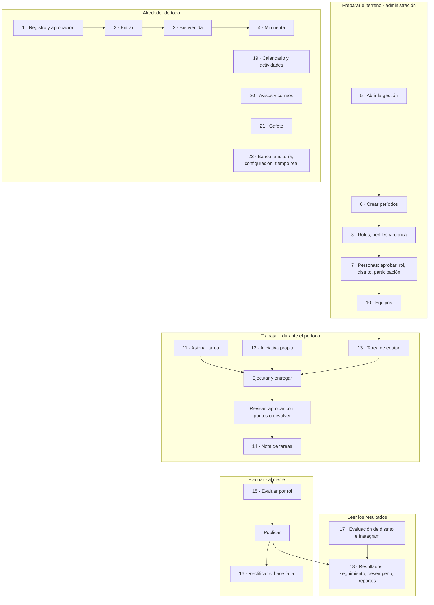
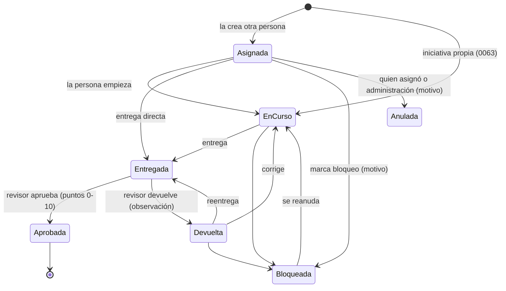

# DOCUMENTACIÓN COMPLETA DEL SISTEMA · EIGHT CREATORS LABs

> Versión de un solo archivo. Los capítulos separados están en [`docs/sistema/`](sistema/00-indice.md). Generado con `node tools/compilar-documentacion.mjs`; **edita los capítulos, no este archivo**.

---

# Documentación completa del sistema · EIGHT CREATORS LABs

Portal de evaluación del desempeño del equipo de **CELIDER 08 Santiago** (eight-coms.vercel.app).
Estado descrito: **15 de noviembre de 2026**, con las migraciones **0001 a 0064** aplicadas por el dueño del proyecto en su base de Supabase.

Este es el documento completo del sistema. No es un resumen: describe **qué es cada cosa, quién la hace, en qué pantalla, con qué reglas, qué avisa, qué guarda y qué puede salir mal**, proceso por proceso, y termina con un análisis de qué está donde no debe y qué funciones importantes quedaron escondidas.

## Cómo está organizado

| Capítulo | Qué responde |
|---|---|
| [01 · Qué es el sistema y quién lo usa](sistema/01-que-es-y-actores.md) | Propósito, los tres tipos de acceso, los roles del equipo, las gestiones y los períodos, vocabulario base |
| [02 · Mapa de procesos](sistema/02-mapa-de-procesos.md) | Los 22 procesos del sistema, cómo se encadenan de punta a punta y qué pantalla es la «casa» de cada uno |
| [03 · Acceso, cuenta y bienvenida](sistema/03-proceso-acceso-cuenta.md) | Registro, confirmación, aprobación, entrar, recuperar contraseña, instalar la app, Mi cuenta, preferencias, bienvenida |
| [04 · Organización del año](sistema/04-proceso-organizacion.md) | Gestiones, períodos, participación, personas, roles y segundo rol, perfiles de evaluación, rúbrica, distritos, equipos |
| [05 · Tareas](sistema/05-proceso-tareas.md) | Tarea individual, iniciativa propia, tarea de equipo, estados, entrega, revisión, nota, correcciones, plazos, historial |
| [06 · Evaluación](sistema/06-proceso-evaluacion.md) | Evaluar por rol, borrador, publicar, rectificar, versiones, cobertura, rúbrica clásica, evaluación de distrito |
| [07 · Cálculo de resultados](sistema/07-calculos-y-resultados.md) | Fórmulas exactas, niveles, percentil, nota de tareas, dos roles, ejemplos numéricos y cada regla de borde |
| [08 · Seguimiento, desempeño, reportes y distritos](sistema/08-seguimiento-desempeno-reportes.md) | Cómo se lee lo que ya está calculado: quién está al día, cómo les va, reportes, ranking de distritos, Instagram |
| [09 · Comunicación](sistema/09-proceso-comunicacion.md) | Calendario, actividades, avisos de la campana, correos, banco de imágenes |
| [10 · Gafetes, auditoría, configuración y tiempo real](sistema/10-gafetes-auditoria-config-sync.md) | Gafete con QR y Wallet, centro de auditoría, Configuración general, sincronización sin recargar |
| [11 · Pantallas por portal](sistema/11-pantallas-por-portal.md) | Cada pantalla de los tres portales: para qué sirve, quién la ve, qué se hace en ella |
| [12 · Datos, seguridad y operación](sistema/12-datos-seguridad-operacion.md) | Tablas, funciones, permisos, migraciones, trabajos programados, correo, despliegue, pruebas |
| [13 · Análisis y propuesta de ubicación](sistema/13-analisis-y-propuesta.md) | Qué está redundante, escondido o fuera de lugar, y dónde debería estar |
| [14 · Glosario y pendientes](sistema/14-glosario-y-pendientes.md) | Términos, decisiones abiertas, lo que no se pudo verificar |

Hay además una versión de **un solo archivo** con todos los capítulos seguidos: [`../DOCUMENTACION-COMPLETA-DEL-SISTEMA.md`](DOCUMENTACION-COMPLETA-DEL-SISTEMA.md).

## Cómo leer los avisos de honestidad

- **Verificado** = salió de leer el código o de una prueba que corre en este repositorio (`tools/pruebas`).
- **No verificado contra la base viva** = se describe lo que el código y las migraciones hacen, pero no se pudo comprobar en la base real de producción (el conector de Supabase de las sesiones de trabajo no tiene acceso de escritura ni siempre de lectura).
- **Decisión pendiente** = una regla que hoy tiene un valor provisional y necesita que el dueño la confirme.

## Documentos hermanos

Esta documentación **reúne y ordena**; el detalle técnico fino sigue en: `CLAUDE.md` (reglas de trabajo y trampas aprendidas), `docs/documentacion-tecnica.md` (arquitectura resumida), `docs/auditoria/` (hallazgos H-01…H-12 y matrices de permisos y fórmulas), `docs/sincronizacion-tiempo-real.md`, `docs/notificaciones-contrato.md`, `docs/configurar-correos.md`, `docs/google-wallet.md` y los manuales de uso en `ayuda/`.

---

# 01 · Qué es el sistema y quién lo usa

## 1.1 Propósito

EIGHT CREATORS LABs es el **portal de evaluación del desempeño** del equipo creativo de CELIDER 08 Santiago. Sirve para tres cosas encadenadas:

1. **Organizar el trabajo**: quién hace qué, para cuándo, con qué rol y en qué equipo (tareas individuales y de equipo, calendario, actividades).
2. **Evaluar a las personas** con una rúbrica por roles y con las notas de las tareas, de forma comparable, reproducible y con rastro de cada cambio.
3. **Leer los resultados**: cada persona ve cómo le va, cada secretaría ve su distrito, la administración ve todo el equipo y el ranking de distritos.

No es un sistema de nómina ni de asistencia. No guarda archivos de trabajo (solo **enlaces** a ellos), salvo la foto de perfil y las capturas de estadísticas de Instagram de cada distrito.

## 1.2 Cómo está construido (en una página)

- **Páginas estáticas** (HTML, CSS y JavaScript sin compilar) servidas por Vercel. No hay servidor propio: cada página habla directamente con Supabase.
- **Supabase** es la base de datos (PostgreSQL), el sistema de cuentas (Auth), el almacenamiento de archivos (Storage) y el canal de tiempo real (Realtime). Toda regla importante vive **en la base de datos** (funciones, disparadores y políticas de seguridad por fila), no en la pantalla: la pantalla solo presenta.
- **Tres portales** según quién entra: `user.html` (miembros), `secretario.html` (secretarías de distrito) y `admin.html` (administración). Una página de entrada (`index.html`) para iniciar sesión o crear cuenta, una página pública de verificación de gafetes (`/v/<código>`) y los manuales de uso (`ayuda/`).
- **Correo**: una cola de avisos que se envía con una función de Supabase (`enviar-notificaciones`) a través de un puente de Google Apps Script. Los correos de Auth (confirmar cuenta, recuperar contraseña) pasan por otra función (`auth-correo`).
- **Pase de Google Wallet**: una tercera función (`gafete-wallet`) crea el pase del gafete (todavía sin configurar: faltan la cuenta emisora y los secretos).

Detalle técnico: capítulo 12 y `docs/documentacion-tecnica.md`.

## 1.3 Los tres tipos de acceso (rol funcional)

El **rol funcional** decide **qué puede hacer una persona en el sistema**. Lo asigna **solo la administración** y la base de datos lo impone: ni el registro ni la propia persona pueden cambiarlo.

| Tipo de acceso | Cómo se identifica | Portal | Qué puede, en una frase |
|---|---|---|---|
| **Miembro** | `tipo_miembro = 'miembro'`, `es_admin = false` | `user.html` | Ve y trabaja lo suyo: sus tareas, su evaluación, su perfil, su desempeño, su gafete, el calendario, el banco de imágenes |
| **Secretaría de distrito** | `tipo_miembro = 'secretario'` con un distrito | `secretario.html` | Todo lo de un miembro **más** supervisar y trabajar con su distrito: ver a su gente, asignar y revisar tareas, crear actividades de su distrito, seguimiento, desempeño y reportes de su distrito, y subir las estadísticas de Instagram de su distrito |
| **Administración** | `es_admin = true` | `admin.html` | Todo el sistema: personas, accesos, períodos, rúbrica, evaluar, tareas, equipos, distritos, reportes, auditoría, configuración. **No se evalúa a sí misma** |

Reglas que nunca cambian:

- **Registrarse no da ningún permiso.** La cuenta nace como miembro, sin distrito, sin rol y **sin acceso aprobado**; hasta que la administración la aprueba, la persona no entra al portal (verificado: trigger `on_auth_user_created` y `profiles_bloquear_privilegios`).
- Los campos privilegiados (`es_admin`, `tipo_miembro`, `distrito`, `rol_id`, `aprobado`) los frena un disparador de la base de datos para cualquiera que no sea administración.
- **Nadie aprueba su propia tarea**, ni siquiera una secretaría; y la administración no se evalúa.
- La seguridad es **de la base de datos** (políticas por fila). El portal nunca filtra «por si acaso»: lo que una persona no puede ver, la base no se lo entrega.

## 1.4 Los roles del equipo (rol operativo)

El **rol operativo** es lo que la persona *hace* en el equipo. Es distinto del tipo de acceso. Se guarda en la tabla `roles` y cada rol tiene: nombre, descripción, responsabilidades y requisitos (que ve la persona cuando le asignan una tarea, en Mi cuenta y en la bienvenida).

Los ocho roles de partida (la asignación exacta a la tabla `roles` es un dato que decide el dueño): **Fotografía, Diseño Gráfico, Video / Edición, Redacción, Redes Sociales, Producción, Dirección y Comunicaciones**.

Una persona puede tener, desde la migración 0062:

- **Rol principal** (`profiles.rol_id`): decide su **perfil de evaluación** (qué criterios técnicos se le puntúan y con qué pesos) y es donde se puntúa el **núcleo transversal**.
- **Un rol secundario** (opcional, una fila en `persona_roles` distinta del principal): un segundo rol con el que también puede trabajar y ser evaluada. **Máximo 2 roles distintos por persona.** Las personas que ya tenían más de dos no se tocan: la base las lista y el portal les pide dejar uno.
- **Preferencias de rol** (`preferencias_rol`): lo que la persona *quiere* hacer, en orden, con un rol predeterminado. Es **información para quien asigna, nunca una restricción ni un permiso**.

Las cuatro cosas **nunca se mezclan**: tipo de acceso · rol principal · rol secundario/permitidos · preferencias.

## 1.5 Gestión, período y participación

- **Gestión** = el año de trabajo (por ejemplo «2026-2027»). Cada gestión tiene **sus propios** períodos, criterios, rúbrica, perfiles, calendario y actividades. Una gestión pasada queda **en solo lectura**: se lee siempre, no se escribe nunca (lo impone la base con `gestion_escribible()`). Al abrir una gestión nueva se archiva la anterior y se clona el catálogo de criterios y la última versión de cada perfil.
- **Período de evaluación (PE)** = una etapa dentro de la gestión (PE1, PE2, PE3…). Cada uno tiene **cuatro fechas** (inicio, fin del trabajo, entrega de resultados, jornada de cierre), un **modelo de rúbrica** (`v2` por roles o `legacy` clásica) y puede estar **activo**. **Solo uno está activo a la vez** (índice único parcial; se cambia con `set_periodo_activo`).
- **Participación**: una persona participa en un PE salvo que la administración la marque como no participante. **Un PE en el que no participas no existe para ti**: no aparece en tus selectores, perfil, evolución ni calendario.
- **Modelo del período**: los períodos anteriores a la rúbrica por roles son **clásicos** (7 criterios de 0 a 4 + bono, máximo 30). Los nuevos son **por roles** (24 criterios: 5 núcleo + 19 técnicos, resultado de 0 a 100). Los dos modelos **nunca se mezclan** ni se promedian; el modelo de un período no cambia una vez que tiene evaluaciones. Las **tareas y los equipos existen solo en períodos por roles**.

## 1.6 Vocabulario base

| Término | Significado |
|---|---|
| **Publicada** | Una evaluación que ya cuenta oficialmente. Solo las publicadas cuentan en resultados, ranking, desempeño y reportes. Un **borrador** no es un resultado |
| **Núcleo** | Las 5 competencias transversales, iguales para todos los roles: plazos, respuesta, colaboración, iniciativa, calidad |
| **Técnico** | Las competencias propias del rol, con pesos que suman 100 |
| **Percentil** | Posición de la persona dentro de su rol, de 0 a 100 |
| **Nota de tareas** | Resumen de 0 a 100 de las tareas aprobadas con puntos, que entra al resultado según el peso que fije el PE |
| **Nivel** | Excelente, Bueno, En proceso, Bajo, según cortes de puntaje (capítulo 7) |
| **Iniciativa propia** | Tarea que la persona crea para sí misma («Mi iniciativa») |
| **Equipo** | Grupo de personas para **un** período por roles, con tareas compartidas |
| **Distrito** | Agrupación territorial de personas; tiene su propia evaluación y ranking |
| **Aviso** | Notificación en la campana y, según el tipo, por correo |

## 1.7 Quién ve qué (resumen)

| Quién | Ve |
|---|---|
| Miembro | Solo lo suyo: su perfil, evaluaciones **publicadas** suyas, sus tareas, sus equipos, calendario, banco de imágenes, avisos |
| Secretaría | Lo suyo **más** las personas de su distrito (perfiles, tareas, seguimiento, desempeño, reportes) y los equipos con personas de su distrito; evaluaciones **publicadas** de su distrito; el ranking de distritos (los demás distritos se muestran sin detalle) |
| Administración | Todo, incluidos los **borradores** de evaluación |

La matriz completa por funcionalidad y por tabla está en `docs/auditoria/02-matriz-funcionalidades-permisos.md`.

---

# 02 · Mapa de procesos

El sistema se entiende como **22 procesos** que se encadenan. Este capítulo da la vista de pájaro; cada proceso se desarrolla paso a paso en los capítulos 03 a 10.

## 2.1 La cadena de punta a punta



Lectura: la administración **prepara** el año (gestión, períodos, rúbrica, personas, equipos); durante el período el equipo **trabaja** con tareas que se revisan y puntúan; al cierre la administración **evalúa** por rol y **publica**; desde ese momento los resultados se **leen** en las pantallas de cada persona. Alrededor, el calendario programa, los avisos informan y los servicios transversales dan identidad, rastro y actualización en vivo.

## 2.2 Tabla de los 22 procesos

| N.º | Proceso | Quién lo hace | Pantalla «casa» | Capítulo |
|---|---|---|---|---|
| 1 | Registro y aprobación de acceso | Persona nueva → administración | Entrada (`index.html`) · Admin → Personas | 03 |
| 2 | Inicio de sesión y recuperación de contraseña | Cualquiera | Entrada | 03 |
| 3 | Bienvenida y primeros pasos | Persona nueva o con novedades | Inicio (tarjeta «Primeros pasos») · Mi cuenta | 03 |
| 4 | Mi cuenta: foto, nombre, contraseña, tema, roles y preferencias | Cada persona | Mi cuenta | 03 |
| 5 | Gestión del año | Administración | Gestiones (hoy bajo Configuración) | 04 |
| 6 | Períodos de evaluación | Administración | Períodos | 04 |
| 7 | Personas: acceso, tipo, distrito, rol(es), participación | Administración | Personas | 04 |
| 8 | Roles, segundo rol, perfiles de evaluación y rúbrica | Administración | Roles y perfiles · Rúbrica | 04 |
| 9 | Distritos (estructura y ranking) | Administración / secretaría | Distritos | 04, 08 |
| 10 | Equipos | Administración | Equipos | 04 |
| 11 | Tarea individual: asignar → ejecutar → entregar → revisar → cerrar | Quien asigna, quien ejecuta, quien revisa | Tareas · Mis tareas | 05 |
| 12 | Iniciativa propia | Cualquier persona con acceso | Mis tareas («+ Mi iniciativa») | 05 |
| 13 | Tarea de equipo | Administración / secretaría; integrantes | Equipos · Mis tareas | 05 |
| 14 | Calificación de tareas (puntos, pesos, correcciones, reglas del PE) | Quien revisa; administración | Tareas (reglas) · perfil | 05 |
| 15 | Evaluar por rol y publicar | Administración | Evaluar | 06 |
| 16 | Rectificar o retirar una evaluación publicada | Administración | Evaluar (Historial de versiones) | 06 |
| 17 | Evaluación de distrito y estadísticas de Instagram | Administración; secretaría sube cifras | Distritos | 06, 08 |
| 18 | Leer resultados: perfil, desempeño, seguimiento, reportes, ranking | Todos, según su acceso | Mi perfil · Desempeño · Seguimiento · Reportes | 08 |
| 19 | Calendario y actividades | Administración, secretaría (su distrito); todos leen | Calendario · Actividades | 09 |
| 20 | Avisos (campana) y correos | Automático | Campana · Mi cuenta → Preferencias | 09 |
| 21 | Gafete con QR, Wallet y verificación pública | Persona, administración | Mi perfil → Mi gafete · `/v/<código>` | 10 |
| 22 | Servicios transversales: banco de imágenes, auditoría, configuración general, sincronización en vivo | Varios | Banco · Auditoría · Configuración | 09, 10 |


## 2.3 Qué pasa en un período típico (guion)

Este es el recorrido que el sistema está diseñado para sostener. Cada paso remite al capítulo donde se detalla.

1. **Antes del período.** La administración abre (o ya tiene abierta) la gestión, crea el PE con sus cuatro fechas, revisa que los perfiles de cada rol estén vigentes, aprueba a las personas nuevas, les fija tipo, distrito y rol (y, si aplica, un segundo rol), marca quién no participa y arma los equipos. Define las **reglas de calificación de tareas** del PE (peso de las tareas en el resultado, mínimo de tareas, etc.). Ver caps. 04, 05.
2. **Al empezar.** Cada persona entra, ve en Inicio la cuenta regresiva a la próxima fecha y sus tareas. Si es nueva, el asistente de bienvenida la guía. Cap. 03.
3. **Durante el trabajo.** La administración o la secretaría **asignan** tareas (a una persona, a varias o a un equipo), con rol, fecha límite y qué competencias evidencia. La persona **empieza**, **entrega** (enlace y/o nota) y, si algo se bloquea, lo **marca bloqueado** con motivo. Una persona también puede crear **su propia iniciativa**, que nace *En curso*. Cap. 05.
4. **Revisión.** Quien revisa **aprueba con puntos (0–10)** —obligatorio— o **devuelve** con una observación concreta. Si la fecha límite cambia, se **prorroga con motivo**. Cada hecho queda en el historial. Los puntos aprobados alimentan la **nota de tareas**. Cap. 05.
5. **Cierre.** La administración abre **Evaluar**, revisa la evidencia de tareas de cada persona (solo como ayuda, no puntúa nada), **puntúa el núcleo y los criterios técnicos** de su rol (y del segundo rol si lo tiene), guarda borradores y **publica**. Cap. 06.
6. **Resultados.** Al publicar, la persona ve su resultado, su nivel, su lugar en el rol y cómo se compone (evaluación + tareas); la secretaría ve su distrito; la administración ve el equipo entero, compara períodos y personas y exporta. Cap. 08.
7. **Distritos.** La secretaría sube las estadísticas de Instagram de su distrito con una captura de prueba; la administración evalúa cada distrito y el ranking acumulado se actualiza. Caps. 06, 08.
8. **Correcciones.** Si una evaluación publicada tiene un error, la administración la **rectifica** con un motivo; queda una versión nueva con antes y después. Cap. 06.
9. **Cierre de año.** Se abre la gestión nueva: la anterior queda archivada en solo lectura. Cap. 04.

En paralelo, todo el tiempo: el **calendario** muestra fechas, actividades y tareas (cap. 09); la **campana** y el **correo** avisan lo que corresponde (cap. 09); la **auditoría** registra los cambios sensibles (cap. 10); y los portales **se actualizan solos** cuando otra persona cambia algo (cap. 10).

## 2.4 Dónde vive cada proceso hoy (menú del administrador)

| Grupo del menú | Entradas | Procesos que cubre |
|---|---|---|
| Centro de control | Panel · Desempeño · Seguimiento | 18 |
| Operaciones | Evaluar · Tareas · Equipos · Calendario · Imágenes (Banco de imágenes) | 15, 11–14, 10, 19, 22 |
| Organización | Personas · Distritos | 7, 9, 17 |
| (suelto) | Reportes · Auditoría | 18, 22 |
| Configuración | Un solo ítem que abre el índice: Períodos, Actividades, Rúbrica, Roles y perfiles, Gestiones, tema, selector de entrada | 5, 6, 8, 19 |

El capítulo 13 discute si esta distribución sirve a los procesos o si hay cosas fuera de lugar.

---

# 03 · Acceso, cuenta y bienvenida (procesos 1 a 4)

## Proceso 1 · Registro y aprobación de acceso

**Objetivo.** Que una persona nueva pueda pedir acceso sin poder darse ningún permiso, y que la administración decida quién entra.

**Actores.** La persona nueva; la administración.

**Pantallas.** `index.html` (pestaña **Crear cuenta**) · Admin → **Personas** (y el bloque «Requiere atención» del Panel).

### Actividades paso a paso

1. **La persona abre el portal** (`eight-coms.vercel.app`) y elige **Crear cuenta**. Si no hay ninguna gestión abierta, el registro está cerrado (la página lo comprueba con la función pública `hay_gestion_abierta()`, que devuelve un único verdadero/falso).
2. **Escribe nombre y correo, elige su distrito (o «Invitado externo») y el rol con el que quiere que la evalúen (opcionalmente un segundo rol; máximo 2), y pone una contraseña.** Una barra de seguridad indica si la contraseña es débil o fuerte (usa los mismos niveles de color y siempre escribe el nivel en texto).
3. **Se crea la cuenta en Auth.** Un disparador de la base (`on_auth_user_created`) crea la fila de `profiles` con valores **fijos**: `tipo_miembro = 'miembro'`, `es_admin = false`, `distrito`, `rol_id` vacíos y `aprobado = false`. Lo que la persona eligió se guarda **validado** como **solicitud** (`solicitud_distrito`, `solicitud_rol_id`, `solicitud_rol2_id`; migración 0070). **Nada de eso da permisos.** El nombre es lo único que se toma de los datos de la cuenta; el resto se ignora.
4. **Llega un correo de confirmación** («Confirmar mi correo»). Lo arma y envía la función `auth-correo` (responde 200 de inmediato y envía en segundo plano, con 3 intentos). Si no llega, la persona debe mirar Spam.
5. **La persona confirma el correo.** Hasta aquí tiene cuenta pero **no puede entrar**: al intentarlo, el portal cierra la sesión y la devuelve a `index.html?pendiente=1` con el aviso «Tu cuenta está pendiente de aprobación por el administrador».
6. **La administración se entera**: se genera un aviso `solicitud_acceso` (esencial, campana y correo) y el Panel muestra «Accesos pendientes» en **Requiere atención**.
7. **La administración abre Personas y accesos.** Arriba está la tarjeta **Solicitudes de acceso** (y en el menú, un número junto a «Personas»), con lo que cada persona pidió. **Aprobar** aplica la solicitud (distrito, rol principal y segundo rol) a lo que esté vacío, y la persona entra **ya configurada**. Si quiere cambiar algo, abre la persona (pestaña **Gestión**) antes de aprobar: lo que fije no se pisa. **Secretaría de distrito y administración nunca se piden al registrarse**: las asigna siempre la administración. Cada cambio de privilegios queda en la **auditoría**.
8. **La persona recibe el aviso** `acceso_aprobado` (esencial) y ya puede entrar.

### Reglas y bordes

- Registrarse **no da ningún permiso**; aprobar es siempre un acto de la administración.
- Si un correo se escribe mal, el aviso de confirmación no llega; la persona debe registrarse de nuevo con el correo correcto; la administración puede borrar la cuenta pendiente desde Personas → Gestión. No hay un botón de «reenviar confirmación» en el portal.
- La seguridad del bloqueo es doble: el frontend bloquea con `aprobado === false` explícito, y **la base de datos** impide que cualquiera que no sea administración cambie esos campos.
- Un alta puede quedar «sin rol» o «sin distrito»: el Panel lo muestra en **Datos por revisar**.

### Qué puede salir mal

| Situación | Qué ve la persona | Qué hacer |
|---|---|---|
| No llega el correo | Nada | Revisar Spam; si no llega, registrarse de nuevo con el correo correcto (el portal no tiene un botón de reenvío; la administración puede borrar la cuenta pendiente desde Personas → Gestión) |
| Intenta entrar sin aprobación | Aviso de «pendiente de aprobación» | Esperar; la administración aprueba desde Personas |
| Registro cerrado | Mensaje de que no hay gestión abierta | La administración debe abrir una gestión |

## Proceso 2 · Inicio de sesión y recuperación de contraseña

**Objetivo.** Entrar de forma segura y recuperar el acceso sin intervención de la administración.

**Pantalla.** `index.html` (pestaña **Entrar**).

### Iniciar sesión

1. La persona escribe **correo y contraseña** y toca **Ingresar al portal**. El botón muestra un indicador dentro de sí mismo mientras trabaja.
2. El portal pide la sesión a Supabase y lee el perfil. Según el perfil, **la página de destino se elige por el rol real**: `admin.html` (administración), `secretario.html` (secretaría; un miembro también puede entrar ahí si su tipo lo permite) o `user.html` (miembro).
3. Si el acceso está pendiente, se cierra la sesión y se explica (proceso 1).
4. Los errores (clave incorrecta, correo sin confirmar) se muestran en una caja de alerta **y** marcan el campo con `aria-invalid`: el color nunca es el único indicador.
5. Si la persona llegó desde un enlace de aviso (`#ir/<pestaña>/…`), el portal **recuerda el destino** durante el inicio de sesión y la lleva directo a la pantalla del aviso.

### Recuperar la contraseña

1. En **¿Olvidaste tu contraseña?** la persona escribe su correo.
2. Recibe un correo con un **código de verificación de 6 cifras** (y un enlace). Lo escribe y elige la nueva contraseña.
3. La nueva contraseña debe ser **distinta de la actual**; si pone la misma, el portal lo explica en lugar de dar un error técnico.
4. Si la persona llega por el enlace del correo, Supabase entrega el token en la dirección; `index.html` detecta el evento `PASSWORD_RECOVERY` y cambia el formulario de entrada por el de nueva contraseña.

### Cambiar la contraseña estando dentro

En **Mi cuenta → Seguridad**: contraseña nueva y repetirla (mínimo 8 caracteres, distinta de la actual).

### Pantalla de entrada: comportamiento

- Es **una sola página** con dos paneles (Entrar / Crear cuenta); `#registro` en la dirección abre el registro.
- En escritorio cabe en la altura de la ventana sin desplazarse; en celular una banda de marca arriba y el formulario debajo.
- Los campos son de 16 px (si fueran menores, iOS haría zoom al enfocar).
- El pie de derechos queda **al final de la página**.

## Proceso 3 · Bienvenida y primeros pasos

**Objetivo.** Que una persona nueva entienda qué hacer primero, y que quien ya existía conozca solo lo que cambió.

**Pantallas.** Ventana de bienvenida (se abre sola la primera vez) · tarjeta «Primeros pasos» o «Novedades» en **Inicio / Panel** · Mi cuenta → App (para repasarla).

### Cómo funciona

- El asistente es **por rol funcional** (creator/miembro, secretaría, administración). El **servidor** fija el perfil del asistente según el rol real de la persona (`bienvenida_guardar`), no el cliente.
- **Persona nueva** → ve «Te damos la bienvenida» con 5 pasos. **Persona que ya existía** cuando se creó el asistente → ve «Novedades» (solo lo que cambió); las personas anteriores quedaron «omitidas» para no abrirles el asistente de golpe.
- Tiene **progreso** («Paso 1 de 5 · 0 hechos») y **reanuda donde se quedó**. Algunos pasos se dan por hechos solos (foto de perfil, preferencias).
- Cada paso tiene un botón que **lleva a la pantalla** correspondiente.

### Los pasos

**Miembro:** 1) Conoce tu rol (descripción, responsabilidades y competencias) · 2) Pon tu foto y revisa tu nombre (Mi cuenta → Perfil) · 3) Cuéntanos qué rol te gustaría hacer (preferencias) · 4) Mira tus fechas (Calendario) · 5) Así se entrega un trabajo (Mis tareas).

**Secretaría:** 1) Conoce tu rol · 2) Foto y nombre · 3) Conoce a tu distrito · 4) Asigna tu primera tarea · 5) Sigue a tu distrito (Seguimiento).

**Administración:** Revisa los períodos · Describe los roles y sus perfiles · Aprueba accesos y asigna rol y distrito · Haz tu primera evaluación · Mira el seguimiento global.

**Novedades** (para quienes ya existían): Mi cuenta en pestañas y con preferencias de rol · Nueva tarea en tres pasos (secretaría/administración) · Actividades para personas de tu distrito · Seguimiento de tu distrito · Reportes de tu distrito · Historial de todos los períodos (Mi perfil → Períodos).

### Acciones de la persona

- **Hecho, seguir** marca el paso y avanza. **Ahora no** cierra sin marcar. El avance queda guardado y la tarjeta en Inicio dice «3 de 5 listos. Sigue donde lo dejaste» con el botón **Continuar**.
- La bienvenida se puede **repasar** desde Mi cuenta → App; la administración puede reiniciarla (`bienvenida_reiniciar`).

### Detalle conocido

En celular, el botón de cerrar de la ventana tapa un poco la última letra del título «Te damos la bienvenida».

## Proceso 4 · Mi cuenta: perfil, seguridad, rol y preferencias, app

**Objetivo.** Que cada persona gestione lo suyo sin pedir nada a la administración, salvo lo que solo ella decide (tipo de acceso, distrito, rol).

**Pantalla.** **Mi cuenta** (computadora: el nombre al pie del menú; celular: Más → tu nombre, o el último ítem de la barra inferior). Arriba la foto, el nombre y las etiquetas (tipo de acceso y distrito); debajo, **cuatro pestañas** (el portal recuerda la última que usaste):

| Pestaña | Qué hay |
|---|---|
| **Perfil** | Nombre (con **Guardar**), correo, tipo de acceso y distrito (solo lectura: los asigna la administración), **foto** el **fondo de la tarjeta** (siete patrones de la marca, o «Auto») que ven quienes pueden abrir tu perfil, y **Mi gafete** (tu identificación con QR) |
| **Mi rol** | Tu rol principal con descripción, responsabilidades y requisitos; tu rol secundario si lo tienes; y **«Mi rol y mis preferencias»**: ordena con flechas los roles que te gustaría hacer y marca uno como predeterminado (la estrella solo en roles que tengas habilitados). **No se muestra a la administración** (no se evalúa) |
| **Seguridad** | Cambiar la contraseña |
| **App y ayuda** | **Tema** (oscuro, claro o rosa; se recuerda en ese dispositivo), **Instalar en tu celular**, la bienvenida/novedades, la **ayuda y manual de uso** y **Cerrar sesión** |

### Foto de perfil

- **Cambiar foto**: cualquier imagen del teléfono o computadora, de cualquier tamaño. El portal la **recorta a cuadrado y la reduce** (queda de pocos KB) y la sube al bucket `avatars` (lectura pública, escritura solo en la carpeta propia, tope de 2 MB).
- Si no hay foto o la imagen falla, se muestran las **iniciales sobre fondo liso**. Nadie pinta la foto por su cuenta: hay un componente único.

### Preferencias de aviso

En **Mi cuenta → Preferencias** (o desde el panel de avisos → «Preferencias»): se elige qué avisos **opcionales** llegan por correo. **Desde la migración 0057 todos están encendidos por defecto** y cada persona apaga los que no quiera. Los **esenciales** (tarea asignada, cambios, vencida, corrección solicitada, calificación, equipos, acceso) **no se pueden apagar** y el servidor lo impide.

### Instalar como app

- **Android (Chrome/Edge)**: Mi cuenta → App → *Instalar en tu celular*, o el menú ⋮ → «Instalar app».
- **iPhone (solo Safari)**: Compartir → «Añadir a pantalla de inicio» (no hay API; la fila lo explica).
- **PC (Chrome/Edge)**: el icono de instalar de la barra de direcciones.
- La app instalada **necesita internet**: sin conexión muestra solo una pantalla «Sin conexión» con un botón para reintentar. El *service worker* **no guarda en caché** datos ni scripts, para no mostrar versiones viejas ni datos de otra sesión.

### Tema

Tres temas: **oscuro** (por defecto), **claro** y **rosa**. El cambio se aplica antes de pintar (sin parpadeo) y se guarda por dispositivo. Todos respetan el contraste mínimo (comprobado por `tools/contraste.js`).

### Reglas

- El correo, el tipo de acceso y el distrito aparecen **solo para que se vean**; los asigna la administración.
- La contraseña nueva tiene que ser distinta de la actual.

---

# 04 · Organización del año (procesos 5 a 10)

Todo lo que la administración **prepara antes** de que el equipo trabaje. Si esto está mal, todo lo demás sale mal: por eso cada actividad tiene su regla.

## Proceso 5 · Gestión del año

**Objetivo.** Delimitar el año de trabajo y cerrar el anterior sin perder nada.

**Actor.** Administración. **Pantalla.** Configuración → **Gestiones** (`tab-gestiones`).

### Qué es una gestión

Un contenedor **estanco**: sus períodos, criterios, perfiles, rúbrica, calendario y actividades le pertenecen. Estados: **abierta/actual** o **archivada**. Una archivada es **solo lectura** para todos, incluida la administración (la base lo impone con `gestion_escribible()` y `gestion_id_escribible()` en las políticas de escritura).

### Actividades

1. **Abrir gestión nueva** (botón en la pantalla Gestiones; pide el nombre, por ejemplo «2027-2028»).
2. El sistema ejecuta `abrir_gestion()`: **archiva** la gestión anterior, **crea** la nueva, **clona** el catálogo de 24 criterios y la **última versión de cada perfil de rol**, y deja los períodos de la gestión nueva en modelo por roles (si el origen tenía catálogo).
3. La lista de gestiones muestra cada una con su estado. Las archivadas se consultan en solo lectura (con `?gestion=` en la dirección o desde el selector de entrada).
4. **Selector de entrada**: al abrir el panel de administración, un diálogo pregunta «¿Con qué vas a trabajar?» (gestión y período). Se puede marcar «No volver a mostrar esto» (se guarda en el navegador). Para volver a verlo: Configuración → Apariencia y entrada → **Volver a mostrar**.

### Reglas

- `abrir_gestion` solo la ejecuta la administración (la guarda correcta es `IF NOT public.is_admin() THEN RAISE`; una versión anterior estaba invertida y dejaba pasar a un anónimo: migración 0008, ya corregida).
- **El registro de personas se cierra cuando no hay gestión abierta.**
- La pertenencia de personas a una gestión concreta **no existe**: `profiles` no tiene `gestion_id` (el diseño está en `0006_gestion_miembros.PENDIENTE.sql`, sin aplicar a propósito).
- Escribir en una gestión archivada está bloqueado en la base y los botones del portal se deshabilitan (`bloquearEscritura()`).

## Proceso 6 · Períodos de evaluación

**Objetivo.** Definir las etapas del año, sus fechas y cuál está activa.

**Actor.** Administración. **Pantalla.** Configuración → **Períodos** (`tab-periodos`).

### Actividades

1. **Crear un período**: formulario guiado en orden: **nombre** (PE5, hasta 30 caracteres) → **descripción** (qué trabaja el equipo, hasta 80) → **modelo** (rúbrica por roles o clásica; los períodos nuevos pueden ser por roles) → **cuatro fechas**: *Inicio del período*, *Fin del trabajo*, *Entrega de resultados* y *Jornada de cierre* → **activo** sí/no. El formulario **sugiere fechas** después del período anterior.
2. **Validación de fechas**: inicio ≤ fin del trabajo ≤ entrega ≤ jornada. Si no se cumple, no guarda.
3. **Activar un período**: se hace con `set_periodo_activo(id)`, que **desactiva el anterior y activa el nuevo en un solo paso**. Un índice único parcial garantiza que **solo hay uno activo**; pasar `null` deja la gestión sin período activo (no recomendado: «una gestión sin período activo deja la plataforma sin contexto»).
4. **Editar o borrar** un período: la lista se divide en **Rúbrica por roles** y **Clásicos**, con una línea de tiempo. Un período con evaluaciones **no cambia de modelo**.
5. **Participación por período**: desde Personas, la administración marca quién **no participa** en un PE (`periodo_participantes.activo = false`). Sin fila se asume que participa.

### Reglas

- **Los períodos que existían cuando se creó la rúbrica por roles quedan clásicos para siempre** (`v2_permitido = false`): nadie recalifica a posteriori. Los creados después pueden ser por roles; `v2_permitido` lo fija el servidor.
- El **peso de las tareas** de cada período por roles se configura en **Tareas → Reglas de calificación del PE** (proceso 14). Los períodos viejos arrancan con **0 %**, los nuevos con **20 % «sin confirmar»** hasta que la administración lo guarde.
- Las fechas alimentan: la cuenta regresiva de **Inicio**, el **calendario**, los **recordatorios** y los avisos de cierre.

## Proceso 7 · Personas: acceso, tipo, distrito, rol(es) y participación

**Objetivo.** Que cada persona tenga el tipo de acceso, el distrito y el rol correctos.

**Actor.** Administración (lectura de la secretaría para su distrito). **Pantalla.** **Personas** (`tab-usuarios`).

### Qué muestra

- **Tarjetas** de persona por defecto (con una vista de **tabla** alternativa). Cada tarjeta resume foto, nombre, rol, distrito y estado de evaluación del período elegido.
- **Barra de período** y **filtros**: distrito, **estado** (con conteos): *acceso pendiente, sin evaluar, evaluación en borrador, sin rol, sin distrito, inactivas en el período, administradores*. Una sola definición (`estadosDePersona`) alimenta las tarjetas, la tabla y los enlaces desde el Panel («Requiere atención»).
- Una tarjeta **abre el perfil en un panel lateral** (en celular, una hoja) con pestañas de perfil y una pestaña extra **Gestión**.

### Pestaña Gestión (todo lo que antes era una fila de tabla)

| Control | Qué hace | Efecto |
|---|---|---|
| **Acceso** (aprobar / revocar) | Aprueba o quita el acceso | Aviso `acceso_aprobado` al aprobar; auditoría |
| **Tipo de acceso** | Miembro / secretaría | Decide el portal y los permisos |
| **Administrador** | Marca `es_admin` | La persona deja de evaluarse |
| **Distrito** | Asigna el distrito | Define qué ve una secretaría |
| **Rol principal** | Asigna el rol | Define el perfil de evaluación y el núcleo |
| **Segundo rol** (0062) | Elige **un** segundo rol o «Sin segundo rol» | Permite asignarle tareas con ese rol y evaluarla también por él. Máximo 2 roles; si ya tiene más, aparece un aviso para dejar uno |
| **Participa en el período** | Activa/desactiva en el PE elegido | Si no participa, el PE «no existe» para ella |
| **Gafete** | Abre, regenera o revoca el gafete | Capítulo 10 |
| **Eliminar** | Borra la persona (con confirmación) | Auditoría; revisar que no queden huérfanos |

Los cambios pasan por los mismos manejadores y llamadas a la API de siempre; la base valida (disparador `profiles_bloquear_privilegios`) y la **auditoría registra** privilegios y borrados (tabla `auditoria_global`).

### Reglas del segundo rol (0062)

- Máximo **2 roles distintos** por persona: lo imponen dos disparadores (`persona_roles_max2` y `profiles_rol_max2`). Los datos anteriores **no se borran**: `personas_con_mas_de_dos_roles()` lista a quienes ya tenían más y el portal les pide elegir.
- El segundo rol es la **única** fila de `persona_roles` distinta del principal. Quitar un permitido o cambiar el principal limpia el rol predeterminado de las preferencias, no las preferencias.
- **Sin segundo rol, solo la administración puede asignar una tarea de otro rol**, y queda marcada **«Excepción de rol»** (`rol_excepcion = true`, fijado por el servidor).

### Datos por revisar (Panel)

El Panel detecta contradicciones entre datos ya guardados y avisa dónde mirar (no corrige nada): personas aprobadas **sin rol o sin distrito**, evaluación publicada de alguien que **no participa**, evaluación de una persona **sin acceso aprobado** o de la administración, **período activo sin fechas**.

## Proceso 8 · Roles, segundo rol, perfiles de evaluación y rúbrica

**Objetivo.** Definir **qué se mide** y **con qué peso** para cada rol.

**Actor.** Administración. **Pantallas.** Configuración → **Roles y perfiles** (`tab-roles`) y **Rúbrica** (`tab-rubrica`).

### Roles (la tabla `roles`)

Cada rol lleva: **nombre**, **qué hace** (descripción, hasta 1000), **responsabilidades** (una por línea, hasta 2000) y **requisitos** (hasta 1000). Eso lo ven las personas al recibir una tarea, en Mi cuenta y en la bienvenida. La pantalla es una **tarjeta por rol** con su perfil vigente, una barra de pesos apilada y las versiones anteriores.

### Perfiles de evaluación (`perfiles_rol` + `perfil_criterios`)

- Un perfil es la **lista de criterios técnicos con sus pesos** de un rol. Los pesos **suman exactamente 100** (lo exige un disparador diferido).
- **Versionado**: un perfil **usado por alguna evaluación es inmutable**. Para cambiarlo, `crear_perfil_rol()` genera una **versión nueva** que rige **desde un período en el que ese rol aún no tiene evaluaciones**.
- El perfil de cada evaluación lo **fija el servidor** (`perfil_vigente`) en el primer guardado y no cambia: así los resultados históricos son reproducibles.
- **Quién ve cuál**: una persona evaluada en un perfil conserva ese perfil aunque después cambie de rol.

### Rúbrica por roles (`criterios_v2`, por gestión)

**24 criterios**: 5 **núcleo** (iguales para todos los roles, comparados en valor absoluto) y 19 **técnicos**.

| Núcleo | Técnicos (algunos, por rol) |
|---|---|
| Cumplimiento de plazos de entrega · Respuesta y disponibilidad ante requerimientos · Colaboración y trabajo en equipo · Iniciativa y proactividad · Calidad y completitud de la entrega | Planificación y organización · Revisión y control de calidad · Edición y montaje audiovisual · Diseño y composición gráfica · Fluidez y expresión oral · Construcción narrativa y guion · Ejecución y publicación en redes · Composición y encuadre fotográfico · Dominio técnico del equipo de captura · Ortografía, gramática y redacción · Identidad de marca · Métricas · Gestión de comunidad · Logística y coordinación de coberturas · Gestión de recursos y equipos · Liderazgo y delegación · Visión estratégica · Vocería institucional · Claridad del mensaje |

Cada criterio tiene **anclas** («¿Cómo se puntúa?») para los valores 1, 3 y 5 (2 y 4 son intermedios) —relevantes para las evaluaciones antiguas en escala 1–5— y un `key`, `tipo`, `activo` y orden. Se muestran **siempre con el nombre completo**, nunca con códigos de tres letras.

### Escala de puntuación

- **Evaluaciones nuevas** (desde 0023): cada criterio técnico se puntúa **de 0 hasta su propio peso** y cada criterio del núcleo **de 0 a 10**, arrastrando una barra, escribiendo el número o con −/+.
- **Evaluaciones antiguas** conservan su escala 1–5 y se calculan **exactamente como antes**. La escala (`cinco` o `pesos`) la fija el servidor al primer guardado.
- **Un criterio sin puntuar se excluye del cálculo; nunca vale 0.** (Cero es una puntuación válida.)

### Rúbrica clásica

Los períodos clásicos usan **7 criterios de 0 a 4 + bono de excelencia (0 a 2)**, máximo 30, que se administran en la pestaña **Rúbrica → Clásica** y en la tabla de significados por nivel (1 a 4 por criterio). No se crean períodos clásicos nuevos.

## Proceso 9 · Distritos (estructura)

**Objetivo.** Agrupar a las personas por distrito y poder evaluar cada distrito.

- Los distritos son una tabla propia; cada persona tiene un distrito (lo asigna la administración).
- La **secretaría** de un distrito ve a su gente, sus tareas, su seguimiento, su desempeño y sus reportes.
- La **evaluación de distrito** y el **ranking acumulado** se describen en los capítulos 06 y 08; las **estadísticas de Instagram** las sube cada secretaría (cap. 08).
- Pantalla de administración: **Distritos** (ranking acumulado y un panel por distrito con Resumen · Evaluación · Estadísticas · Personas).

## Proceso 10 · Equipos

**Objetivo.** Agrupar personas de un período para trabajar tareas compartidas y ver cómo rinde el grupo.

**Actor.** Administración (crea y modifica); integrantes y secretaría leen. **Pantalla.** **Equipos** (`tab-equipos`); «Mis equipos» bajo las tareas de Entregas.

### Actividades

1. **Nuevo equipo**: nombre, **PE** (después **no se puede cambiar**), descripción opcional, **responsable de seguimiento** (opcional; recibe los avisos del equipo) y **ámbito** (un distrito: solo pueden entrar personas de ese distrito).
2. **Añadir integrantes**: buscar y marcar personas. **Pueden entrar**: acceso aprobado, que no sean administración y que **no estén desactivadas en ese PE**.
3. **Excepción de ámbito**: si el equipo tiene distrito y se quiere sumar a alguien de otro, se usa la excepción y se **escribe el motivo** (queda guardado).
4. **Retirar** a un integrante: pide motivo; quien entra o sale recibe un aviso **esencial** con correo.
5. **Cambiar estado** (activo, inactivo, archivado): archivar pide motivo y **no se puede si el equipo tiene tareas de equipo abiertas**. Los equipos **nunca se borran**.
6. **Alertas**: si un integrante cambia de distrito o deja de participar, **nada cambia solo**: el equipo muestra una alerta (evento `alerta`) y la administración decide.

### Reglas y permisos

- Solo la administración escribe (todo por RPC: `equipo_guardar`, `equipo_cambiar_estado`, `equipo_agregar_miembros`, `equipo_retirar_miembro`; el DML directo está revocado).
- Una persona activa aparece **una vez** por equipo (índice único parcial); si se vuelve a añadir se crea una fila nueva (historial).
- **Lectura**: el miembro lee sus equipos (solo la plantilla actual); la secretaría, los equipos cuyo distrito es el suyo o que tienen a alguien de su distrito, con su historial.
- Un equipo **solo existe para períodos por roles**.

---

# 05 · Tareas (procesos 11 a 14)

Las tareas son **los hechos** que respaldan la evaluación: qué se pidió, para cuándo, cuándo se entregó por primera vez, cuántas veces volvió, cuánto se hizo por iniciativa propia y qué nota recibió. **Existen solo en períodos por roles** (el disparador de inserción rechaza cualquier otro). En un período clásico, la pestaña lo explica y mantiene el antiguo formulario «registrar trabajo».

## 5.1 Estados y transiciones

Estados: **Asignada · En curso · Bloqueada · Entregada · Devuelta · Aprobada · Anulada**. «Abiertas» = asignada, en curso, devuelta y bloqueada.



Quién puede cada cambio (matriz `tarea_transicion_valida`):

| Quién | Cambios permitidos |
|---|---|
| **La persona asignada** | Asignada → En curso/Entregada/Bloqueada · En curso → Entregada/Bloqueada · Devuelta → En curso/Entregada/Bloqueada · Bloqueada → En curso |
| **Quien revisa** | Entregada → Aprobada/Devuelta · Asignada/En curso/Devuelta → Bloqueada · Bloqueada → En curso |
| **Administración** | Cualquier cambio de estado (distinto del actual) |

**Todo lo importante lo fija el servidor**, no el navegador: `origen`, `asignada_por`, `estado` inicial, `entregada_en`, `aprobada_en`, `rondas_revision` se sobrescriben en cada inserción/cambio.

## Proceso 11 · Tarea individual: asignar → ejecutar → entregar → revisar → cerrar

**Actores.** Quien asigna (administración a cualquiera; secretaría a miembros de **su** distrito); la persona asignada; quien revisa (administración o secretaría del distrito, **nunca** la propia tarea).

**Pantallas.** Admin/Secretaría → **Tareas** (asignar y revisar) · Todos → **Mis tareas** · Perfil → pestaña Tareas.

### 11.1 Asignar (asistente «Nueva tarea» en tres pasos)

Se abre con **+ Nueva tarea** en Tareas (si hay equipos activos en el período, primero pregunta **«¿para quién es?»**: **para personas** —una tarea para cada una— o **para un equipo** —una sola tarea compartida—), o desde el perfil de una persona, o desde un día del calendario.

**Paso 1 · Qué.** Título (obligatorio, hasta 160 caracteres), **Qué se espera** (hasta **20 000** caracteres desde 0060: se puede pegar documentación completa), **fecha límite**, **prioridad** (baja, normal, alta), el **período** (si hay varios por roles) y, opcional, una **actividad** del calendario y **el rol para el que es el trabajo** (carga las responsabilidades y las competencias de ese rol).

**Paso 2 · Quién.** Un selector con búsqueda sin tildes (por nombre, rol o distrito), filtros **Todos / Equipos / Personas**, y **insignias** por persona: su rol, si lo tiene **habilitado**, si lo **prefiere (n.º N)**, su **rol predeterminado**, su **carga** (abiertas) y **vencidas**, y si **no participa**. Se pueden marcar personas sueltas o un **equipo entero** (el equipo se expande a sus integrantes de ese momento; una tarea colectiva es otra cosa: ver proceso 13).

**Paso 3 · Rol y resumen.** Un **rol por persona**; se ven sus responsabilidades y con qué competencias se evalúa. Se marcan las **competencias que evidencia** la tarea (opcional; «Sugerir las del rol» marca las principales). Se revisa el resumen.

### 11.2 Avisos al crear

| Aviso | Qué significa | Quién puede continuar |
|---|---|---|
| **Rol no habilitado** para esa persona | El rol elegido no es el suyo ni su segundo rol | **Administración** sí: la tarea queda como **«Excepción de rol»**. **Secretaría no puede** |
| Ya tiene una tarea abierta con el mismo título | Posible duplicado | Se confirma con la casilla «Entiendo los avisos» |
| **Carga alta** (5 o más abiertas) o alguna **vencida** | La persona ya tiene mucho trabajo | Se puede crear igual |
| **No participa en el período** · **fecha límite ya pasada** | La tarea no contaría en el resumen o nacería vencida | Se confirma |

Al crear, la persona recibe un aviso en la campana y un correo (**«tarea asignada» es esencial**).

### 11.3 Ejecutar (la persona asignada)

- **Empezar** (pasa a En curso). **Entregar**: se necesita un **enlace https** y/o una **nota** (uno de los dos es obligatorio); la entrega **solo se escribe en el momento de entregar**.
- **Bloquear** con el motivo («¿de qué o de quién depende?»): una tarea bloqueada **no cuenta como atrasada** mientras siga así; quien asignó recibe el aviso. **Reanudar** la devuelve a En curso.
- La persona **no puede** cambiar la fecha, aprobar ni anular.
- La descripción larga se ve recortada con **«Ver todo (N caracteres)»** que despliega el texto entero.

### 11.4 Revisar (quien revisa)

1. En **Tareas** se usa el filtro **Por revisar** (muestra el número) o se busca por persona.
2. **Ver entrega**: se lee el enlace o la nota.
3. **Aprobar y puntuar**: se ponen los **Puntos (0 a 10), obligatorios**, y si corresponde el **Peso de la tarea** (cuánto cuenta frente a las demás; por defecto 1). Una tarea **propia siempre pesa 1**.
4. **Devolver para corregir**: se escribe **«Qué hay que corregir»** (obligatorio y concreto). La persona recibe aviso con la observación (correo incluido).
5. **Lo de «a tiempo» se mide en la primera entrega**: devolver y corregir no la vuelve tarde.

### 11.5 Mover el plazo, bloquear, anular, historial

- **Mover la fecha límite**: nueva fecha + **motivo** (mínimo 5 caracteres) mediante `prorrogar_tarea()`. La fecha original (`fecha_limite_original`) **nunca cambia** y queda registrada; la persona recibe aviso («Cambió una tarea»).
- **Anular** la tarea: necesita motivo. **Una tarea anulada no entra en ninguna cuenta** (ni tareas ni promedios).
- **Historial** (`tarea_eventos`): cada cambio con quién, qué y cuándo. Es **append-only**: solo lo escriben disparadores y no se puede borrar.

### 11.6 Corregir una nota ya aprobada

Una vez aprobada, los puntos **no se editan a mano**. Solo la administración, desde la tarea, con **Corregir nota**, **Anular nota** o **Restaurar nota** (`corregir_nota_tarea`, `anular_nota_tarea`, `restaurar_nota_tarea`), siempre con **motivo ≥ 5 caracteres**. Cada cambio queda en el **historial de notas** (`calificaciones_historial`) con los pesos y reglas vigentes en ese momento. Una tarea con historial de notas **no se puede borrar**.

### 11.7 Avisos de todo el proceso

`tarea_asignada` · `tarea_cambio` · `tarea_por_vencer` (recordatorio; hoy o mañana) · `tarea_vencida` · `entrega_registrada` (a quien revisa) · `correccion_solicitada` · `tarea_aprobada` · `tarea_bloqueada`. Los esenciales: asignada, cambio, vencida, corrección. Ver capítulo 09.

## Proceso 12 · Iniciativa propia («+ Mi iniciativa»)

**Objetivo.** Que cualquier persona registre trabajo que decidió hacer por su cuenta y pueda contarlo como iniciativa.

**Actor.** Cualquier persona con acceso aprobado. **Pantalla.** **Mis tareas → + Mi iniciativa** (formulario simple de `core/tareas.js`).

### Actividades

1. Tocar **+ Mi iniciativa**.
2. Escribir **título**, **qué hiciste o harás** y, si quiere, una **fecha**.
3. **Guardar.** Desde la migración **0063**, la tarea **nace «En curso»** (no hace falta «Empezar»). Las asignadas por otra persona siguen naciendo «Asignada».
4. La persona **entrega** (enlace y/o nota) y **otra persona** la revisa.

### Reglas

- Una tarea para uno mismo es **siempre** de origen «propia», la haya marcado como la haya marcado (lo decide el servidor).
- **Nadie aprueba su propia tarea.** Por eso la iniciativa **solo cuenta como iniciativa cuando alguien más la aprueba**: es lo que impide inflarla.
- Una propia pesa **1** y cuenta para la nota de tareas **solo si la regla del PE «¿Cuentan las iniciativas propias?» está en Sí** (valor por defecto: Sí).
- Las propias **ya existentes** que seguían «Asignada» siguen así hasta que su dueña toque «Empezar»; la migración trae un UPDATE opcional comentado para pasarlas a «En curso».

## Proceso 13 · Tarea de equipo

**Objetivo.** Asignar **una** tarea compartida a un equipo (no una copia por persona) y calificarla como grupo.

**Actores.** Administración (o la secretaría del distrito del equipo si ella no participa) asigna y revisa; los integrantes aportan y entregan.

**Pantallas.** Admin → **Equipos** (dentro del equipo) · Mis tareas (bloque «Equipos») · Secretaría → **Tareas**.

### Actividades

1. Dentro del equipo, **Nueva tarea de equipo**: **título**, **instrucciones** (hasta 20 000), **criterios de evaluación** (texto, hasta 5 000), **fecha límite**, **prioridad**, **responsable** (opcional) y los **criterios que evidencia** (orientativo) y el **peso** de la tarea.
2. Los integrantes **de ese momento** reciben el aviso «Tarea para tu equipo». **Quien se suma después** entra a las tareas todavía abiertas (asignada/en curso/bloqueada/devuelta); **quien se va** sale de las abiertas y entregadas. Las **aprobadas y anuladas no cambian**.
3. **Avanzar**: cualquier integrante registra un aporte (**qué se avanzó** y **avance del equipo 0–100 %**); queda con su autoría fijada por el servidor.
4. **Entregar**: cualquier integrante pone el **enlace** (https) y/o una **nota**. Es **una** entrega para todo el equipo; la primera mide el plazo.
5. **Aprobar**: la administración (o la secretaría que no participa) pone **Puntos (0–10)** y **Peso**. La nota es **del grupo**: cada persona cuenta **una vez**.
6. **Devolver**: con **observación para el equipo** (obligatoria).
7. **Nota individual**: si una persona rindió distinto, quien revisa le pone una **nota individual** con evidencia (mínimo 10 caracteres). **Reemplaza la del grupo solo para ella** y se muestra aparte.
8. **Mover plazo / Anular**: solo la administración; anular pide motivo y **solo la administración la reabre** (estado extra «anulada»).

### Reglas

- Una **fila compartida** por tarea: participantes, aportes y eventos viven en tablas propias (`tareas_equipo`, `tarea_equipo_participantes`, `tarea_equipo_aportes`, `tarea_equipo_eventos`).
- Una persona **cuenta** en una colectiva si **participaba cuando se aprobó** o si **dejó al menos un aporte**.
- **No hay archivos adjuntos**: la evidencia es un enlace y/o una nota.
- El **progreso** (`tarea_equipo_avance`): aprobada/entregada = 100 %, anulada = sin dato, y en otro caso el último % reportado.
- Los integrantes **no pueden** editar, aprobar, prorrogar ni anular.

## Proceso 14 · Calificación de tareas (puntos, pesos y reglas por período)

**Objetivo.** Que los puntos de las tareas aprobadas entren a la evaluación con **una sola definición** y con reglas visibles y configurables **por período**.

**Actor.** Administración (configura); quien revisa (puntúa). **Pantallas.** Admin → **Tareas → Reglas de calificación de tareas** (entre el selector de PE y la lista) · perfil → «Cómo se compone tu evaluación».

### La nota de tareas

```
nota_tareas = 100 · Σ( peso_efectivo · puntos / 10 ) / Σ( peso_efectivo )     sobre las tareas que CUENTAN
peso_efectivo = peso de la tarea × multiplicador de su tipo (individual | colectiva)
```

**Cuentan**: tareas **aprobadas**, con puntos y no anuladas (y las de iniciativa propia solo si la regla lo permite). **No cuentan —y nunca se rellenan con 0—**: entregadas esperando revisión, en curso, devueltas, bloqueadas, anuladas, con la nota anulada, aprobadas antes de que existieran los puntos. Una **vencida sin entregar cuenta como 0 solo si** la regla «vencidas como cero» está activa (apagada por defecto).

Se **calcula al leer** (no hay caché ni tabla de totales): crear, corregir o anular una nota actualiza todas las pantallas a la vez y no puede duplicarse.

### Reglas por PE (`periodo_calif_config`; solo administración vía `calif_config_guardar`)

| Regla | Qué decide | Valor inicial |
|---|---|---|
| **Peso de las tareas en el resultado** (0 a 100 %) | Cuánto pesa la nota de tareas frente a la evaluación | PE existentes: **0 %**; PE nuevos por roles: **20 % «sin confirmar»** hasta que se guarde |
| **Multiplicador de tareas individuales** | Cuánto pesa una individual frente a una colectiva | 1 |
| **Multiplicador de tareas del equipo** | Ídem | 1 |
| **Mínimo de tareas calificadas** | Con menos, no hay nota de tareas | 1 |
| **¿Cuentan las iniciativas propias?** | Si las aprobadas por otra persona cuentan | Sí |
| **¿Las vencidas sin entregar cuentan como 0?** | Penalización por no entregar | No (no recomendado) |
| **Sin tareas calificadas, ¿se pierden los puntos de tareas?** (0061) | Con **Sí**, quien no llegue al mínimo tiene **0 en tareas** y pierde el peso entero | No |

**Qué hace «sí pierde puntos»:** con peso 20 %, quien no tiene tareas calificadas queda con **0,8 × su evaluación**. Aplica por igual a **todas** las personas del PE, también a las que **no tenían tareas asignadas**; por eso hay que **asignar tareas a todos** antes de activarla y dejar «iniciativas propias» en Sí.

### Cómo se cambia una regla

1. Tareas → elegir el período → el bloque de reglas (resumen «Tareas: N % del resultado») → **Editar reglas**.
2. Ajustar los campos y escribir el **Motivo del cambio** (**obligatorio** si el PE ya tiene evaluaciones publicadas).
3. Guardar: los resultados se **recalculan al instante** y cada cambio queda en `periodo_calif_config_hist`.

### Dónde se ve el efecto

- En **Evaluar**, el resumen de cada persona muestra «Tareas 80 (pesan 20 %)» o «Tareas sin calificar».
- En el **perfil**, «Cómo se compone tu evaluación» detalla pieza por pieza **qué tarea cuenta, cuánto aporta y por qué una no cuenta** (`tareas_calificacion_detalle`).
- Ningún otro lugar recalcula: todos leen `resultados_periodo()`.

---

# 06 · Evaluación (procesos 15 a 17)

## Proceso 15 · Evaluar por rol y publicar

**Objetivo.** Que la administración puntúe a cada persona de forma comparable, con los hechos delante, y publique un resultado oficial.

**Actor.** Solo **administración** (`evaluaciones_admin`). Una persona nunca puntúa a otra por esta vía; la administración **no se evalúa**.

**Pantalla.** Admin → **Evaluar** (`tab-evaluar`).

### 15.1 Qué se ve en Evaluar

- **Arriba**: período, búsqueda, filtros de **rol** y **distrito**, y los estados con conteos: **Todas · Pendientes · Borrador · Publicadas**. Una barra muestra el avance de evaluaciones publicadas y hay atajos.
- **Computadora**: la lista de personas a la izquierda y el formulario a la derecha. **Celular**: el formulario aparece **debajo de la lista** y la pantalla baja sola hasta él al elegir a una persona.
- **Modo enfoque**: al abrir a una persona, el resumen y los atajos de arriba se **ocultan solos** para dar más espacio a los criterios. El botón **Mostrar resumen / Ocultar resumen** lo alterna y el portal **recuerda** la elección. Sin nadie elegido todo está a la vista.
- **Resumen de la persona**: su rol (y «+ segundo rol»), distrito, la versión de su perfil, y la **nota de tareas con su peso** («Tareas 80 · pesan 20 %») o «Tareas sin calificar».
- **Evidencia de tareas** (`resumen_tareas_periodo`): lo entregado a tiempo, devoluciones, iniciativas, tareas vencidas o prorrogadas. Son **hechos de ayuda**: sugiere a qué criterio del núcleo alimenta cada hecho (Plazos ← a tiempo/vencidas/prorrogadas; Calidad ← devoluciones; Iniciativa ← propias aprobadas por otra persona), **nunca puntúa ni rellena nada**. Con pocas tareas con plazo avisa que se lea con cautela.

### 15.2 Actividades paso a paso

1. **Elegir el período** y **tocar a la persona**. Arriba del formulario se ve su rol y la versión de su perfil. Solo se puede evaluar a quien **tiene rol** y cuyo rol **tiene perfil vigente** (si no, la pantalla explica qué falta: asignar rol en Personas, o crear el perfil en Roles y perfiles).
2. **Revisar la evidencia de tareas.**
3. **Puntuar el núcleo transversal** (5 criterios, cada uno de 0 a 10) y los **criterios técnicos del rol principal** (cada uno de 0 a su peso).
4. **Si la persona tiene segundo rol** (0062) y hay perfil vigente para él: aparece un bloque con los **criterios técnicos del segundo rol** (solo puntos de 0 a su peso; sus claves van con prefijo `r2:` en la pantalla; el comentario va en la nota general). **El núcleo se puntúa una sola vez.**
5. **Escribir comentarios** (opcional) y completar los **campos de registro** (sí/no, opciones, texto) que existan.
6. **Mirar el contador** «N de M obligatorios». **Guardar como Borrador** cuantas veces haga falta. **Publicar** solo se habilita cuando los obligatorios están completos (y los del segundo rol, si se empezaron a puntuar; ver 15.5).
7. Los borradores que ya no sirven se eliminan: **Eliminar borrador** (el de una persona) o **Eliminar los N borradores** (los del período), siempre con confirmación. **Las publicadas no se tocan.**

### 15.3 La barra de puntos

Cada criterio se puntúa **de 0 hasta su propio peso** (técnico) o **de 0 a 10** (núcleo). La escala se ve bajo el nombre («Escala 0 a 30 · peso 30»).

| Para… | Hacer |
|---|---|
| Mover el valor | Arrastrar la bolita de la barra |
| Elegir un número exacto | Escribirlo en la casilla (si se pasa del máximo, se corrige) |
| Ajustar de a uno | Tocar **−** o **+** (desde «sin puntuar», **+** empieza en 1 y **−** en 0) |
| Dejarlo sin puntuar | Borrar el número. **«Sin puntuar» no vale 0**: el criterio queda fuera del cálculo |

**Ejemplo.** Perfil de Fotografía: Composición 30, Dominio técnico 25, Diseño 20, Planificación 15, Revisión 10 (suman 100). Si se dan 24, 17, 14, 9 y 6, el **técnico es 70**.

### 15.4 Escala fijada por el servidor

La escala de una evaluación la fija el servidor **en el primer guardado** y no cambia. Las evaluaciones guardadas **antes** de la puntuación por peso siguen en **1 a 5** (barra de cinco paradas) y se convierten a la misma nota sobre 100 **sin reescribirse**. El perfil de una evaluación también lo fija el servidor.

### 15.5 Validación al publicar

El disparador `evaluaciones_validar_modelo` valida: modelo, escala, perfil fijado, completitud de obligatorios, y, con segundo rol, que los puntajes del segundo rol que se guarden estén completos (según la cabecera de la migración 0062, la validación exige completar los puntajes del rol 2). Si la persona tiene segundo rol pero aún no se le puntúa, el resultado usa solo el rol principal y se marca «evaluación incompleta» cuando hay tareas de ese rol. Un criterio sin puntuar **no se exige** si es opcional; la validación de completitud aplica a evaluaciones por roles (la clásica nunca la tuvo).

### 15.6 Qué pasa al publicar

- La evaluación pasa a **publicada** y empieza a **contar**: aparece en el perfil de la persona, el desempeño, el ranking, los reportes y el seguimiento.
- Se genera el aviso **`calificacion_nueva`** (esencial) a la persona evaluada.
- Se deja una fila en el **historial de versiones** (`evaluaciones_versiones`).
- Una evaluación **publicada ya no se modifica ni se borra por UPDATE/DELETE directo** (proceso 16).

### 15.7 Reglas especiales

- **Rol «pequeño»**: si un rol tiene **menos de 4 personas evaluadas**, el percentil se reemplaza por el técnico y las pantallas lo dicen («rol pequeño», `.v2-nota--regla`): sin esa explicación parecería favoritismo.
- **Cobertura** (0056): `evaluacion_cobertura()` dice cuántos criterios de escala se puntuaron **de los que aplicaban** (núcleo y técnicos, y el peso técnico puntuado). Se muestra como una nota en «Cómo se compone tu evaluación» **solo si falta algún criterio**.
- **Rúbrica clásica** (períodos antiguos): 7 criterios de 0 a 4 + bono (0–2), también con barra; suma = total sobre 30.
- Una persona **sin rol** no se puede evaluar en rúbrica por roles; tampoco si **su rol no tiene perfil**.

## Proceso 16 · Rectificar o retirar una evaluación publicada

**Objetivo.** Corregir un error **sin perder rastro**.

**Actor.** Administración. **Pantalla.** Evaluar → persona publicada → **Historial de versiones** y el botón de corrección.

### Actividades

1. En Evaluar, una evaluación **publicada** muestra **«versión N»**.
2. Para **corregirla** se edita y se guarda: el portal pide un **motivo** (mínimo 5 caracteres) y llama a `rectificar_evaluacion(id, puntajes, comentarios, motivo, respuestas, bono, puntajes del rol 2)`. Para **retirarla a borrador**, `retirar_evaluacion(id, motivo)`.
3. Cada una **sube la versión** y guarda en `evaluaciones_versiones` (append-only, sin permisos de cliente): **antes y después**, el **resultado calculado antes y después**, el motivo y quién lo hizo.
4. **Historial de versiones** (solo administración): por versión, quién, cuándo, motivo, **los criterios que cambiaron con su nombre completo** y el resultado antes/después.
5. La persona evaluada recibe el aviso **`calificacion_cambiada`** (esencial).

### Reglas

- **Nunca** se llama al guardado directo de una evaluación que pueda estar publicada: el portal enruta por `API.guardarEvaluacion()`.
- Ambas funciones exigen **administración**, **gestión no archivada** y **motivo ≥ 5**.
- Sin sesión (SQL Editor) el cambio pasa pero se registra como «Sin sesión (mantenimiento)»; el borrado en cascada de una persona sigue funcionando.
- El estado sigue siendo solo `borrador` / `publicado`; la versión es un **número**, no un estado.
- Detalle de producción: la migración 0059 corrigió que `evaluaciones.id` es **UUID** (no BIGINT): sin ella publicar fallaba con un error técnico.

## Proceso 17 · Evaluación de distrito (y las estadísticas que la alimentan)

**Objetivo.** Evaluar a cada distrito como unidad y mantener un **ranking acumulado**.

**Actores.** Administración evalúa; la secretaría de cada distrito sube sus estadísticas de Instagram.

**Pantallas.** Admin → **Distritos** (panel por distrito) · Secretaría → **Distrito → Estadísticas**.

### 17.1 Estadísticas de Instagram (0043 y 0054)

La secretaría sube, **por período**, las cifras de la cuenta de su distrito **con una captura de pantalla como prueba**.

| Campo | Tipo |
|---|---|
| Visualizaciones | entero |
| Cuentas alcanzadas | entero |
| Visitas al perfil | entero |
| Seguidores (neto) | puede ser negativo (ganados menos perdidos) |
| Publicaciones % · Historias % · Reels % | porcentaje |

1. **Distrito → Estadísticas** → elegir el período → llenar las cifras → **adjuntar la captura** (obligatoria).
2. El navegador **reduce la imagen** (sin recortar, lado largo 1280 px, WebP→JPEG, calidad hasta ≤ 250 KB; el bucket admite hasta 600 KB). Se guarda en el bucket **privado** `capturas-distrito` (ruta `<distrito>/<período>/captura-<fecha>.<ext>`) y se ve con **URL firmada de corta vida**.
3. La fila registra quién la subió y cuándo (los fija un disparador, nunca el cliente).
4. **Cualquier secretaría del distrito** puede corregir la fila compartida; la administración lee y corrige todo; **solo la administración borra**; los miembros no ven nada. En una gestión archivada nadie escribe.
5. **Historial** (0054): cada corrección que cambia algo, o el borrado, guarda la **fila anterior** (cifras, captura, quién y cuándo) en `estadisticas_distrito_hist`. **El portal ya no borra la captura anterior** al reemplazarla: es la prueba del valor anterior. (Todavía no hay pantalla para ver ese historial; la lectura existe en `API.getHistorialEstadisticasDistrito`.)
6. **Pendiente de decisión de negocio**: estados «validada/cerrada» de las estadísticas y quién las cierra.

### 17.2 Evaluar un distrito

1. Admin → **Distritos** → elegir un distrito → pestaña **Evaluación** (el formulario «Evaluar un distrito»).
2. Se ven la entrega de estadísticas de la secretaría, su captura, y se **pre-llenan** las cifras de Instagram (`ig_stats`) si la evaluación no tiene las suyas; la administración puede editarlas.
3. Se puntúan **4 competencias de 0 a 7 cada una** (**total sobre 28**): **CGO** Gestión y Organización · **CCT** Creativa y Técnica · **COM** Comunicativa · **CEE** Ejecución Estratégica. Se guarda como **borrador** y se **publica**.
4. Niveles de distrito: **87 / 67 / 37 % de 28** (mismos porcentajes que la rúbrica por roles; antes eran 24/17/10 de 28 y se unificaron por decisión del dueño).

### 17.3 Ranking acumulado

`Distritos.consolidar()`: **solo evaluaciones publicadas**; **promedio = total ÷ PE evaluados**; **los empates comparten posición** (1, 1, 3…); un PE sin publicadas **no cuenta** y se dice así. Se ve una columna por PE, el total, el promedio sobre 28 y el porcentaje, con filtros de pendientes (sin evaluar / borrador / sin estadísticas) y la elección de qué PE incluir, más CSV.

**Visibilidad**: la secretaría ve su posición y su evolución; los demás distritos permanecen **sin detalle** en su pantalla. Nota: la **base** permite a todo usuario autenticado leer evaluaciones de distrito publicadas (política `eval_dist_read`); la reserva la hace la pantalla. Es una **decisión de negocio pendiente** (¿el ranking es público para todo el equipo?).

---

# 07 · Cálculo de resultados

**Regla de oro: el resultado se calcula en la base de datos, en un solo lugar** (`resultados_periodo()`). Ninguna pantalla recalcula nada: el perfil, el panel, el desempeño, el seguimiento, los reportes, el ranking y el gafete **leen** esa misma función. Si la fórmula cambia, todas las pantallas cambian a la vez; si alguna tuviera su propia fórmula, divergirían (ya pasó una vez con la clasificación de niveles).

El resultado **se calcula al leer**: no hay caché ni tabla de totales, así que crear, corregir o anular una tarea o una nota actualiza todo en el acto y no puede duplicarse.

## 7.1 Qué cuenta y qué no

- Solo cuentan las evaluaciones **publicadas** (la administración puede pedir los borradores para previsualizar).
- Un criterio **sin puntuar se excluye** del cálculo; **no vale 0**. El 0 es una puntuación válida.
- Una persona que **no participa** en un PE no tiene resultado en él.
- La rúbrica **por roles** (0–100) y la **clásica** (otra escala) y la de **distrito** (0–28) **nunca se mezclan ni se promedian entre sí**.

## 7.2 Rúbrica por roles: las piezas

### Núcleo (0–100)
Media de los criterios del núcleo **puntuados**, cada uno convertido a porcentaje:
- Escala **por peso** (evaluaciones nuevas): `puntos / 10 · 100`.
- Escala **1–5** (evaluaciones antiguas): `(puntos − 1) / 4 · 100`.

### Técnico (0–100)
Σ (peso · porcentaje) / Σ peso, **solo sobre los criterios puntuados**. Con escala por peso equivale a `Σ puntos · 100 / Σ pesos de los criterios puntuados` (si se puntúan todos, es la suma de los puntos, porque los pesos suman 100).

### Individual (sin tareas) — `individual_eval`
```
individual_eval = 0,6 · técnico + 0,4 · núcleo
```

### Percentil dentro del rol
```
percentil = (posición − 1) / (n − 1) · 100
```
- Se ordena por **técnico** dentro del rol; **los empates usan la posición media**, de modo que el mejor de cada rol llega a 100.
- **Roles con menos de 4 personas evaluadas**: percentil := técnico y `rol_pequeno = true` (las pantallas deben decirlo).
- Para calcularlo hacen falta datos de otras personas del rol que un miembro no puede leer; por eso la función es `SECURITY DEFINER` y **filtra ella misma lo que devuelve** (administración todo; secretaría su distrito; miembro lo suyo).

### General (sin tareas) — `general_eval`
```
general_eval = 0,4 · núcleo + 0,6 · percentil
```

## 7.3 Con tareas

### Nota de tareas (0–100)
```
nota_tareas = 100 · Σ( peso_efectivo · puntos / 10 ) / Σ( peso_efectivo )
peso_efectivo = peso de la tarea × multiplicador de su tipo
```
Detalle de qué tareas cuentan: capítulo 05, proceso 14.

### Mezcla en el resultado
Sea `w = peso de las tareas del PE / 100`, que solo se aplica si la persona **tiene nota de tareas** (o si la regla «sin tareas pierde puntos» está activa):
```
individual = (1 − w) · (0,6 · técnico + 0,4 · núcleo) + w · nota_tareas
general    = (1 − w) · (0,4 · núcleo + 0,6 · percentil) + w · nota_tareas
```
- Si la persona **no llega al mínimo de tareas**, `nota_tareas` es nulo y `w = 0`: **conserva su evaluación pura** (nadie baja por no tener tareas calificadas).
- **Excepción** — regla «sin tareas calificadas se pierden los puntos» = Sí: `nota_tareas = 0` con peso `w` completo.
- El percentil sigue ordenando por **técnico** (no por resultado con tareas). Es una regla a confirmar (D-5 de la auditoría).
- Se devuelven también `individual_eval`, `general_eval`, `tareas`, `tareas_n` y `peso_tareas` (el % que realmente aportan las tareas **a esta persona**: 0 si no hay nota).
- Redondeo: `ROUND(x, 1)` en cada columna.

## 7.4 Dos roles (0062)

Una persona con **segundo rol** tiene **una sola evaluación por período**, con dos conjuntos de puntajes: `puntajes` (núcleo + técnico del rol principal) y `puntajes_rol2` (solo los técnicos del segundo rol, de 0 a su peso en el perfil de ese rol). El perfil del segundo rol (`perfil2_id`) lo fija el servidor al primer guardado con datos.

**Peso de cada rol según las tareas**: el peso de un rol es la **suma del peso efectivo de las tareas que cuentan en el período con ese rol** (`tareas.rol_id`; una tarea sin rol o de equipo cuenta para el principal). Con `peso_total = peso_rol1 + peso_rol2`:

```
w2 = peso_rol2 / peso_total          (solo si hay puntajes del rol 2 y tiene tareas que cuenten)
técnico   = (1 − w2) · técnico_rol1 + w2 · técnico_rol2
percentil = (1 − w2) · percentil_en_rol1 + w2 · percentil_en_rol2
```
Cada percentil compara a la persona **solo con quienes tienen puntajes de ese rol**. Después se aplican las mismas fórmulas de individual y general.

- **Si hay tareas del rol 2 pero falta su evaluación** → `rol2_incompleta = true` y se usa **solo el rol principal** (nunca se rellena con 0); la pantalla lo dice («evaluación incompleta»).
- **Una persona con un solo rol, o sin puntajes del rol 2, da exactamente el resultado de antes** (hay una prueba de paridad en `sql-0062.mjs`).
- Columnas nuevas de `resultados_periodo`: `rol2_id`, `rol2_nombre`, `tecnico_rol1`, `tecnico_rol2`, `peso_rol2`, `rol2_incompleta`.

## 7.5 Niveles

| Escala | Excelente | Bueno | En proceso | Bajo |
|---|---|---|---|---|
| **Por roles** (0–100) | ≥ **87** | ≥ **67** | ≥ **37** | < 37 |
| **Clásica** (de 30) | ≥ **26** | ≥ **20** | ≥ **11** | < 11 |
| **Distrito** (de 28) | ≥ **24,36** (87 %) | ≥ **18,76** (67 %) | ≥ **10,36** (37 %) | < 10,36 |

Los tres cortes de cada escala viven en un solo archivo (`core/niveles.js`); `scoreColor`, `scoreLabel` y `scoreClass` derivan de él. Se pintan con los mismos tokens de color (`--sex … --sba` para relleno y `-txt` para texto): son **cuatro pasos de luminosidad**, no cuatro colores.

## 7.6 Ejemplos con números

**Ejemplo 1 — evaluación sin tareas.** Núcleo puntuado 8, 7, 9, 6, 8 (de 10): porcentajes 80, 70, 90, 60, 80 → **núcleo = 76**. Perfil Fotografía (pesos 30/25/20/15/10), puntos 24, 17, 14, 9, 6 → **técnico = 70**.
`individual = 0,6·70 + 0,4·76 = 42 + 30,4 = 72,4` → nivel **Bueno** (≥ 67).

**Ejemplo 2 — con tareas.** Peso de tareas del PE 20 %. Tareas aprobadas: A (8 puntos, peso 2), B (10 puntos, peso 1), C (6 puntos, peso 1):
`nota_tareas = 100 · (2·0,8 + 1·1 + 1·0,6) / (2+1+1) = 100 · 3,2 / 4 = 80`.
`individual = 0,8 · 72,4 + 0,2 · 80 = 57,92 + 16 = 73,9`.

**Ejemplo 3 — percentil y general.** El rol tiene 5 personas evaluadas y la persona es la 3.ª por técnico: `percentil = (3−1)/(5−1)·100 = 50`.
`general_eval = 0,4·76 + 0,6·50 = 30,4 + 30 = 60,4`. Con tareas: `0,8·60,4 + 0,2·80 = 64,3`.

**Ejemplo 4 — sin tareas, regla «pierde puntos» = Sí.** Mismos datos del ejemplo 1: `nota_tareas = 0` con `w = 0,2` → `individual = 0,8 · 72,4 = 57,9` (frente a 72,4 con la regla apagada).

**Ejemplo 5 — dos roles.** Técnico rol 1 = 70, técnico rol 2 = 60, núcleo = 76. Tareas que cuentan: rol 1 pesa 3 y rol 2 pesa 1 → `w2 = 1/4 = 0,25`.
`técnico = 0,75·70 + 0,25·60 = 67,5` → `individual (sin tareas) = 0,6·67,5 + 0,4·76 = 40,5 + 30,4 = 70,9`.

## 7.7 La rúbrica clásica (períodos antiguos)

- **7 criterios × 4 puntos = 28 + bono de excelencia (0–2) = 30 máximo.**
- El total es la **suma de lo guardado**; un criterio ausente cuenta **0** (a diferencia de la rúbrica por roles; es una inconsistencia conocida, D-2).
- Se calcula **en el navegador** (`calcScore`, `calcScorePuntajes`), no en la base. Para dibujar gráficos mezclados el Panel la normaliza a 0–100 **solo para dibujar**; el puntaje oficial es el de 30.
- El máximo usa los criterios vigentes (`MAX_TOTAL()`); no hay versión guardada de la rúbrica clásica (D-4).

## 7.8 Distrito

`total = CGO + CCT + COM + CEE` (cada una 0–7) sobre **28**. Ranking acumulado: **promedio = total ÷ PE evaluados**, empates comparten posición.

## 7.9 Cosas que se calculan fuera de `resultados_periodo` (y por qué es seguro)

| Cálculo | Dónde | Regla |
|---|---|---|
| Variación entre períodos | Desempeño (cliente) | Último valor menos el del período anterior **con dato**; un hueco no se interpola |
| Tendencia | Mi desempeño | Último frente al promedio de los anteriores; «estable» dentro de ±3 % de la escala |
| Promedio / mín / máx del equipo | Desempeño | Media simple de resultados **publicados** del período; cada persona una vez |
| Porcentajes de cumplimiento | Seguimiento y reportes | **Σ numerador ÷ Σ denominador**, nunca promedio de porcentajes; denominador 0 → «—» |
| Promedios en reportes | Reportes | **Ponderados** (Σ resultados ÷ Σ cantidad), nunca promedio de promedios; rúbricas por separado |

Un test de la base de código falla si aparece la fórmula `0.6/0.4` en `core/desempeno.js`.

## 7.10 Zona horaria y «a tiempo»

«A tiempo» se mide en la **primera entrega**, en la zona horaria de la gestión (`config.zona_horaria`; por defecto `America/Santiago`). **Está por confirmar** con el dueño: una zona equivocada marcaría mal las entregas cercanas a la medianoche.

## 7.11 Decisiones y reglas provisionales

| # | Tema | Estado |
|---|---|---|
| D-3 | El redondeo a 1 decimal se aplica en la base y los promedios del cliente usan valores ya redondeados (diferencia ≤ ±0,05) | A decidir si importa |
| D-5 | El percentil ordena por técnico, no por resultado con tareas | Regla a confirmar |
| D-6 | Peso de tareas de los PE nuevos: 20 % provisional | Decisión del comité |
| — | Tardía: se mide y se muestra, pero **no hay penalización ni regla configurable** de tardía | Pendiente |
| — | Vencida sin entregar = 0 solo con la regla del PE (apagada por defecto) | Configurable |

---

# 08 · Leer los resultados (proceso 18)

Una vez publicadas las evaluaciones y aprobadas las tareas, el sistema ofrece **seis lecturas** distintas. Todas leen los mismos datos; lo que cambia es **la pregunta que responden**. Este capítulo fija esa pregunta para cada una, porque es la forma de que no se dupliquen.

| Lectura | Pregunta que responde | Quién |
|---|---|---|
| **Inicio** | ¿Qué necesito hacer ahora? | Miembro, secretaría |
| **Mi perfil** | ¿Cómo me va a mí? | Cada persona (y quien la supervisa) |
| **Panel** (administración) | ¿Qué requiere atención y cómo va el período? | Administración |
| **Seguimiento** | ¿**Quién está al día**? (estado de evaluaciones, entregas y vencidas) | Administración, secretaría (su distrito) |
| **Desempeño** | ¿**Cómo les va**? (resultados, evolución, comparaciones) | Administración, secretaría (su distrito), cada persona (propio) |
| **Reportes** | ¿Qué cifras llevo a una reunión o a un papel? (con exportación) | Administración, secretaría (su distrito) |
| **Distritos** | ¿Cómo va cada distrito? (ranking y evaluación) | Administración; secretaría (lo suyo) |

Fuente común: `seguimiento_global()` y `resultados_periodo()`.

## 8.1 Inicio (miembro y secretaría)

**Pantalla.** `Inicio` (`core/inicio.js`). Responde «qué necesito hacer ahora».

- **Saludo y cuenta regresiva**: «Hola, Ana», el período en curso y una tarjeta con **los días que faltan** para la próxima fecha (por ejemplo «10 días para entrega de scores · PE2 · 25 nov»).
- **Primeros pasos / Novedades**: tarjeta con el avance del asistente de bienvenida y botón **Continuar**.
- **Tu evaluación**: anillo con la nota (0–100), el **nivel** (por ejemplo «Bueno»), «Individual sobre 100» y el **percentil en tu rol**; botones **Ver mi perfil** y **Ver mi desempeño**. Si no hay evaluación publicada, dice **cuándo se publicará**.
- **Para atender**: tus tareas abiertas (las devueltas primero, después por fecha límite) con **Ir a Mis tareas**. Si no hay, lo dice.
- **Próximas fechas**: las siguientes fechas del período y **Ver línea de tiempo**.
- **En un período clásico** dice que las tareas no aplican y apunta a Mis tareas.
- **Secretaría**: añade un bloque **«Tu distrito»** y la **bandeja de trabajo del distrito**: una fila por persona con lo que ella puede resolver hoy (tareas **vencidas** = abiertas con fecha anterior a hoy, la bloqueada no cuenta; y **entregas por revisar**), ordenada por días de atraso y después por tiempo de espera; cada fila abre el perfil.

## 8.2 Mi perfil (todas las personas)

**Pantalla.** `Mi perfil` (`core/perfil.js`), en tres modos: **propio**, **supervisión** (secretaría mirando a su gente) y **admin**. La base decide qué recibe cada uno; el módulo **no calcula ninguna nota**.

**Cabecera**: foto, nombre, rol (y segundo rol), **versión del perfil de evaluación**, distrito y el **anillo con la nota** y su cambio frente al período anterior. **Mi gafete** aparece en el perfil propio; la administración ve «Gafete» en cualquier perfil.

**Pestañas internas** (las dos últimas solo en el perfil propio de miembros y secretarías):

| Pestaña | Qué muestra |
|---|---|
| **Resumen** | Lectura rápida (puntos más altos y dónde hay más margen), tu lugar en el rol, **«Cómo se compone tu evaluación»** (pieza por pieza: núcleo, técnico, tareas, y qué tarea cuenta, cuánto aporta y por qué una no cuenta), nota de cobertura si falta algún criterio |
| **Criterios** | Cada criterio con **«¿Cómo se puntúa?»** (anclas), tu puntuación y los comentarios |
| **Tareas** | Tareas del período (para quien supervisa: lista completa de revisión) |
| **Períodos** | **Una tarjeta por PE**: tu participación, el estado de tu evaluación y los hechos de tus tareas, y tu equipo si lo hay |
| **Desempeño** | Evolución, tabla por período y comparar dos períodos propios (reemplaza a *Evolución* en el perfil propio; los perfiles de otras personas conservan *Evolución*) |
| **Cómo me evalúan** | La rúbrica de tu rol (y de tu segundo rol): cómo se calcula tu resultado, los 5 criterios del núcleo y los técnicos con su peso, cada uno con sus anclas 1-3-5. Se ve aunque aún no haya evaluación publicada |
| **Mi rol** | Qué se espera de tu rol y tus preferencias de rol (antes estaban en Mi cuenta) |

**Reglas de lectura**: un período **clásico** se muestra en su escala (22/30, nivel por 26/20/11, bono, 7 criterios de 1–4) y **nunca se mezcla** con por roles en un gráfico ni en «cambio frente al período anterior»; su pestaña Tareas dice que el período no usa tareas. Un PE en el que no participaste no aparece.

## 8.3 Panel (administración)

**Pantalla.** `Panel` (`admin-panel.js`). Es la pantalla de inicio de la administración y **le gusta al dueño tal como está**.

- **Requiere atención** (arriba): accesos por aprobar, personas sin evaluar, borradores sin publicar, entregas por revisar y tareas vencidas, cada uno con un enlace a donde se resuelve (por ejemplo «Evaluar», «Publicar», «Revisar»). **Solo hechos; nunca puntúa.**
- **Datos por revisar**: contradicciones entre datos guardados (capítulo 04).
- **Cuatro KPIs**: *Evaluaciones publicadas* (7/9, 78 % del equipo), *Promedio del equipo* (con variación frente al período anterior), *Mejor resultado*, *Entregas a tiempo*.
- **Progreso y nivel**, y un acordeón **«Análisis del período»**: *Distribución por nivel* (histograma), *¿Estamos mejorando?* (tendencia entre períodos), *Comparación* (por rol o distrito, para calibrar), *Competencias comunes* (radar), *Mapa de calor* (persona × competencia) y *Los mejores resultados*. Cada gráfico responde una pregunta y lleva una **descripción en texto con las mismas cifras** para lectores de pantalla.
- Normaliza **ambos modelos a 0–100 solo para dibujar**; el puntaje oficial sale de la base o de la fórmula clásica.
- La tarjeta **Primeros pasos** de la bienvenida aparece aquí también.

## 8.4 Seguimiento — «¿Quién está al día?»

**Pantalla.** `Seguimiento` (`core/seguimiento.js`). Administración (todo) y secretaría (su distrito); el miembro ve su fila dentro de Mi perfil → Períodos.

- **Todas las personas × todos los períodos de la gestión, agrupadas por rol**: en cada período, el **estado de su evaluación** (Publicada, Borrador, Sin publicar), su resultado y los **hechos de sus tareas**.
- **Tres indicadores arriba**, cada uno con su numerador y denominador en pantalla:
  - *Evaluaciones publicadas* = personas con evaluación **publicada** ÷ personas que **participan**, en los períodos ya en juego.
  - *Entregas a tiempo* = tareas asignadas entregadas **dentro del plazo** ÷ tareas asignadas entregadas **con plazo** (se mide sobre la **primera** entrega).
  - *Tareas vencidas* = tareas asignadas, nunca entregadas, con plazo ya pasado (no cuenta lo bloqueado).
- Búsqueda, filtros y tablas que **pasan a tarjetas bajo 768 px**.
- Los **borradores solo los ve la administración**; los demás los ven como «Sin publicar» **sin puntaje**.
- Se muestra el **segundo rol** (0062) cuando lo hay.
- **No calcula resultados**: el de por roles viene de `resultados_periodo()`; el de la clásica, la suma de sus puntajes más el bono.

## 8.5 Desempeño — «¿Cómo les va?»

**Pantalla.** `Desempeño` (`core/desempeno.js`). Administración (todo el equipo), secretaría («Desempeño del distrito», reutiliza el mismo módulo con los datos de su distrito) y cada persona (**dentro de su perfil**, solo la propia trayectoria).

**Administración** — dos grandes bloques:

1. **Desempeño del equipo por período**: KPIs (promedio del equipo con variación, evaluadas ÷ participan, quién sube y baja, entregas a tiempo), **evolución del equipo** (promedio, mínimo y máximo por período) y **promedio por rol** (calibración: ¿un rol sale sistemáticamente más alto?).
2. **Comparar**: **dos períodos persona por persona** (quién subió y quién bajó) y **hasta 5 personas a la vez** a lo largo de los períodos (series distinguidas por color, trazo y punto).
3. **Cada persona**: tarjetas de resultado por persona (cada una abre su detalle frente al promedio del equipo y cada nombre abre su perfil).

Filtros: **rúbrica, métrica, rol, distrito, períodos incluidos y búsqueda**. Muestra el **segundo rol** cuando existe.

**Reglas**: solo evaluaciones **publicadas** (dice cuántas quedan fuera); rúbrica por roles y clásica **nunca se mezclan** (un selector las separa); la variación es la resta entre dos valores ya calculados.

**Diferencia con Seguimiento**: Seguimiento es **operativo** (estado y cumplimiento, presente); Desempeño es **analítico** (resultados y su evolución). La tabla «Todas las personas × períodos» **vive solo en Seguimiento**; Desempeño apunta a ella.

## 8.6 Reportes

**Pantalla.** `Reportes` (`admin-reportes.js`; secretaría: su pestaña Reportes). Dos modos en administración:

### «Todos los PE» (por defecto) — Reporte general

`reporte_general_pe(gestion, distrito, rol)` y `ReporteGeneral` (`core/reporte-general.js`). Una fila por PE de la gestión que la persona puede ver.

- **Una sola fuente**: personas, participación, evaluaciones y resultados salen de `seguimiento_global()`; solo lo que éste no desglosa (tareas por estado y origen, anuladas, colectivas, equipos, actividades) se **cuenta** sobre `tareas`, `tareas_equipo` y `equipos`.
- **Qué es total, promedio o porcentaje**: TOTAL = suma de conteos; PORCENTAJE = Σ numerador ÷ Σ denominador; PROMEDIO = Σ de resultados ÷ Σ de cantidades (ponderado). **Personas** no se suman entre PE; **actividades** y **equipos integrantes** tampoco (una persona puede estar en dos PE). Un PE clásico muestra «no aplica» en tareas (no 0). «Sin datos» = ni evaluación, ni tareas, ni equipos.
- **Tareas**: unidad = individuales + colectivas; **una colectiva es UNA**; las anuladas no entran en ninguna cifra (se informan aparte); abiertas + en revisión + aprobadas = total.
- **Trazabilidad**: cada fila se abre con el desglose de tareas, equipos, la regla del PE, la distribución por distrito/rol y la lista de personas que componen las cifras.
- **Filtros** de distrito y rol (recalculados **en la base**: un PE sin personas en el filtro no desaparece, sale en 0); estado, rúbrica, «con vencidas / por publicar / sin datos», búsqueda y orden son del front.
- **CSV** con numerador y denominador en columnas separadas, fila TOTAL, alcance, filtros y hora de los datos, y celdas de texto neutralizadas contra fórmulas (`=`, `@`…).

### «Un PE en detalle» — constructor

Un constructor (**período · alcance: equipo, distrito, rol o persona · secciones**) con una **hoja imprimible** (`.rpt-hoja`; PDF imprimiendo con el tema claro forzado), exportación **CSV** y soporte para ambas rúbricas. Secciones: **Entre períodos** y **Por actividad** (`ReporteEquipo`: publicadas ÷ participan; a tiempo ÷ entregadas con plazo; entregadas ÷ asignadas; aprobadas ÷ entregadas).

### Lo que **no** existe en los reportes

Seguimiento de asistencia o participación más fino que «participa sí/no», tendencia de cumplimiento por fecha (solo el estado actual) y «miembros activos» más allá de `profiles.aprobado` y `periodo_participantes.activo`.

## 8.7 Distritos (lectura)

- **Administración → Distritos**: ranking **acumulado** (una columna por PE, total, promedio sobre 28, porcentaje), promedio por período y global, filtros de pendientes, chips para elegir los PE incluidos, CSV, y un **panel por distrito** con cuatro pestañas: **Resumen · Evaluación · Estadísticas · Personas**.
- **Secretaría → Distrito**: pestañas **Resumen · Personas · Estadísticas · Ranking de distritos**. *Resumen* muestra su posición («#5 de 10 distritos»), el promedio sobre 28 y el porcentaje, su nivel, los períodos evaluados, un bloque **«Qué falta»** (por ejemplo «Falta enviar las estadísticas de Instagram de PE2») y su evolución. *Personas* son las tarjetas del distrito (con «N por revisar» y «N vencidas»); **solo ve a su distrito** (no es un filtro del portal: la base no entrega más).
- Cálculo y reglas: capítulo 06, 17.3.

## 8.8 Cómo se ve lo mismo según quién mira

| Dato | Miembro | Secretaría | Administración |
|---|---|---|---|
| Su evaluación | Solo publicada | Solo publicada | Publicada y borrador |
| Evaluación de otra persona | — | Publicada, de su distrito | Todas |
| Tareas de otra persona | — | De su distrito | Todas |
| Equipos | Los suyos | Los de su distrito | Todos |
| Ranking de distritos | — | Su posición; otros sin detalle | Todo |
| Reportes y CSV | — | De su distrito | Todo |

---

# 09 · Comunicación (procesos 19 a 22, parte 1)

## Proceso 19 · Calendario y actividades

**Objetivo.** Que todos vean en un solo lugar las fechas de los períodos, las actividades del equipo o del distrito y los plazos de sus tareas.

**Pantallas.** **Calendario** (para todos los roles) y, en administración, su **Lista de actividades** (botón en el propio Calendario; también se puede **crear una actividad** desde un día o con **Nueva actividad**). Los **tipos** (etiquetas) se administran en Configuración.

### 19.1 Qué junta el calendario

Una **cuadrícula del mes** más un **panel de agenda** del día elegido, con tres fuentes:

1. **Fechas de los períodos** (los rangos de cada PE y sus cuatro fechas clave).
2. **Actividades** y jornadas.
3. **Tareas**: fechas límite, vencidas, entregadas y aprobadas.

La **leyenda** de colores se arma con las **etiquetas** (por ejemplo: *Fechas de los períodos, Mis tareas / Tareas del distrito, Entrega, Jornada, Capacitación, Reunión, Evento*) y **filtra** la cuadrícula. Las celdas mantienen al menos 44 px de ancho desde 360 px. Los botones del selector de períodos (`renderPEBar`) muestran su rango de fechas y marcan el día de hoy.

### 19.2 Actividades (`actividades`, `etiquetas`, `actividad_destinatarios`)

Una actividad es **literal**: título, fecha o rango, **tipo (etiqueta)**, descripción y **para quién**. No depende de los períodos.

**Alcance («Para quién»)**:

| Alcance | Quién la ve |
|---|---|
| **Todo el equipo** | Todas las personas con acceso (solo la administración la crea) |
| **Un distrito** | Las personas de ese distrito (la administración elige el distrito; la secretaría **solo el suyo**) |
| **Personas y equipos elegidos** (`seleccion`) | Solo las destinatarias, quien la creó, la administración y la secretaría del distrito dueño. **Elegir un equipo expande a sus integrantes de ese momento**: la selección siempre es una lista de personas |

**Crear o editar** (`ActividadForm`): **Tipo** (etiqueta) y **Para quién**, con un renglón que dice **a cuántas personas se avisará**. La secretaría solo ve personas de **su** distrito y no puede crear actividades para todo el equipo ni para otro distrito.

**Etiquetas**: nombre y **color de una paleta fija de 8 tonos** (coral, violeta, verde, ámbar, cian, azul, rojo, gris; medidos a 3:1 en ambos temas). Se **siembran por gestión**. La etiqueta de partida «Hito» pasó a llamarse **«Evento»** (0026).

### 19.3 Reglas

- Una **actividad con tareas vinculadas no se borra** (disparador con mensaje claro): un `ON DELETE SET NULL` en cascada chocaría con «una tarea aprobada es historia».
- En una **gestión archivada** todo es solo lectura.
- **Desde un día** del calendario se puede **crear una actividad** o **asignar una tarea**. La tarea pertenece a un **período**: el que contiene ese día, o si no el activo; el formulario deja elegir entre los períodos por roles.
- **Avisos**: `actividad_nueva` (opcional) al crearla y `actividad_recordatorio` (opcional) **la víspera**; ambos respetan el alcance de la actividad. Una «selección» encola su aviso cuando ya tiene destinatarias.

## Proceso 20 · Avisos (la campana) y correos

**Objetivo.** Que cada persona sepa lo que le toca sin tener que buscarlo, sin que la información se invente aparte.

**Pantallas.** La **campana** (cabecera en celular; en computadora «Avisos» en el menú) · **Preferencias** de aviso (Mi cuenta) · administración: **Estado de los correos**.

### 20.1 Una cola, dos canales

Todo aviso nace en **una sola cola** (`notificaciones`). De ahí salen **dos canales independientes**:

- **La campana** (en la aplicación): siempre se crea, incluso para quien no tiene correo.
- **El correo**: se decide **al enviar** (`notif_reclamar()`): se omite si la persona no tiene correo (`sin_correo`) o si es opcional y la persona lo apagó (`preferencia`).

Lo que llega por correo **es la misma información** que en la campana: no se inventan avisos aparte.

### 20.2 El catálogo de avisos (`notif_tipos`: 20 tipos)

| Categoría | Tipo | Esencial |
|---|---|---|
| Tareas | Tarea asignada · Tarea colectiva asignada · Cambios en una tarea · **Tarea por vencer** (opcional) · Tarea vencida · **Entrega registrada** (opcional) · Corrección solicitada · **Tarea aprobada** (opcional) · **Tarea bloqueada** (opcional) | Los no marcados «opcional» |
| Equipos | Incorporación a un equipo · Retiro de un equipo | Sí |
| Calificaciones | Calificación nueva · Calificación modificada · **Observación nueva** (opcional) · **Evaluaciones sin publicar** (opcional) | Las dos primeras |
| Actividades | **Actividad nueva** · **Actividad de mañana** · **Cambio de estado** (todos opcionales) | No |
| Cuenta | Solicitud de acceso · Acceso aprobado | Sí |

**Esenciales**: no se pueden apagar y el servidor lo impide (`guardar_preferencias_notif`, todo o nada). **Opcionales**: desde 0057 vienen **encendidos por correo** y cada persona apaga los que no quiere.

Cada tipo declara: categoría, si es esencial, **a qué roles va**, qué **claves de datos** admite (lista blanca; **nunca notas ni comentarios en los datos**), cuáles son obligatorias y a qué **pestaña lleva** según el rol de quien lo recibe.

### 20.3 Cómo nace un aviso (`notif_emitir`)

`notif_emitir(tipo, destinatarios[], datos, ref_tipo, ref_id, evento, actor, despues)`: **no lanza errores** a quien lo llama; **deduplica** (`tipo:ref:evento:destinatario`, único), **excluye al actor** (quien hizo el cambio no se avisa a sí mismo), rechaza destinatarios desconocidos o sin acceso aprobado y roles que el tipo no admite, **filtra las claves** de `datos` y recorta el texto a 500 caracteres. Los fallos van a `notificaciones_eventos` (append-only). Los avisos de equipos y notas se enganchan a las **tablas de eventos** (no a las de negocio): un hecho = un aviso (una tarea individual aprobada notifica solo `tarea_aprobada`; una de equipo aprobada, solo `calificacion_nueva`).

**Avisos programados** (trabajos `pg_cron`): `notif_recordatorios` (diario 11:00: tareas por vencer, actividades de mañana), `notif_recordatorios_equipos` (diario 11:05), `notif_mantenimiento` (diario 11:30; borra eventos de aviso con más de 90 días) y `notif_enviar` (cada 5 minutos; dispara la función de envío).

### 20.4 La campana (qué hace la persona)

1. Toca la campana. Si hay avisos sin leer, un número rojo.
2. Se abre el panel **Avisos**, agrupados en **Hoy / Ayer / Esta semana / Antes**, con **icono por categoría** (tareas, calificaciones, equipos, actividades, cuenta) y cuánto hace que ocurrieron. **Sin leer** = fondo teñido + título en negrita + texto para lectores (nunca solo el color).
3. **Tocar un aviso** lo marca como leído y **abre su destino** (por ejemplo la tarea). Hay **chips de categoría**, **Marcar todo como leído** (también por categoría), **Ver más** y **Preferencias**.
4. El contador se actualiza **en vivo** (tiempo real) y al volver a la pestaña; un aviso programado a futuro aparece cuando llega su hora.

**Enlaces de aviso**: `user.html|secretario.html|admin.html#ir/<pestaña>[/<tipo>/<id>]`; el portal elegido es el del **rol real** del destinatario. Si la persona no tiene sesión, el destino se **recuerda** y se abre tras iniciar sesión.

### 20.5 Preferencias

Mi cuenta → Preferencias (o desde el panel de avisos): una lista de los tipos **opcionales** con interruptor de correo. Los esenciales se muestran como «siempre» y no se pueden cambiar.

### 20.6 Envío de correos (para operación)

- **Función** `enviar-notificaciones` (la lógica pura está en `nucleo.mjs`, probada en Node; `index.ts` solo la conecta).
- **`CORREO_MODO`**: `apagado` (**por defecto**: la cola no se toca), `prueba` (marca «simulado» y no envía nada real; opcionalmente solo a `CORREO_PRUEBA_DESTINO`) y `produccion` (envía).
- **Reintentos** a los 5, 15, 60 y 180 minutos, máximo 5; un error permanente (dirección mala) no se reintenta; marcar un aviso ya resuelto no hace nada; si el correo salió pero falló la confirmación, nunca se marca como error. El puente de Apps Script deduplica por clave (`n<id>`). **Solo `correo_estado = 'enviado'`** significa que el proveedor lo aceptó.
- **Capacidad**: el remitente es un Gmail personal vía Apps Script y llega a **~100 destinatarios por día**. Con ~25 personas, **una tarea de equipo más calificaciones publicadas pueden pasar de ~50 correos**. Si crece, hay que cambiar a un proveedor transaccional.
- **Estado de los correos** (administración, en el panel de avisos): cuántos salieron, cuántos fallaron, y por qué.
- **Correos de Auth** (confirmar, recuperar contraseña…): plantillas en `supabase/emails/`, enviados por `auth-correo` (responde de inmediato y envía en segundo plano; si esperara el envío daría `hook_timeout` y la persona no recibiría nada).
- Configuración paso a paso: `docs/configurar-correos.md`. Contrato del catálogo: `docs/notificaciones-contrato.md`.

### 20.7 Un tipo de aviso nuevo (para quien desarrolle)

Una fila en `notif_tipos`, una entrada en `AVISOS` (`plantillas.mjs`, luego `node tools/generar-correos.mjs`) y una en `Notif.TIPOS`. `tools/pruebas/correo.mjs` falla si alguno de los tres no coincide.

## Proceso 22 (parte) · Banco de imágenes

**Objetivo.** Un lugar común con los **enlaces** a las fotos y videos de cada evento.

**Pantalla.** **Banco de imágenes** (menú: «Imágenes»; administración: Operaciones; miembro y secretaría: junto a Mis tareas).

### Actividades

1. **Ver y buscar**: título, descripción, evento y enlace (Drive, Dropbox…), con búsqueda y filtros (acción bancoFiltrar), agrupado por el rol de quien lo subió.
2. **Añadir**: título, descripción, evento y **enlace `http(s)`** (inválidos se rechazan: la base lo exige con CHECK y el cliente lo valida).
3. **Editar o borrar**: quien lo subió o la administración.
4. Abrir un enlace usa `rel="noopener noreferrer"`.

### Reglas (RLS de 0058)

- **No se guardan archivos**, solo enlaces.
- **Lee** toda persona con acceso aprobado (decisión **provisional**: el mensaje del dueño llegó cortado; si debe limitarse por rol o distrito, se cambia la política `banco_leer`).
- **Añade** cualquier persona aprobada en una gestión no archivada.
- `creado_por`, `gestion_id`, `rol_id` y `distrito` los **fija el servidor** (`banco_fijar`); el rol de quien sube es lo que agrupa «las imágenes de Fotografía».

---

# 10 · Gafetes, auditoría, configuración y tiempo real (procesos 21 y 22)

## Proceso 21 · Gafete con QR, Wallet y verificación pública

**Objetivo.** Dar a cada persona una **identificación verificable**: lo que se imprime y lo que se verifica no pueden diverger.

**Actores.** Cada persona (su propio gafete); la administración (el de cualquiera, y regenerar o revocar); cualquier persona **sin sesión** (verificar).

**Pantallas.** Mi perfil → **Mi gafete** (propio) · perfil de cualquier persona → **Gafete** (administración) · página pública `/v/<código>` (`verificar.html`).

### 21.1 El gafete

- Se dibuja en un `<canvas>` (**sin librerías de captura**) con la **identidad vigente** (malla de color, vidrio, tipografía ligera) en el tema que la persona usa; se muestra en un panel y se puede **Descargar PNG** (×2, nítido para imprimir o subir a una wallet) y **Copiar enlace**.
- El **código QR** (librería `qrcode-generator`, vendorizada en `core/vendor/qrcode.js`, sin CDN) lleva `https://<host>/v/<token>`. El `token` es **aleatorio de 96 bits**, **nunca el id ni el correo**.
- La tabla `gafetes` **no tiene permisos para nadie**: todo pasa por funciones: `obtener_gafete`, `regenerar_gafete` y `revocar_gafete` (administración) y `verificar_gafete` (**la única ejecutable por anónimos**).
- Los datos impresos salen de `verificar_gafete(token)`.

### 21.2 Verificación pública

`/v/<código>` (reescritura de Vercel hacia `verificar.html`; página **sin sesión**, `noindex`).

- Muestra solo: **nombre, foto, rol, distrito, cargo, ingreso y número de PE con evaluación publicada**, con un sello de «verificado». **Nunca correo, notas ni comentarios.**
- Una cuenta **sin aprobar**, un token **desconocido** o uno **revocado** responden **igual** (`{valido:false}`): no se puede distinguir cuál era el caso.

### 21.3 Administración del gafete

1. En el perfil de la persona (Gestión): **abrir** el gafete, **regenerar** (nuevo código; el anterior deja de valer) o **revocar**.
2. **Un gafete revocado solo lo reactiva la administración**. La persona ve «Este gafete está revocado» y puede pedir **«Activar con un código nuevo»** a la administración.

### 21.4 Google Wallet (Android) — sin configurar

- El botón **«Añadir a Google Wallet»** aparece en el gafete **propio**: dibuja la imagen del pase (1032×812, sin texto), la sube a `avatars/<uid>/wallet-hero.jpg` y llama a la función `gafete-wallet`, que crea o actualiza el pase por la API de Google Wallet y devuelve un **enlace firmado** (RS256, con cuenta de servicio).
- **Hace falta configurar**: `GOOGLE_WALLET_ISSUER_ID` y `GOOGLE_WALLET_SA_JSON`. Sin ellos la función responde **503 `no_configurado`** y el portal lo explica («Google Wallet aún no está activado en este portal»). El alta, paso a paso, está en `docs/google-wallet.md`. **El dueño decidió no trabajarlo por ahora.**
- **Apple Wallet: no hay `.pkpass`**: iOS rechaza pases sin la firma de un certificado de Apple Developer (de pago). Alternativa sin pagar: apps como Pass2U Wallet crean el pase desde el enlace del QR.

## Proceso 22a · Auditoría global

**Objetivo.** Responder «¿quién cambió qué, cuándo y por qué?» en un solo lugar.

**Actor.** **Solo administración.** **Pantalla.** **Auditoría** (grupo suelto del menú, tras Reportes; `core/auditoria.js`; solo lectura).

### Qué hace

`auditoria_listar(desde, hasta, origen, buscar, limite, offset)` (SECURITY DEFINER, solo administración) **une** el registro nuevo `auditoria_global` con los historiales que ya existían, **sin copiar datos**:

| Origen | Qué registra |
|---|---|
| Personas | Cambios de privilegios (rol funcional, tipo, distrito, rol, acceso) y borrado |
| Períodos | Crear, borrar, activar, desactivar |
| Gestiones | Crear, abrir, archivar, cambiar |
| Distritos | Evaluaciones de distrito (borrador, publicada, estado), **sin los textos de comentarios** |
| Evaluaciones | Versiones y rectificaciones (0053) |
| Notas de tareas | `calificaciones_historial` |
| Reglas del PE | `periodo_calif_config_hist` |
| Tareas / Tareas de equipo / Equipos | `tarea_eventos`, `tarea_equipo_eventos`, `equipo_eventos` |
| Estadísticas de Instagram | `estadisticas_distrito_hist` (0054) |

### Actividades

1. Abrir **Auditoría**; filtrar por **origen**, **fechas desde/hasta** y **buscar** (persona, acción, motivo).
2. Leer la lista paginada (50 por página): **Cuándo · Origen · Qué pasó · Quién · Motivo y valores**; **Ver valores** despliega antes/después.
3. **Descargar CSV** de las mismas filas y filtros (hasta 5000, celdas neutralizadas contra fórmulas).

### Reglas

- Los **disparadores** que escriben `auditoria_global` **no pueden impedir** la operación: si fallan, se ignoran.
- **Nunca guarda correos.**
- Un cambio hecho **sin sesión** (SQL Editor) queda con actor vacío: **«Sin sesión (mantenimiento)»**.
- Si falta la migración de un historial, ese origen simplemente **no aparece** (cada uno entra solo si su tabla existe).
- **Un origen nuevo** = una parte más en `auditoria_listar` + su etiqueta en `Auditoria.ORIGENES` y `ACCIONES_TXT`.

## Proceso 22b · Configuración general

**Objetivo.** Un **índice de todo lo configurable**, por apartados, para que la administración no tenga que adivinar dónde está cada ajuste.

**Actor.** Administración. **Pantalla.** **Configuración** (`tab-configuracion`; `core/configuracion.js`).

### Lo primero que se ve: «Preparar la evaluación»

Arriba del índice hay una **lista de verificación** de solo lectura sobre el período elegido: cada persona con **rol** y **distrito**, cada rol en uso con su **perfil de evaluación vigente**, **fechas** completas y **reglas de tareas confirmadas**. Cada fila pendiente tiene un botón que lleva a donde se resuelve.

### Apartados

Cada **fila** dice qué se configura, muestra el **valor actual** (cuando ya está cargado) y tiene un botón que **abre la pantalla que lo edita**; el tema y el selector de entrada se cambian **ahí mismo**.

| Apartado | Filas |
|---|---|
| **Organización** | Gestión · Períodos de evaluación · Distritos · Personas y accesos · Equipos |
| **Evaluación** | Roles y perfiles · Rúbrica y criterios · Reglas de calificación de tareas (se abren en Tareas) · Niveles de desempeño (solo lectura) |
| **Calendario y actividades** | Tipos de actividad (las actividades se crean y listan desde el Calendario) · Calendario |
| **Comunicación** | Avisos y correos (informativo) · Banco de imágenes |
| **Apariencia y entrada** | **Tema** (oscuro/claro/rosa, aquí mismo) · Selector de entrada («Volver a mostrar») · Mi cuenta |
| **Seguridad y registro** | Auditoría · Gafetes (informativo: se gestionan desde el perfil) · Reportes |

Para una opción nueva en la plataforma, se **suma su fila al arreglo `APARTADOS`**: no hay otra lista. Las pantallas Períodos, Actividades, Rúbrica, Roles y Gestiones ya **no tienen entrada propia en el menú**: cuelgan de Configuración.

> Limitación honesta: hoy es un **índice con enlaces** más dos ajustes inline; no edita todo en un solo lugar.

## Proceso 22c · Sincronización en tiempo real

**Objetivo.** Que nadie tenga que recargar la página para ver lo que cambió otra persona.

**Mecanismo.** **Supabase Realtime · `postgres_changes`**. La RLS se evalúa con el rol de **quien escucha**: nadie recibe una fila que no podría leer con un `SELECT`. El módulo central es `core/sync.js` (con `sync.css` para el indicador de conexión). Detalle y auditoría previa: `docs/sincronizacion-tiempo-real.md`.

### Cómo funciona

- Las pantallas **no se suscriben a nada**: se **registran** con `Sync.on(temas, fn, { id, vista, alEntrar })`. Un **cambio de tabla invalida también las vistas derivadas** mediante el mapa `TABLAS` (una tarea aprobada invalida: listado de tareas, seguimiento, KPIs del Panel, estadísticas, desempeño, reportes, notificaciones…).
- **Refresco acotado**: solo se repinta la pestaña que se ve; las ráfagas de cambios se agrupan; un diálogo abierto o un texto sin guardar **aplazan** el refresco; el scroll se conserva; si hay una petición idéntica en vuelo se comparte (`Sync.unico`).
- **Avisos en tiempo real**: la tabla `notificaciones` **no se abre**; nace `notif_senal` (una fila por persona con un contador) que la campana escucha.
- **Concurrencia**: al abrir un formulario de evaluación, `Sync.vigilar` avisa si otra persona la **modifica o borra** mientras se edita («Otra persona modificó esta evaluación…»); las transiciones de tareas ya se validan en SQL.

### Carga inicial y reconexión

| Situación | Qué pasa |
|---|---|
| Iniciar sesión / abrir el portal | Se abre el canal del perfil y los de la vista visible |
| Volver a una pestaña inactiva (> 20 s) | Se **resincroniza** todo lo visible |
| Se cae internet | Estado «sin red»: **no se finge actualizar**; aparece un indicador discreto («Sin conexión. Lo que ves puede estar desactualizado. Última comprobación…») |
| Vuelve internet | Se reabren canales, se **resincroniza todo** y se **revalida el acceso** |
| Cae un canal con red | Reintento con espera creciente (1, 2, 4… hasta 30 s, con aleatoriedad) |
| Cambia mi perfil (rol, acceso, tipo) | Se **revalida el acceso al instante** (ver abajo) |

### Seguridad

- La **migración 0064** publica en `supabase_realtime` solo tablas que **existen, tienen RLS y clave primaria**; **anon no recibe nada** (`REVOKE ALL … FROM anon`); los eventos `DELETE` llevan solo la clave primaria.
- **Revalidación inmediata del acceso**: cualquier cambio en **mi** fila de `profiles` relee el perfil: si falta → `index.html`; si `aprobado = false` → cierra sesión y a `?pendiente=1`; si el portal ya no le corresponde (dejó de ser admin, etc.) → la **redirige a su portal**; si cambió rol o distrito → invalida todo y avisa. **Revocar un acceso corta la sesión abierta.**
- La **CSP** necesitó `wss://*.supabase.co` en `connect-src`: en CSP, `https:` no cubre `wss:`.

### Qué no se pudo verificar

La **publicación real** `supabase_realtime` y el comportamiento con latencia real: se probaron con simulación multisesión y PGlite, **no contra la base viva**. Verificar a mano abriendo el portal en **dos navegadores** (por ejemplo una ventana normal y una de incógnito) y comprobando que un cambio aparece en el otro sin recargar. El módulo **«Solicito tu ayuda» no existe** en el repositorio y no se inventó.

### Reglas para quien desarrolle

1. Una tabla nueva escuchada va en `TABLAS` **y** en la lista de la migración 0064 (`front-sync.mjs` falla si no coinciden).
2. El repintado debe pasar por `renderCargando()` o respetar `Sync.silencioso()`, o parpadeará.
3. Los formularios largos **no se repintan** con el refresco: se refresca la lista y se avisa con `Sync.vigilar`.
4. Una pantalla nueva se **registra** en el `initSync()` de su portal.

---

# 11 · Pantallas por portal

Cada pantalla con: **para qué sirve**, **qué se hace en ella** y **qué proceso atiende**. Los portales comparten componentes: lo que se llama igual se comporta igual.

## 11.0 Elementos comunes a todos los portales

| Elemento | Qué hace |
|---|---|
| **Menú lateral** (computadora) | Grupos de destinos. Al pie: tu nombre (abre **Mi cuenta**), la **ayuda y manual**, tema, avisos y cerrar sesión; el selector de gestión en administración |
| **Barra inferior** (celular, < 768 px) | Cuatro o cinco destinos frecuentes (`fav`); solo el destino activo muestra su nombre; el resto está en **Más** |
| **Hoja «Más»** (celular) | Destinos en cuadrícula de 3 columnas, acciones en 2, tu cuenta arriba. Se cierra **arrastrando hacia abajo** |
| **Cabecera móvil** | Isotipo, **buscar** (lupa) y **avisos** (campana) como botones redondos; el título de la pantalla va en el contenido |
| **Buscador** (`Ctrl/⌘ + K`) | Salta a una sección, abre el perfil de una persona o inicia una acción. Todo lo que ofrece ya existe; la base decide qué funciona |
| **Campana** | Panel de avisos (proceso 20) |
| **Selector de períodos** | Píldoras generadas desde datos (`renderPEBar`): código y fechas; punto bajo el activo; marca de hoy. Nunca hay PE escritos a mano en el HTML |
| **Panel lateral de perfil** | Abre el perfil de una persona sin salir de la pantalla (hoja en celular) |
| **Indicador de conexión** | Aparece solo cuando se pierde la red (proceso 22c) |
| **Pie de derechos** | Al final de la página: «© 2026 ODTeam X · Todos los derechos reservados · Iniciativa de Wellyn Ramos y Oscar Núñez» |

Reglas visuales transversales: título de pantalla con 4 niveles de jerarquía; tres temas; contraste mínimo 4,5:1 en texto y 3:1 en rellenos; mínimo 44 px de objetivo táctil; nada se comunica solo por color; todo texto de personas pasa por `escHtml`.

---

## 11.1 Portal del miembro (`user.html`)

Cinco destinos más Mi cuenta (Inicio · Mi perfil · Calendario · Mis tareas · Imágenes). Se entra con `Auth.requireRole('miembro')`.

| Pantalla | Para qué sirve | Qué se hace | Proceso |
|---|---|---|---|
| **Inicio** | ¿Qué necesito hacer ahora? | Ver cuenta regresiva, mi evaluación (anillo, nivel, percentil), tareas por atender, próximas fechas, bienvenida | 3, 18 |
| **Mi perfil** | ¿Cómo me va? | Resumen · Criterios · Tareas · Períodos · Desempeño; **Mi gafete** | 18, 21 |
| **Calendario** | Todas las fechas en un lugar | Ver mes, agenda del día, filtrar por etiqueta | 19 |
| **Mis tareas** | Mi trabajo | Ver mis tareas, **Empezar**, **Entregar**, **Bloquear**, **+ Mi iniciativa**; ver «Mis equipos»; línea de tiempo del período | 11, 12, 13 |
| **Banco de imágenes** | Enlaces a fotos y videos | Ver, buscar, añadir, editar lo mío | 22 |
| **Mi cuenta** | Lo mío | Perfil (foto, nombre, fondo), Mi rol y preferencias, Seguridad, App (tema, instalar, ayuda, cerrar sesión) | 4 |

En un período **clásico**, Mis tareas muestra el antiguo formulario «registrar trabajo».

---

## 11.2 Portal de la secretaría (`secretario.html`)

Dos grupos: **Mi espacio** (igual que el miembro) y **Mi distrito**. Se entra con `Auth.requireAnyRole(['secretario','miembro'])`.

### Mi espacio
**Inicio** (añade el bloque «Tu distrito» y la **bandeja de trabajo**), **Mi perfil**, **Calendario**, **Mis tareas**, **Imágenes** (Banco de imágenes) y **Mi cuenta**: como en el miembro. **Sus propias tareas están en Entregas**: no las aprueba ella.

### Mi distrito

| Pantalla | Para qué sirve | Qué se hace | Proceso |
|---|---|---|---|
| **Distrito** | Mi gente y mi lugar | **Resumen** (posición, «Qué falta», evolución) · **Personas** (tarjetas, abrir perfiles en modo supervisión) · **Estadísticas** (subir las cifras de Instagram con captura) · **Ranking de distritos** | 8, 17, 18 |
| **Tareas** | Asignar y revisar | **+ Nueva tarea** en tres pasos (solo a su distrito, con rol por persona); filtros **Por revisar / Abiertas / Vencidas / Aprobadas**; revisar entregas (**Aprobar con puntos**, **Devolver**); equipos de su distrito | 11, 13 |
| **Desempeño del distrito** | ¿Cómo les va a mi distrito? | Reutiliza el módulo de Desempeño con los datos de su distrito | 18 |
| **Seguimiento** | ¿Quién está al día en mi distrito? | Persona × período, por rol | 18 |
| **Reportes** | Cifras de mi distrito | «Todos los PE» y cortes **Entre períodos / Por actividad**, con CSV | 18 |
| **Calendario → Nueva actividad** | Programar para mi distrito | Crear actividades **solo** para su distrito o personas de su distrito | 19 |

Restricción clave: **solo ve a su distrito**. No es un filtro del portal: la base no entrega más.

---

## 11.3 Portal de administración (`admin.html`)

Se entra con `Auth.requireAuth(true)` (solo `es_admin`). Al abrir, el **selector de entrada** pregunta gestión y período.

### Centro de control

| Pantalla | Para qué sirve | Qué se hace | Proceso |
|---|---|---|---|
| **Panel** | ¿Qué requiere atención? ¿cómo va el período? | **Requiere atención** (enlaces a donde se resuelve), **Datos por revisar**, **Cierre del período** (lista de verificación), 4 KPIs, análisis (acordeón) | 18 |
| **Desempeño** | ¿Cómo les va? | KPIs, evolución del equipo, promedio por rol, **comparar dos períodos**, **comparar hasta 5 personas**, tarjetas por persona | 18 |
| **Seguimiento** | ¿Quién está al día? | Persona × período por rol: estado de evaluación, resultado, hechos de tareas | 18 |

### Operaciones

| Pantalla | Para qué sirve | Qué se hace | Proceso |
|---|---|---|---|
| **Evaluar** | Puntuar y publicar | Elegir persona, ver evidencia, puntuar núcleo y técnico (y segundo rol), guardar borrador, **publicar**, **rectificar**, **Historial de versiones**, eliminar borradores | 15, 16 |
| **Tareas** | Asignar, revisar y calificar | **Reglas de calificación del PE** (arriba), **+ Nueva tarea**, filtros por estado y persona, **Ver entrega**, **Aprobar y puntuar**, **Devolver**, **Mover plazo**, **Anular**, **Corregir/Anular/Restaurar nota**, **Historial** | 11, 14 |
| **Equipos** | Equipos del período | Crear, añadir/retirar integrantes, cambiar estado, **tarea de equipo**, aportes, calificación grupal, notas individuales, historial | 10, 13 |
| **Calendario** | Fechas y tareas del mes | Ver, **Nueva actividad**, **Lista de actividades**, crear actividad o asignar tarea desde un día | 19 |
| **Banco de imágenes** | Enlaces de eventos | Ver, añadir, editar y borrar cualquier ítem | 22 |

### Organización

| Pantalla | Para qué sirve | Qué se hace | Proceso |
|---|---|---|---|
| **Personas y accesos** (menú: «Personas») | Accesos, roles, distrito | Tarjetas o tabla; filtros de estado; **Gestión**: aprobar, tipo, distrito, rol, **segundo rol**, participación, gafete, eliminar | 1, 7 |
| **Distritos** | Evaluar y comparar distritos | Ranking acumulado; por distrito: **Resumen · Evaluación · Estadísticas · Personas** | 17 |

### Sueltos
| Pantalla | Qué se hace | Proceso |
|---|---|---|
| **Reportes** | **Todos los PE** (reporte general) o **Un PE en detalle** (constructor, hoja imprimible, CSV) | 18 |
| **Auditoría** | Filtrar y leer cambios sensibles; descargar CSV | 22 |

### Configuración (un solo ítem que abre el índice; arriba, la lista «Preparar la evaluación»)

| Sub-pantalla | Qué se hace | Proceso |
|---|---|---|
| **Gestiones** | Abrir gestión, ver archivadas | 5 |
| **Períodos** | Crear/editar, fechas, modelo, activar | 6 |
| **Actividades** (se abre desde el Calendario) | Lista y creación de actividades, y tipos (etiquetas) | 19 |
| **Rúbrica** | Competencias comunes y de rol (con anclas), campos de registro; rúbrica clásica | 8 |
| **Roles y perfiles** | Descripción, responsabilidades, requisitos; perfiles con pesos y versiones | 8 |

---

## 11.4 Entrada y páginas públicas

| Página | Para qué |
|---|---|
| `index.html` | **Entrar / Crear cuenta** (un solo lugar), recuperar contraseña |
| `/v/<código>` (`verificar.html`) | Verificación **pública** del gafete (sin sesión) |
| `ayuda/miembro.html` · `ayuda/secretario.html` | Manuales públicos de uso |
| `ayuda/admin.html` | Carcasa del manual de administración: **privado** (su texto vive en la tabla `manuales_privados`; solo lo lee la administración con sesión) |
| `offline.html` | Pantalla «Sin conexión» de la app instalada |
| `registro.html` | Solo redirige a `index.html#registro` (enlaces viejos) |

## 11.5 Qué ve cada pantalla cuando no hay datos

Reglas: un estado **vacío** es de línea punteada y dice **cuándo llegarán** los datos (por ejemplo «Aún no hay evaluación publicada para PE2. Se publica el 25 de noviembre»); un **error** lleva icono, texto y `role="alert"` con un botón de reintentar (nunca se muestra vacío cuando falló); una **carga** usa esqueletos o un indicador. Los tres nunca se parecen entre sí.

---

# 12 · Datos, seguridad y operación

## 12.1 Arquitectura de despliegue

```
Navegador ──HTTPS──► Vercel (páginas estáticas, cabeceras, reescritura /v/:token)
   │
   └──HTTPS/WSS──► Supabase (proyecto «eight coms»: owfmorjlymoxqrzhadnf)
                      ├─ Auth (cuentas, confirmación, recuperación, hook de correos)
                      ├─ PostgreSQL (tablas + RLS + funciones SECURITY DEFINER + disparadores + pg_cron)
                      ├─ Storage (avatars público de lectura; capturas-distrito privado)
                      ├─ Realtime (postgres_changes)
                      └─ Edge Functions: enviar-notificaciones · auth-correo · gafete-wallet
```

- **Producción = rama `main`** del repositorio `odteam-x/eight-coms`, desplegada por Vercel (proyecto `eight-coms`; dominio `eight-coms.vercel.app`). Cada PR genera una vista previa.
- **Sin compilación**: los scripts son clásicos (globales), se cargan con `<script defer>`; las dependencias externas (cliente de Supabase, Chart.js, iconos) van **fijadas a versión exacta con hash SRI**. Subir una versión exige recalcular el hash. Los iconos son SVG empaquetados en `core/iconos.js` (sin CDN).
- **Las migraciones se aplican a mano** en el SQL Editor de Supabase, en orden numérico (las sesiones de trabajo no tienen permiso de escritura en la base).

## 12.2 Cabeceras y CSP (vercel.json)

CSP **en modo enforcing**: `default-src 'self'`; `script-src 'self' https://cdn.jsdelivr.net`; `style-src 'self' 'unsafe-inline' https://fonts.googleapis.com`; `font-src https://fonts.gstatic.com`; `img-src 'self' data: https://*.supabase.co`; `connect-src 'self' https://*.supabase.co wss://*.supabase.co`; `frame-ancestors 'none'`; `base-uri 'none'`; `form-action 'self'`. Consecuencias:

- **Nada se ejecuta desde un atributo HTML ni un `<script>` en línea.** Los clics van por una tabla de acciones (`ACCIONES` en `config.js`, con `data-act`/`data-arg`/`data-arg2`); los cambios y entradas por `data-change`/`data-input` contra una **lista blanca** (`_ACCIONES_SIMPLES`). Un botón nuevo es una entrada nueva en `ACCIONES`, nunca un `onclick`.
- Todo dato de personas va por `escHtml()` antes de `innerHTML`; colores guardados solo por `colorSeguro()`; texto de celdas CSV con neutralización de fórmulas.
- Además: cabeceras de caché para `sw.js` (sin caché), manifest, imágenes y vendor.

## 12.3 Modelo de datos (por dominio)

| Dominio | Tablas principales |
|---|---|
| **Personas** | `profiles` (nombre, correo, `tipo_miembro`, `es_admin`, `distrito`, `rol_id`, `aprobado`, `avatar_url`, fondo), `roles`, `persona_roles`, `preferencias_rol`, `distritos`, `periodo_participantes`, `bienvenida_estado`, `gafetes` |
| **Estructura del año** | `gestiones`, `periodos_evaluacion` (fechas, `modelo`, `activo`, `v2_permitido`), `config` |
| **Rúbrica** | Clásica: `criterios`, `rubrica`. Por roles: `criterios_v2`, `perfiles_rol`, `perfil_criterios` (más los campos de registro dinámicos de 0020) |
| **Evaluación** | `evaluaciones` (puntajes, `puntajes_rol2`, `perfil_id`, `perfil2_id`, `escala`, `estado`, `version`…), `evaluaciones_versiones`, `evaluaciones_distrito` |
| **Tareas** | `tareas`, `tarea_eventos`, `trabajos_entregados` (solo períodos clásicos) |
| **Equipos** | `equipos`, `equipo_miembros`, `equipo_eventos`, `tareas_equipo`, `tarea_equipo_participantes`, `tarea_equipo_aportes`, `tarea_equipo_eventos` |
| **Notas de tareas** | `periodo_calif_config`, `periodo_calif_config_hist`, `calificaciones_historial` |
| **Distritos** | `estadisticas_distrito`, `estadisticas_distrito_hist` |
| **Calendario** | `calendario` (fechas por período), `actividades`, `actividad_destinatarios`, `etiquetas` |
| **Avisos** | `notificaciones`, `notificaciones_eventos`, `notif_tipos`, `notif_preferencias`, `notif_senal` |
| **Soporte** | `auditoria_global`, `banco_imagenes`, `manuales_privados` |

Reglas de datos que cruzan todo:

- **Identidad = `evaluado_id` (UUID)**, nunca el correo.
- **Los puntajes son anidados** (`row.puntajes[clave]`), nunca se esparcen sobre la fila (una competencia llamada `nombre` pisaría los datos de la persona).
- **Historiales append-only**: `tarea_eventos`, `equipo_eventos`, `tarea_equipo_eventos`, `calificaciones_historial`, `periodo_calif_config_hist`, `evaluaciones_versiones`, `estadisticas_distrito_hist`, `auditoria_global`, `notificaciones_eventos`. Los escriben **solo disparadores**; los clientes tienen revocados INSERT/UPDATE/DELETE.
- Todas las tablas tienen **RLS**.
- La tabla `credenciales` (contraseñas en texto plano) **se eliminó** en la migración 0002 y no se debe volver a crear.

## 12.4 Seguridad: cómo se impone

1. **Registro sin privilegios**: el disparador `on_auth_user_created` fija los campos; no se confía en `user_metadata` (el usuario puede escribirlo); solo se lee `nombre`.
2. **Campos privilegiados congelados**: `profiles_bloquear_privilegios` rechaza a cualquiera que no sea administración. (Nunca basta con un `WITH CHECK` de RLS: una política con `WITH CHECK` nulo reutiliza su `USING`.)
3. **Acceso aprobado**: el frontend bloquea con `aprobado === false`; la base mantiene los campos cerrados.
4. **Guardia de administración**: `IF NOT public.is_admin() THEN RAISE`. **Nunca** `auth.uid() IS NOT NULL AND NOT is_admin()` (esa forma invierte la guarda: dejaba pasar a un anónimo; migración 0008).
5. **Permisos de ejecución**: `REVOKE … FROM PUBLIC` además de anon/authenticated (PostgreSQL concede EXECUTE a PUBLIC al crear una función y anon lo hereda). Los disparadores también (0010). **Cinco funciones SECURITY DEFINER siguen siendo ejecutables por anon a propósito** porque las políticas las invocan: `is_admin`, `is_secretario`, `get_my_distrito`, `get_district_member_ids`, `gestion_escribible`. Para un anónimo devuelven `false` / `null` / `[]`. La prueba `cadena.mjs` verifica que **anon solo ejecuta la lista permitida** (`PERMITIDAS_ANON`, que incluye `verificar_gafete` y `hay_gestion_abierta`).
6. **Ninguna tabla se lee sin sesión** (verificado desde fuera con la clave pública).
7. **Funciones que filtran lo que devuelven**: `resultados_periodo`, `seguimiento_global`, `personas_asignables`, etc. son SECURITY DEFINER **y filtran por quien llama** (administración todo, secretaría su distrito, miembro lo suyo).
8. **Gestión archivada = solo lectura** (`gestion_escribible` en las políticas; antes había políticas heredadas con `WITH CHECK` nulo que lo permitían: se eliminaron en 0013).
9. **Almacenamiento**: `avatars` (lectura pública, escritura solo en la carpeta propia, 2 MB); `capturas-distrito` **privado** (políticas por carpeta de distrito, 600 KB, URL firmada de corta vida).
10. **Matriz completa** de permisos por funcionalidad y por tabla: `docs/auditoria/02-matriz-funcionalidades-permisos.md`.

### Brechas y decisiones abiertas de seguridad

- `eval_dist_read`: la base deja leer a todo autenticado las evaluaciones de distrito **publicadas**; la reserva entre distritos la hace solo la pantalla (decisión de negocio).
- Archivos `fix-*.sql` sueltos en la raíz del repositorio, fuera de `migrations/` (uno de ellos recrea una política sin `gestion_escribible`): estado real **no verificable** sin la base viva.
- Activar en Supabase Auth la **protección contra contraseñas filtradas** (pendiente).
- **Huérfanos al borrar personas**: hipótesis por comprobar con la base viva.

## 12.5 Funciones principales de la base (contratos de lectura y escritura)

| Función | Qué hace | Quién |
|---|---|---|
| `resultados_periodo(periodo, borradores)` | **El** resultado: núcleo, técnico, individual, percentil, general, tareas, segundo rol | Filtrada por quien llama |
| `seguimiento_global(gestion)` | Persona × período con estado y hechos de tareas | Idem |
| `reporte_general_pe(gestion, distrito, rol)` | Una fila por PE (lee `seguimiento_global`) | Idem |
| `evaluacion_cobertura(periodo, persona)` | Criterios puntuados de los que aplicaban | Idem |
| `tareas_calificacion_detalle` / `_resumen` | Qué tarea cuenta, cuánto aporta, por qué no | Idem |
| `rectificar_evaluacion`, `retirar_evaluacion`, `evaluacion_versiones` | Corrección con versión | Administración |
| `calif_config`, `calif_config_guardar` | Reglas de calificación del PE | Admin escribe; secretaría lee |
| `corregir_nota_tarea`, `anular_nota_tarea`, `restaurar_nota_tarea`, `nota_individual_equipo` | Correcciones de notas | Admin (y revisor para individual en equipo) |
| `prorrogar_tarea` | Mover plazo con motivo | Revisor / admin |
| `equipo_guardar`, `equipo_cambiar_estado`, `equipo_agregar_miembros`, `equipo_retirar_miembro`, `equipo_integrantes`, `equipos_resumen`, `tarea_equipo_aportar`, `equipo_resultados` | Equipos y tareas de equipo | Según rol |
| `personas_asignables(periodo, rol)` | Quién puede recibir una asignación (con compatibilidad, preferencia y carga) | Admin todas; secretaría su distrito; miembro nada |
| `guardar_preferencias_rol`, `guardar_actividad`, `guardar_preferencias_notif` | Escrituras atómicas | Cada persona / roles |
| `abrir_gestion`, `set_periodo_activo`, `crear_perfil_rol` | Estructura del año | Administración |
| `notif_emitir`, `notif_reclamar`, `mis_notificaciones`, `notif_no_leidas`, `notif_marcar_leida`, `notif_marcar_todas` | Avisos | Internas / la propia persona |
| `obtener_gafete`, `regenerar_gafete`, `revocar_gafete`, `verificar_gafete` | Gafetes | Persona/admin; `verificar_gafete` también anon |
| `auditoria_listar` | Auditoría unificada | Solo administración |
| `bienvenida_guardar`, `bienvenida_reiniciar` | Asistente | Persona / admin |
| `rol_secundario_de`, `personas_con_mas_de_dos_roles` | Dos roles | Interna / admin |
| `hay_gestion_abierta` | ¿Hay gestión abierta? | Pública |

`calif_items` y `calif_puntaje` son **internas** (revocadas a clientes).

## 12.6 Trabajos programados y funciones de borde

| Pieza | Horario / disparo | Qué hace |
|---|---|---|
| `notif_enviar` (pg_cron) | cada 5 min | Dispara la función de envío de correos |
| `notif_recordatorios` | diario 11:00 | Tareas por vencer y actividades de mañana |
| `notif_recordatorios_equipos` | diario 11:05 | Recordatorios de tareas de equipo |
| `notif_mantenimiento` | diario 11:30 | Borra eventos de aviso con más de 90 días (`notificaciones_eventos`) |
| Edge `enviar-notificaciones` | por `notif_enviar` | Arma y envía correos (`CORREO_MODO`: apagado/prueba/produccion) |
| Edge `auth-correo` | hook de Auth | Correos de confirmación y recuperación |
| Edge `gafete-wallet` | botón del gafete | Pase de Google Wallet (sin configurar → 503) |

Secretos de funciones (no van al repositorio ni a un chat): los de correo/Apps Script, `CORREO_MODO`, `CORREO_PRUEBA_DESTINO`, `GOOGLE_WALLET_ISSUER_ID`, `GOOGLE_WALLET_SA_JSON`.

## 12.7 Migraciones (0001 a 0064)

Estado: **todas aplicadas por el dueño** (incluidas 0059 a 0064 el 15 de noviembre de 2026). Se aplican a mano, en orden. Cada una es **idempotente**, lleva su cabecera (qué hace / qué no cambia) y su **reversa comentada**.

| Rango | Contenido |
|---|---|
| 0001–0014 | Seguridad de perfiles, borrado de `credenciales`, período activo único, limpieza de políticas heredadas, **gestiones**, fechas unificadas, guardia de administración corregida, cierre de lectura anónima, revocación en disparadores, FK de evaluaciones, bucket `avatars`, escritura por gestión, `hay_gestion_abierta` |
| 0015–0017 | **Rúbrica por roles** (criterios, perfiles, `resultados_periodo`), **tareas**, **puntos por tarea** |
| 0018–0019, 0022 | Actividades y etiquetas; cola de **notificaciones**; campana |
| 0020, 0023 | Criterios y campos dinámicos; **puntuación por peso** |
| 0021, 0024–0026 | Roles permitidos y preferencias; **alcance de actividades**; seguimiento global y bienvenida; etiqueta «Evento» |
| 0030 | Fondo de perfil |
| 0031–0036 | **Equipos**, tareas de equipo, **notas**, calificación de tareas, **resultados integrados**, vistas de equipos |
| 0040–0042, 0057 | Notificaciones integral; avisos de equipos y notas; opcionales por correo (apagados y luego encendidos) |
| 0043, 0054 | Estadísticas de Instagram del distrito y su historial |
| 0044 | Manuales privados |
| 0050–0051 | Reporte general de PE y equipos |
| 0052 | **Gafetes** |
| 0053, 0059 | **Rectificación** de evaluaciones y corrección de `UUID` |
| 0055 | **Auditoría global** |
| 0056 | Cobertura de evaluación |
| 0058 | Banco de imágenes |
| 0060 | Texto largo en tareas |
| 0061 | «Sin tareas, se pierden los puntos» |
| 0062 | **Dos roles por persona** |
| 0063 | Tareas propias **En curso** |
| 0064 | **Sincronización en tiempo real** |
| 0070 | **Registro con solicitud** (distrito o invitado externo y hasta 2 roles; se aplica al aprobar) |

Huecos de numeración (0027–0029, 0037–0039, 0045–0049): no hay archivos; **no son migraciones perdidas**. `0006_gestion_miembros.PENDIENTE.sql` y `0015_seed_perfiles.PENDIENTE.sql` quedan pendientes a propósito. `supabase-schema.sql` es una **foto histórica**, no la fuente de verdad.

Cómo cambiar la base desde ahora: ver `docs/auditoria/06-registro-migraciones.md` (archivo nuevo con cabecera y reversa → prueba `sql-00NN.mjs` con paridad → `cadena.mjs` verde → PR → aplicar → anotar).

## 12.8 Pruebas y herramientas

`tools/pruebas/` (se instalan con `npm install` allí). **72 archivos**, más de **2 400 aserciones** a la última auditoría.

- **SQL con PGlite** (Postgres real) como `authenticated` y `anon`, de modo que **la RLS cuenta**: `sql-0015…0064.mjs`. `base-eq.mjs` imita los permisos por defecto de Supabase para que un `REVOKE` olvidado falle. Cada migración tiene **prueba de paridad**: aplicarla no cambia resultados existentes.
- **Cadena completa**: `cadena.mjs` aplica todas las migraciones en orden y comprueba lo que anon puede ejecutar.
- **Frontend**: `front.mjs`, `front-rediseno.mjs` (marcado, acciones, «sin manejadores en línea», reglas visuales prohibidas), `front-equipos`, `front-desempeno`, `front-estadisticas`, `front-distritos`, `front-manual`, `front-tema`, `front-gafete`, `front-sync`, `front-dos-roles`, `front-reglas-tareas`, `front-texto-largo`, etc.
- **Sincronización**: `sync-multisesion.mjs` simula varias sesiones simultáneas.
- **Correo**: `correo.mjs` (catálogo, plantillas y claves coherentes).
- **Contraste**: `node tools/contraste.js` resuelve los tokens de ambos temas y falla bajo 4,5:1 (texto) o 3:1 (relleno/borde/foco); señala colores literales fuera de `:root`.
- **Iconos**: `iconos.mjs` falla si un icono pedido no existe en `core/iconos.js`.
- **Correr todo**: `npm run todo` en `tools/pruebas` (cada script en su proceso, con resumen y un reintento; el encadenado con `&&` se caía en Windows por una aserción de libuv, aunque ninguna prueba fallara: H-11).
- **Simulador (demo)**: `node tools/pruebas/ui/server.mjs . <puerto>` sirve el sitio **real** con un Supabase simulado y datos inventados: `admin.html?as=admin`, `secretario.html?as=sec`, `user.html?as=m1|m5`, `index.html?as=anon` (más parámetros como `?bv=1|2|3`, `?banco=0`, `?rg=…`). Sirve para recorrer pantallas y medir (`audit-layout.js`) sin tocar producción.
- **Capturas del manual**: `tools/capturas-manual.mjs`.
- **Generadores**: `tools/generar-manuales.mjs` (manuales), `generar-correos.mjs` (plantillas), `generar-iconos.mjs`, `generar-favicon.mjs`, `generar-icono-apple.mjs`.

## 12.9 Convenciones para quien desarrolle

- Una acción nueva → entrada en `ACCIONES`. Un dato humano → `escHtml()`. Una pantalla nueva → `.pantalla-cab` + `h1.pantalla-t` y registro en `Sync`.
- **Prohibido** (regla del dueño, vigilada por `front-rediseno.mjs`): barras de acento en un borde de tarjetas/avisos, contornos de neón al pasar el ratón, emojis o medallas como indicadores, **caja con fondo propio dentro de otra caja**, contenedores seguidos sin separación.
- **Dos modelos de rúbrica deben seguir funcionando**: toda rama v2 empieza con `esPeriodoV2(periodo)`.
- **Nunca** una segunda fórmula en JavaScript.
- Cada cambio visual: `contraste.js`, el simulador a 320/390/768/1024/1440/1920 y las pruebas de front.
- Manuales: se edita el **generador**, no el HTML; se vuelven a capturar las imágenes cuando cambia una pantalla.

---

# 13 · Análisis y propuesta de ubicación

Este capítulo responde a lo que el dueño del proyecto observa: **hay cosas donde no deben estar y funciones que deberían ser principales y se pierden**. Se apoya en los procesos descritos en los capítulos 03 a 10 y en cómo están hoy las pantallas (capítulo 11).

> **Estado (15 de noviembre de 2026).** Este capítulo nació como propuesta y **ya se aplicó casi toda**. Ver la sección 13.7 («Qué se aplicó y qué no»). Se conserva el análisis original para que se entienda por qué.

## 13.1 Criterios con los que se juzga cada pantalla

1. **Un proceso tiene una casa**: la pantalla donde se hace debe ser fácil de encontrar para quien lo hace y estar **cerca de lo que le precede y le sigue**.
2. **Una pregunta, una pantalla**: dos pantallas no deben responder la misma pregunta.
3. **Lo frecuente arriba, lo raro abajo**: el menú sigue el orden de uso, no el orden en que se programó.
4. **Lo crítico no se esconde**: publicar, revisar entregas, aprobar accesos y cerrar un período son los momentos donde un error cuesta más.
5. **El nombre dice lo que se hace** para quien entra por primera vez.

## 13.2 Lo que está bien y no se toca

| Elemento | Por qué conservarlo |
|---|---|
| **Panel de administración** (Requiere atención, KPIs, análisis) | Lo prefiere el dueño tal como está; «Requiere atención» ya lleva directo a donde se resuelve cada pendiente |
| **Inicio del miembro** («¿qué necesito hacer ahora?») | Responde una sola pregunta con lo justo |
| **Seguimiento vs Desempeño** (ya separados) | Cada uno responde una pregunta distinta |
| **Evaluar** (lista + formulario con evidencia al lado, modo enfoque) | Es el corazón; el modo enfoque ya le dio espacio |
| **Asistente de «Nueva tarea» en tres pasos** | Reúne en un solo flujo las validaciones que evitan errores |
| **Calidad de la base** (cálculo único, historiales, auditoría) | No hay nada que duplicar |

## 13.3 Hallazgos: dónde está algo que no debería, o escondido

Convención: **Esfuerzo** S = horas, M = un par de días, L = una semana o más. **Impacto**: cuánto ayuda a que el proceso se cumpla bien.

### A. Funciones principales que se pierden

| ID | Hallazgo | Evidencia | Impacto | Propuesta | Esfuerzo |
|---|---|---|---|---|---|
| A1 | **No existe un «cierre de período»**. El momento más delicado (revisar todo, evaluar a todos, publicar, confirmar las reglas) no tiene una pantalla propia; está repartido entre Panel, Tareas (reglas), Evaluar (borradores) y Distritos (estadísticas) | El Panel muestra pendientes sueltos; el peso de tareas «sin confirmar» (20 %) no se avisa en ninguna parte visible | **Alto** | Una **lista de cierre** del período (en Panel o en Períodos): fechas completas · reglas de tareas **confirmadas** · tareas por revisar = 0 · todas las personas evaluadas y publicadas · estadísticas de cada distrito enviadas · distritos evaluados. Cada línea con su enlace. Es solo lectura: reutiliza datos que ya existen | M |
| A2 | **«Mi desempeño» del miembro se esconde dentro de Mi perfil → Desempeño** (antes tenía entrada de menú) | `core/perfil.js` (`TAB_DESEMPENO`); el menú del miembro no lo muestra | Medio | Un enlace **«Ver mi desempeño»** en la tarjeta «Tu evaluación» de Inicio que abra esa pestaña | S |
| A3 | **El gafete es difícil de encontrar**: está dentro del perfil (propio) y en Personas → Gestión (administración) | Botón «Mi gafete» en el perfil | Medio | Fila «Mi gafete» en **Mi cuenta → Perfil**, y un acceso en Inicio. Para la administración: acción «Gafete» también desde la tarjeta de persona | S |
| A4 | **Ayuda y manual, bienvenida y novedades** están en Mi cuenta → pestaña **«App»**, un nombre que no los anuncia | `core/cuenta.js` | Medio | Renombrar la pestaña **«App y ayuda»** y/o añadir «Ayuda» al menú (ya está en el pie del rail) | S |
| A5 | **Reglas de calificación de tareas** (peso 20 %, mínimo, sin tareas pierde puntos) son **configuración del período**, pero viven en la pantalla Tareas | Panel de reglas bajo el selector de PE en Tareas | Medio | Dejarlas donde están (se usan al revisar) **y** mostrar un resumen con enlace en la tarjeta de cada PE de **Períodos**, y el aviso «sin confirmar» en el Panel | S |
| A6 | **Historial de versiones, Mover plazo, Anular nota, Corregir nota** son funciones críticas dentro de diálogos poco visibles | `Tareas.abrirModal`, Evaluar | Bajo/Medio | Documentarlas en el manual de administración; ya hay rastro en Auditoría. No cambia la pantalla | S |

### B. Redundancias (dos lugares para lo mismo)

| ID | Hallazgo | Evidencia | Propuesta | Esfuerzo |
|---|---|---|---|---|
| B1 | **Tareas individuales y de equipo se asignan en dos pantallas distintas** (Tareas y Equipos → detalle). La secretaría ve ambas dentro de Tareas; la administración no | `abrirTareas` vs `abrirEquipos` | En **Tareas**, un selector **Individuales / De equipo** y que **+ Nueva tarea** pregunte primero «¿para personas o para un equipo?». Equipos queda para armar equipos | M–L |
| B2 | **Actividades vive en Configuración**, pero es operación diaria (crear una actividad); el **Calendario** también la crea desde un día | Menú: Configuración → Actividades; Operaciones → Calendario | Mover la **lista y creación de actividades al Calendario** (pestaña «Lista»). Dejar en Configuración solo los **tipos (etiquetas)** | M |
| B3 | **Mi perfil → Tareas** repite lo de **Entregas** para la propia persona | `core/perfil.js` pestaña Tareas; `core/tareas.js` | En el perfil **propio**, reemplazar la pestaña por un resumen con enlace a Entregas (la lista completa de revisión se mantiene para quien supervisa a otra persona) | S |
| B4 | **El Panel y el Seguimiento repiten indicadores** (evaluaciones publicadas, entregas a tiempo) | `admin-panel.js` y `core/seguimiento.js` | Mantener el Panel (decisión del dueño); añadir el texto «ver detalle en Seguimiento» a cada KPI. Los gráficos analíticos del acordeón apuntan a Desempeño | S |
| B5 | **La evaluación se prepara en tres sitios**: **Roles y perfiles** (pesos), **Rúbrica** (definiciones) y **Personas → Gestión** (rol de cada persona) | Menú | Una **lista de verificación «Preparar la evaluación»** en Configuración: cada rol tiene perfil vigente · cada persona aprobada tiene rol · reglas confirmadas · fechas completas, con enlaces. No mueve pantallas | M |
| B6 | **Preferencias de aviso** se editan en dos lugares (panel de avisos y Mi cuenta) | `core/notificaciones.js`, `core/cuenta.js` | Mantener los dos accesos; es práctica, no un error. Que el aviso opcional diga «Puedes apagarlo en Preferencias» | S |

### C. Nombres que no dicen lo que hacen

| ID | Hallazgo | Propuesta |
|---|---|---|
| C1 | **«Entregas»** (miembro y secretaría) en realidad es **«mis tareas»**. La secretaría además tiene **«Tareas»** (las de su distrito): suena a lo mismo | Renombrar la propia a **«Mis tareas»** (mantener «Entregas» solo como filtro) |
| C2 | **«Banco»** no explica qué es | Usar el nombre completo **«Banco de imágenes»** en menú y celular |
| C3 | **«Personas»** (administración) mezcla *personas* con *accesos* | «Personas y accesos» (como ya dice Configuración) |
| C4 | **«App»** en Mi cuenta (ver A4) | «App y ayuda» |
| C5 | **«Panel»** vs **«Centro de control»** (grupo) | Está bien; mantener |

### D. Orden del menú de administración

Hoy: **Centro de control** (Panel, Desempeño, Seguimiento) → **Operaciones** (Evaluar, Tareas, Equipos, Calendario, Banco) → **Organización** (Personas, Distritos) → Reportes → Auditoría → Configuración.

El **orden por pregunta** es correcto. Lo que cambia con el tiempo es **qué se usa cuando**:

| Momento del período | Lo que más usa la administración | ¿Está a mano? |
|---|---|---|
| Antes | Períodos, Personas, Roles y perfiles, Equipos | Períodos y Roles están **detrás de Configuración** (plegado) |
| Durante | Tareas (revisar), Calendario, Panel | Sí |
| Cierre | Evaluar, Distritos, Panel | Sí, pero no hay lista de cierre (A1) |
| Después | Desempeño, Reportes | Sí |

**Propuesta**: no reordenar el menú; **resolver con la lista de cierre (A1) y la lista «Preparar la evaluación» (B5)**, que son pantallas de **proceso**, no de dato.

### E. Procesos que **no existen** y se echan en falta

| ID | Proceso ausente | Qué haría | Esfuerzo |
|---|---|---|---|
| E1 | **Cierre de período** guiado (A1) | Lista + acción final que bloquea cambios | M |
| E2 | **«Solicito tu ayuda»** | Pedido de ayuda entre personas (se mencionó en la especificación de sincronización; **no existe en el repositorio**) | L (necesita definir quién ayuda a quién) |
| E3 | **Penalización o etiqueta de entrega tardía** | Hoy se mide «a tiempo» pero no hay regla configurable | M (decisión de negocio primero) |
| E4 | **Estados «validada/cerrada» de las estadísticas de Instagram** y **pantalla del historial** de correcciones | Ya hay datos (0054); falta la pantalla y la decisión de quién cierra | M |
| E5 | **Reenvío del correo de confirmación** / alta guiada por la administración | Hoy una persona con correo mal escrito debe registrarse de nuevo | S–M |
| E6 | **Alertas de puntuaciones atípicas** | Detectar notas fuera de patrón antes de publicar | M |
| E7 | **Tablas con paginación y acciones masivas** (por ejemplo, aprobar varios accesos) | Cuando el equipo crezca | M |
| E8 | **Seguimiento de participación/asistencia** más fino que «participa sí/no» | Los reportes lo dicen explícitamente | L |

(El dueño pidió que estas ideas se hagan **solo si las considero importantes**; mi lectura está en 13.5.)

## 13.4 La ruta propuesta: el sistema ordenado por proceso

Cada fila es un **momento** del ciclo, con **quién**, **dónde** y **qué debería ser evidente** (lo que hoy falla o está bien).

| Momento | Quién | Dónde hoy | Lo que debería ser evidente |
|---|---|---|---|
| 1. Pedir acceso | Persona nueva | Entrada | Que queda pendiente y qué sigue |
| 2. Aprobar y ubicar | Administración | Personas | Los accesos pendientes (Panel → Requiere atención) y el **rol y el distrito** de cada alta |
| 3. Preparar el período | Administración | Períodos · Roles y perfiles · Rúbrica | **Lista «Preparar la evaluación»** (B5) |
| 4. Organizar el trabajo | Admin / secretaría | Tareas · Equipos · Calendario | **Una** pantalla para asignar (B1) |
| 5. Hacer y entregar | Cada persona | Entregas («Mis tareas») | Qué tengo que hacer hoy (Inicio) |
| 6. Revisar y puntuar | Admin / secretaría | Tareas → Por revisar | El contador y la bandeja de la secretaría |
| 7. Confirmar las reglas | Administración | Tareas (reglas) | **Aviso «sin confirmar»** antes de evaluar (A5) |
| 8. Evaluar | Administración | Evaluar | La evidencia al lado, el modo enfoque |
| 9. Subir y evaluar distritos | Secretaría / admin | Distrito → Estadísticas · Distritos | Qué distritos faltan (A1) |
| 10. **Cerrar y publicar** | Administración | (repartido) | **Lista de cierre** (A1) |
| 11. Leer resultados | Todos | Inicio · Mi perfil · Desempeño · Seguimiento · Reportes | Cada pantalla con su pregunta |
| 12. Corregir | Administración | Evaluar → versiones | El motivo y el historial |
| 13. Abrir el año nuevo | Administración | Gestiones | Que el anterior queda archivado |

## 13.5 Mi priorización (qué haría y en qué orden)

| Prioridad | Cambio | Por qué |
|---|---|---|
| **1** | **A1 + B5: lista de cierre y lista «Preparar la evaluación»** | Son los dos momentos donde un olvido cuesta más (publicar con reglas sin confirmar, o con personas sin rol); reutilizan datos que ya existen y no mueven pantallas |
| **2** | **B1: una sola puerta para asignar tareas** | Es la mayor confusión funcional: individuales y de equipo en dos pantallas |
| **3** | **C1–C4: renombrar** («Mis tareas», «Banco de imágenes», «Personas y accesos», «App y ayuda») | Cuesta casi nada y reduce el «dónde está» |
| **4** | **A2, A3: enlaces** a Mi desempeño y Mi gafete desde Inicio / Mi cuenta | Rescatan funciones que hoy se pierden |
| **5** | **B2: Actividades dentro del Calendario** | Operación diaria en la pantalla de las fechas |
| **6** | **B3, B4, A5: enlaces y resúmenes** | Reducen redundancia sin quitar nada |
| **Después** | **E3, E4, E5** | Dependen de decisiones de negocio |
| **No por ahora** | **E7, E8, E6, E2** | Aún no hay volumen ni definición |

## 13.6 Cómo se mide que la reorganización funciona

- **Tiempo hasta la primera acción**: cuánto tarda un miembro en encontrar sus tareas, su evaluación y su gafete; cuánto tarda la administración en publicar un período.
- **Errores evitables**: publicaciones con reglas sin confirmar; personas evaluadas sin rol; tareas asignadas con «Excepción de rol» no intencionada.
- **Preguntas al equipo**: «¿dónde está X?» (las respuestas deberían bajar tras los renombrados y los enlaces).

## 13.7 Qué se aplicó y qué no

| ID | Qué se hizo | Estado |
|---|---|---|
| **A1** | **Cierre del período**: lista de verificación en el Panel (fechas completas · reglas confirmadas · entregas por revisar · evaluaciones publicadas · estadísticas y evaluación de cada distrito). Solo lectura; cada fila lleva a donde se resuelve; lo que no se puede comprobar se omite | ✅ Aplicado |
| **B5** | **Preparar la evaluación**: lista de verificación al inicio de Configuración (cada persona con rol y distrito · cada rol en uso con perfil vigente · fechas · reglas confirmadas) | ✅ Aplicado |
| **B1** | **Una sola puerta para asignar**: **+ Nueva tarea** pregunta «¿para personas o para un equipo?»; se quitó el segundo botón «Nueva tarea de equipo» de la lista | ✅ Aplicado |
| **C1** | «Entregas» → **«Mis tareas»** (menú, título, ayudas, manuales) | ✅ Aplicado |
| **C2** | El menú dice **«Imágenes»** (cabe en el menú) y la pantalla **«Banco de imágenes»** | ✅ Aplicado (con matiz: el rótulo del menú es corto para que no se trunque) |
| **C3** | La pantalla se titula **«Personas y accesos»** (el menú conserva «Personas» por el mismo motivo) | ✅ Aplicado (con matiz) |
| **C4 / A4** | Pestaña **«App y ayuda»** en Mi cuenta | ✅ Aplicado |
| **A2** | **«Ver mi desempeño»** en la tarjeta «Tu evaluación» de Inicio | ✅ Aplicado |
| **A3** | **«Mi gafete»** en Mi cuenta → Perfil | ✅ Aplicado |
| **B2** | Calendario con **Nueva actividad** y **Lista de actividades**; el ítem sigue resaltando «Calendario»; Configuración queda con los **tipos** | ◐ Parcial: la lista sigue siendo su propia pantalla, abierta desde el Calendario (moverla dentro del calendario es un cambio mayor) |
| **A5** | El aviso de reglas «sin confirmar» aparece en las dos listas (Cierre y Preparar) | ◐ Cubierto por las listas; no hay resumen en la tarjeta de cada PE en Períodos |
| **B3, B4, B6, A6** | Enlaces y resúmenes menores | ⏸ No se hicieron (bajo impacto; el Panel se deja como está por decisión del dueño) |
| **E1–E8** | Procesos ausentes (cierre guiado con bloqueo, «Solicito tu ayuda», penalización por tardía, estados de Instagram, reenvío de confirmación, alertas atípicas, paginación y acciones masivas, asistencia) | ⏸ Sin empezar: dependen de decisiones de negocio o de volumen |

---

# 14 · Glosario y pendientes

## 14.1 Glosario

| Término | Significado |
|---|---|
| **Administración** | Tipo de acceso con `es_admin = true`. Gestiona todo y **no se evalúa** |
| **Aprobado / acceso pendiente** | `profiles.aprobado`: hasta que la administración aprueba, la persona no entra |
| **Aviso** | Notificación (campana y, según el tipo, correo) |
| **Bandeja de trabajo** | Lista en el Inicio de la secretaría con lo que puede resolver hoy en su distrito |
| **Borrador / Publicada** | Estados de una evaluación. Solo la publicada cuenta |
| **Cobertura** | Criterios puntuados de los que aplicaban a una persona |
| **Colectiva** | Tarea de equipo: una sola fila para todo el grupo |
| **Criterio** | Competencia que se puntúa. **Núcleo** (5, iguales para todos) o **técnico** (propios del rol) |
| **Distrito** | Agrupación de personas; tiene evaluación y ranking propios |
| **Esencial / opcional** | Tipos de aviso: los esenciales no se pueden apagar |
| **Excepción de rol** | Tarea asignada por la administración con un rol que la persona no tiene habilitado |
| **Gestión** | El año de trabajo; contenedor de períodos, criterios, perfiles y calendario |
| **Gafete** | Identificación con QR verificable públicamente |
| **General** | Resultado que mezcla núcleo y percentil (y tareas) |
| **Individual** | Resultado que mezcla técnico y núcleo (y tareas) |
| **Iniciativa propia** | Tarea creada por la propia persona; solo cuenta cuando otra la aprueba |
| **Modelo (`v2` / `legacy`)** | Rúbrica por roles o clásica de un período |
| **Nivel** | Excelente / Bueno / En proceso / Bajo según los cortes de cada escala |
| **Nota de tareas** | Resumen 0–100 de las tareas aprobadas con puntos |
| **Núcleo** | Las cinco competencias transversales |
| **PE** | Período de evaluación (PE1, PE2…) |
| **Percentil** | Posición de la persona dentro de su rol, 0–100 |
| **Perfil de evaluación** | Pesos de los criterios técnicos de un rol; versionado e inmutable si se usó |
| **Participación** | Si una persona toma parte en un PE; si no, el PE «no existe» para ella |
| **Preferencias de rol** | Lo que la persona querría hacer; información, nunca un permiso |
| **Rectificar** | Corregir una evaluación publicada con motivo y versión nueva |
| **RLS** | Seguridad por fila de la base de datos: decide qué filas ve y escribe cada persona |
| **Rol funcional** | Tipo de acceso (miembro, secretaría, administración) |
| **Rol operativo** | Lo que se hace en el equipo (Fotografía, Redacción…): principal y, desde 0062, un segundo |
| **Rol pequeño** | Rol con menos de 4 personas evaluadas: percentil = técnico |
| **Secretaría de distrito** | Tipo de acceso con distrito: supervisa y gestiona a su distrito |
| **Seguimiento** | Pantalla «¿quién está al día?» |
| **Desempeño** | Pantalla «¿cómo les va?» |
| **Tiempo real** | Los portales se actualizan solos cuando otra persona cambia algo |

## 14.2 Decisiones pendientes del dueño

| # | Decisión | Estado hoy |
|---|---|---|
| 1 | **Peso de las tareas** en el resultado de los PE nuevos | 20 % provisional, marcado «sin confirmar» hasta que se guarde |
| 2 | **Activar «sin tareas calificadas se pierden los puntos»** en un PE concreto | Apagada por defecto; antes asignar tareas a todos |
| 3 | **Ranking de distritos**: ¿público para todo el equipo o solo para secretarías y administración? | La base lo permite; la pantalla lo reserva |
| 4 | **Zona horaria** oficial para «a tiempo» y fechas límite | `America/Santiago` por defecto, por confirmar |
| 5 | **Entrega tardía**: ¿penalización, etiqueta, o nada? | Solo se mide y se muestra |
| 6 | **Percentil por técnico o por resultado con tareas** (D-5) | Por técnico |
| 7 | **Estados «validada/cerrada»** de las estadísticas de Instagram y quién las cierra | Sin definir |
| 8 | **Banco de imágenes**: ¿lo lee todo el mundo o por rol/distrito? | Lee toda persona aprobada (provisional) |
| 9 | **Umbrales de puntuaciones atípicas** (alertas) | Sin definir |
| 10 | **Reorganización propuesta** (capítulo 13) | A decidir por el dueño |

## 14.3 Pendientes técnicos y de configuración

| Pendiente | Quién |
|---|---|
| **Google Wallet**: crear la cuenta emisora y cargar los secretos (el dueño decidió no trabajarlo por ahora) | Dueño |
| Activar en Supabase Auth la **protección contra contraseñas filtradas** | Dueño |
| **Límite de correo** (~100 por día con el Gmail actual): pasar a un proveedor transaccional si crece | Dueño |
| **Verificación en vivo** de la sincronización con dos sesiones; del aspecto en un iPhone real; del tema claro pantalla por pantalla | Dueño |
| Manual de administración: lo escribe el dueño; el texto vive en la tabla `manuales_privados` (se publica ejecutando el SQL generado antes de desplegar la carcasa) | Dueño |
| Revisar el estado real de los `fix-*.sql` sueltos y de **huérfanos al borrar personas** contra la base viva | Dueño / sesión con acceso |
| Atender detalles de interfaz conocidos: el botón de cerrar tapa la última letra del título de la bienvenida en celular | Desarrollo |

## 14.4 Lo que no se pudo verificar

- **La base de datos en vivo**: las descripciones salen de leer el código y las migraciones y de pruebas con Postgres real simulado (PGlite) y datos de ejemplo; no de consultas a producción. El dueño aplicó todas las migraciones hasta la 0064 y confirmó el resultado, pero **no se leyeron las tablas reales**.
- **La publicación real de Realtime** y su comportamiento con latencia real.
- **Dispositivos reales**: todo se observó en el simulador (320 a 1920 px).
- **El envío real de correos** con volumen y el comportamiento de `pg_cron` en producción.
- **Google Wallet** (sin configurar).

## 14.5 Qué no existe (para que nadie lo busque)

- **«Solicito tu ayuda»**: no está en el repositorio.
- **Apple Wallet** (`.pkpass`): requiere un certificado de pago de Apple.
- **Archivos adjuntos** en tareas y equipos: solo enlaces y notas.
- **Reenvío del correo de confirmación** desde el portal.
- **Penalización por entrega tardía**.
- **Pertenencia de personas a una gestión concreta** (`gestion_miembros`, diseñada y pendiente a propósito).
- **Pantalla del historial de correcciones** de estadísticas de Instagram (los datos sí se guardan).
- **Una segunda fórmula en el cliente**: el cálculo de la rúbrica por roles solo existe en la base (la clásica y el distrito se calculan en el cliente, y es una inconsistencia conocida).

## 14.6 Dónde seguir leyendo

| Tema | Documento |
|---|---|
| Reglas de trabajo y trampas aprendidas (para quien desarrolle) | `CLAUDE.md` |
| Arquitectura resumida | `docs/documentacion-tecnica.md` |
| Estado y pendientes a noviembre | `docs/estado-del-sistema-2026-11.md` |
| Auditoría (H-01…H-12, matrices) | `docs/auditoria/` |
| Tiempo real | `docs/sincronizacion-tiempo-real.md` |
| Notificaciones y correo | `docs/notificaciones-contrato.md`, `docs/configurar-correos.md` |
| Google Wallet | `docs/google-wallet.md` |
| Estudio de interfaz | `docs/estudio-uiux-evaluacion.md`, `docs/sistema-visual-noviembre-2026.md` |
| Manuales de uso | `ayuda/miembro.html`, `ayuda/secretario.html` (el de administración es privado) |

---

