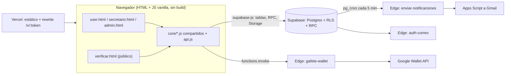

# EIGHT CREATORS LABs · Documentación técnica

Versión del 2026-11-11 (repositorio `odteam-x/eight-coms`, rama `main`). Es el punto de entrada para quien herede o revise el sistema.
Cada afirmación sale del código, de las migraciones o de `CLAUDE.md`; lo que no pudo verificarse está marcado como **(sin verificar)**.
Documentos que amplían este: [`CLAUDE.md`](../CLAUDE.md) (reglas de trabajo, muy detallado), [`docs/auditoria/`](auditoria/README.md) (auditoría de arquitectura de nov-2026),
[`docs/sistema-visual-noviembre-2026.md`](sistema-visual-noviembre-2026.md), [`docs/google-wallet.md`](google-wallet.md), [`docs/configurar-correos.md`](configurar-correos.md),
[`docs/notificaciones-contrato.md`](notificaciones-contrato.md) y [`docs/estado-del-sistema-2026-11.md`](estado-del-sistema-2026-11.md) (qué falta).

## 1. Qué es

Portal de evaluación de desempeño de **CELIDER 08 Santiago**: evalúa a las personas del club con una **rúbrica por roles**, les asigna **tareas** (individuales, por equipo e iniciativas propias) cuya nota entra en el resultado, evalúa **distritos**, muestra **reportes**, avisa por la app y por correo, y emite un **gafete con QR verificable**. La interfaz está en español.

Tres perfiles (campos de `profiles`): **Miembro** (`tipo_miembro = 'miembro'`), **Secretaría** (`tipo_miembro = 'secretario'`, de un distrito) y **Administración** (`es_admin = true`). Una cuenta nueva queda con `aprobado = false` hasta que la administración la acepta.

## 2. Arquitectura

- **Sin build ni bundler.** Cada página es un HTML independiente con scripts clásicos (globales). Terceros por CDN con versión fija e integridad SRI (`supabase-js` 2.112.2, `chart.js` 4.4.7); `qrcode-generator` (MIT) está vendorizado en `core/vendor/`.
- **Hosting:** Vercel; producción = rama `main` (dominio `eight-coms.vercel.app`). `vercel.json` define los encabezados de seguridad y el rewrite `/v/:token → /verificar.html`.
- **Backend:** un proyecto Supabase («eight coms»): Postgres con RLS y funciones `SECURITY DEFINER`, Auth, Storage y tres Edge Functions. Un workflow de GitHub (`keepalive.yml`) hace una consulta periódica para que el plan gratuito no pause el proyecto.
- **PWA:** `manifest.webmanifest` + `sw.js` (solo intercepta navegaciones: sin red muestra `offline.html`).

## 3. Estructura del repositorio

| Ruta | Qué contiene |
|---|---|
| `*.html` | `index` (acceso y registro), `user`, `secretario`, `admin`, `verificar` (público), `offline`, `registro` (redirige) |
| `api.js`, `auth.js`, `config.js`, `supabase-client.js` | Capa de datos (**todas** las consultas), sesión/permisos de página, utilidades y tabla de acciones, cliente `SB` |
| `admin*.js`, `user.js`, `secretario.js`, `login.js`, `registro.js`, `verificar.js` | Lógica de cada página |
| `core/*.js` | 39 módulos compartidos por los tres portales (store, render, perfil, tareas, equipos, rubrica, desempeno, distritos, gafete, notificaciones, auditoria, banco, rail…) |
| `*.css` (24) | `shared.css` (tokens y base), por pantalla (`perfil`, `tareas`, `equipos`…), `vidrio.css` (línea gráfica vigente y los tres temas), `movil.css` |
| `supabase/migrations/` | 51 archivos numerados 0001–0061 con huecos; se aplican **a mano** y en orden |
| `supabase/functions/` | `enviar-notificaciones`, `auth-correo`, `gafete-wallet` |
| `supabase/emails/`, `supabase/apps-script/` | Plantillas de correo y el puente a Gmail |
| `ayuda/` | Manuales de uso (miembro, secretaría y el de administración, que es privado) |
| `tools/` | Generadores (manuales, correos, iconos), `contraste.js` y `tools/pruebas/` (59 scripts de prueba) |
| `docs/` | Documentación (este archivo, auditoría, guías) |

## 4. Portales y pestañas

- **Miembro** (`user.html`): Inicio, Mi perfil (Resumen, Criterios, Tareas, Períodos y Desempeño), Calendario, Entregas, Banco de imágenes, Mi cuenta.
- **Secretaría** (`secretario.html`): lo del miembro más Mi distrito (con estadísticas de Instagram), Seguimiento, Reportes y Tareas de su distrito.
- **Administración** (`admin.html`): Panel, Desempeño, Seguimiento (centro de control); Evaluar, Tareas, Calendario (operaciones); Personas, Equipos, Distritos (organización); Reportes y Auditoría; configuración (Períodos, Rúbrica, Roles, Gestiones). Evaluar tiene un **modo enfoque** que oculta el resumen mientras se evalúa.
- Todas las vistas de una persona (perfil, panel lateral) salen del componente único `Perfil` (`core/perfil.js`; modos `propio`, `supervision`, `admin`).

## 5. Seguridad

1. **El permiso lo impone la base, no la pantalla.** RLS en todas las tablas (41 al 2026-11-08, todas con RLS, según `docs/auditoria/06`) más triggers y funciones `SECURITY DEFINER`.
2. **Campos privilegiados congelados:** el trigger `profiles_bloquear_privilegios` rechaza que un no administrador cambie `es_admin`, `tipo_miembro`, `distrito`, `rol_id` o `aprobado`. No confiar nunca en `WITH CHECK` solo.
3. **Guardias de administración:** `IF NOT public.is_admin() THEN RAISE`, sin prefijos del tipo `auth.uid() IS NOT NULL AND …` (el defecto invertido de 0008).
4. **`anon` casi sin acceso:** solo puede ejecutar una lista cerrada de funciones (`PERMITIDAS_ANON` en `tools/pruebas/cadena.mjs`), hoy con `verificar_gafete(token)` como única lectura pública de datos de miembros. Toda función nueva debe hacer `REVOKE … FROM PUBLIC, anon`.
5. **CSP enforcing** (`script-src 'self' https://cdn.jsdelivr.net`, sin `unsafe-inline` en scripts): sin `onclick` ni `<script>` en línea; los clics van por la tabla `ACCIONES` de `config.js`. Todo dato humano pasa por `escHtml()` antes de `innerHTML`.
6. **Datos públicos del gafete:** nombre, foto, rol, distrito, cargo, ingreso y n.º de PE con evaluación publicada. Nunca correo, notas ni tareas.
7. Los secretos (`CORREO_MODO`, `GOOGLE_WALLET_*`, claves de Apps Script) viven en los *Secrets* de las Edge Functions; nada de eso va al repositorio ni al navegador.

## 6. Modelo de datos (por dominio)

Nombres de tabla tal como aparecen en las migraciones; el detalle de columnas está en cada migración.

- **Personas y accesos:** `profiles`, `roles`, `distritos`, `periodo_participantes` (`activo=false` = no participa; sin fila = participa).
- **Gestiones y períodos:** `gestiones` (año de trabajo; las archivadas son de solo lectura vía `gestion_escribible()`), `periodos_evaluacion` (un solo PE activo por índice único; `modelo` = `legacy` o `v2`).
- **Rúbrica:** clásica (`criterios`, `rubrica`) y por roles (`criterios_v2`, `perfiles_rol`, `perfil_criterios`, con perfiles versionados).
- **Evaluaciones:** `evaluaciones` (puntajes en JSONB, estado `borrador`/`publicado`, `version`), `evaluaciones_versiones` (historial inmutable de publicaciones, rectificaciones y retiros), `evaluaciones_distrito`.
- **Tareas:** `tareas` (individuales y propias), `tareas_equipo` + participantes + aportes + eventos, `equipos` + `equipo_miembros`, `calificaciones_historial`, `periodo_calif_config` (+ `_hist`).
- **Comunicación:** `notificaciones`, `notif_tipos`, `notif_preferencias`, `notificaciones_eventos`, `calendario`, `actividades`, `banco_imagenes`.
- **Distritos:** `estadisticas_distrito` (+ historial) y su bucket privado `capturas-distrito`.
- **Otros:** `gafetes` (token del QR; sin permisos para clientes), `manuales_privados` (solo `is_admin()`), auditoría global (`0055`).
- **Storage:** `avatars` (lectura pública, cada persona escribe en su carpeta `<uid>/`; 2 MB) y `capturas-distrito` (privado).

## 7. El motor de evaluación (una sola definición, en SQL)

`resultados_periodo(periodo, borradores)` es la **única** fuente de los resultados v2; perfil, panel, reportes, ranking y seguimiento la leen. Ningún módulo de JS recalcula.

- **Núcleo** = media de los criterios del núcleo (cada uno a 0–100). **Técnico** = suma ponderada de los criterios del perfil del rol, renormalizada sobre lo puntuado: un criterio sin puntaje **se excluye, nunca vale 0**.
- **Evaluación** = `0.6 × técnico + 0.4 × núcleo`. **General** = `0.4 × núcleo + 0.6 × percentil` (percentil por rol sobre el técnico; con menos de 4 personas en el rol, el percentil se sustituye por el técnico y se avisa «rol pequeño»).
- **Tareas** (reglas por PE en `periodo_calif_config`): `nota_tareas = 100·Σ(peso·puntos/10)/Σ(peso)` sobre las tareas que cuentan. Resultado: `individual = (1 − w)·evaluación + w·nota_tareas`, con `w = peso_tareas/100`. Reglas: `peso_tareas`, `mult_individual`, `mult_colectiva`, `minimo_tareas`, `contar_propias` (iniciativas propias aprobadas por otra persona cuentan), `vencidas_como_cero` y, desde 0061, `sin_tareas_pierde_puntos` (sin nota de tareas, 0 con el peso completo; apagada por defecto). Se editan en **Tareas → reglas del PE**; con evaluaciones publicadas exigen motivo y quedan en el historial.
- **Niveles** (`core/niveles.js`): rúbrica por roles 87/67/37 sobre 100; clásica 26/20/11 sobre 30; distrito 87 %/67 %/37 % de 28. La rúbrica clásica y la de roles **nunca se mezclan ni se promedian**.
- **Solo cuentan evaluaciones publicadas.** Una publicada no se edita por UPDATE: se **rectifica** con motivo (`rectificar_evaluacion`, 0053), o se retira, y cada cambio queda en `evaluaciones_versiones`. Un PE donde la persona no participó no aparece para ella.
- **Cobertura** (`0056`): cuántos criterios aplicables se puntuaron; se muestra en «Cómo se compone tu evaluación».

## 8. Tareas, equipos y notas

Estados: `asignada → en_curso → entregada → aprobada | devuelta`, más `bloqueada` y `anulada`. Triggers imponen quién puede qué: la administración asigna a cualquiera, una secretaría a su distrito y un miembro solo a sí mismo (`origen = 'propia'`); **nadie revisa su propia tarea**. «A tiempo» se mide en la primera entrega, en la zona horaria de la gestión. El plazo solo cambia con `prorrogar_tarea()` (con motivo). Las tareas de equipo son **una sola fila** compartida; la nota del grupo vale para cada integrante, y el revisor puede dar una nota individual con evidencia. Las notas se corrigen o anulan solo con `corregir_nota_tarea` / `anular_nota_tarea` (administración, con motivo) y todo cambio queda en `calificaciones_historial`. La descripción de una tarea admite hasta 20 000 caracteres (0060).

## 9. Distritos y estadísticas

Evaluación de distrito con 4 criterios 0–7 (CGO, CCT, COM, CEE; máximo 28). El ranking acumulado cuenta solo evaluaciones publicadas y promedia por PE evaluado (`core/distritos.js`, `core/distritos-admin.js`). Cada secretaría sube las estadísticas de Instagram de su distrito con una captura de prueba que el navegador reduce (0043); desde 0054 se conserva el historial y la captura anterior ya no se borra.

## 10. Notificaciones y correo

Avisos en la app (campana, panel, preferencias) con catálogo de tipos (`notif_tipos`; 11 esenciales y 9 opcionales). El correo sale de `pg_cron` → Edge Function `enviar-notificaciones` → puente de Google Apps Script → Gmail (límite de Gmail ~100 destinatarios/día). `CORREO_MODO` = `apagado`, `prueba` o `produccion`. Los 11 esenciales no se pueden apagar; desde 0057 también los 9 opcionales salen por correo por defecto (decisión del dueño del proyecto, que revirtió 0042) y cada persona los apaga en Mi cuenta → Preferencias. **Ojo al volumen:** con ~25 personas una tarea de equipo y la nota publicada ya son ~50 correos, y Gmail topa en ~100 destinatarios al día. Trabajos de cron: `notif_enviar` (cada 5 min), `notif_recordatorios`, `notif_recordatorios_equipos`, `notif_mantenimiento`. Guía: `docs/configurar-correos.md`.

## 11. Gafetes, verificación y wallet

`obtener_gafete` / `regenerar_gafete` / `revocar_gafete` y la lectura pública `verificar_gafete(token)` (0052). El QR lleva `https://<host>/v/<token>` (96 bits aleatorios, revocable). `core/gafete.js` dibuja el gafete en `<canvas>` con los tokens del tema vigente y lo descarga en PNG; `verificar.html` muestra el récord público. **Google Wallet** (Android): la función `gafete-wallet` crea el pase por la API y devuelve el enlace firmado; necesita la cuenta de emisor y dos secretos (ver `docs/google-wallet.md`). **No hay Apple Wallet** (exige certificado de Apple Developer de pago).

## 12. Auditoría y trazabilidad

Historiales por dominio (tareas, equipos, calificaciones, reglas, evaluaciones, estadísticas, avisos) más el **Centro de auditoría** (`0055`, pestaña Auditoría): une los historiales y registra cambios de personas, períodos, gestiones y evaluaciones de distrito, con filtros y descarga CSV.

## 13. Sistema visual

- Línea gráfica **«vidrio sobre malla»** (`vidrio.css`): malla asimétrica fija, contenedores de vidrio (relleno translúcido, filete, desenfoque, radio 28), tipografía Barlow ligera con acentos en Source Serif 4 cursiva, y botón activo en píldora blanca.
- **Tres temas** (`core/theme.js`): `dark` (por defecto), `light` y `rosa` (el coral de la marca como protagonista, sobre vino). Se elige en Mi cuenta → App; el botón del menú cicla los tres. Los colores de componentes salen de tokens `--v-*`; **ningún hex fuera de los bloques de tokens** (`tools/contraste.js` lo vigila).
- Telón de diálogos, avisos y hojas: `--v-scrim` (navy / gris pizarra / vino según el tema).
- Contraste: `tools/contraste.js` (temas oscuro y claro de `shared.css`) y `front-tema.mjs` (tema rosa y correcciones del claro), con mínimo 4.5 para texto.
- **Patrones prohibidos** (acordados): barras de acento en el borde de tarjetas/chips, contornos de neón al pasar el ratón, emojis o iconos-medalla como indicador, cajas con fondo propio dentro de otra caja.
- Celular: `movil.css`, barra inferior flotante, cabecera mínima y barra de estado translúcida (`black-translucent`); todo lo pegado al borde superior suma `env(safe-area-inset-top)`.

## 14. Manuales de uso

`ayuda/miembro.html` y `ayuda/secretario.html` son públicos. El de **administración es privado**: `ayuda/admin.html` es una carcasa y el texto vive en `manuales_privados` (solo `is_admin()`); se publica ejecutando `.manuales-privados/admin.sql` (generado, ignorado por git) en el SQL Editor. Todo sale de `node tools/generar-manuales.mjs`.

## 15. Pruebas

`tools/pruebas/` (59 scripts; ver su README):
- **Base de datos:** `sql-00NN.mjs` aplican las migraciones sobre PGlite (Postgres real) con RLS y comprueban reglas, permisos y **paridad** (aplicar una migración no cambia resultados existentes). `cadena.mjs` aplica toda la cadena.
- **Frontend:** `front*.mjs` comprueban el marcado, la CSP, el escape de HTML, los módulos en un entorno simulado y los contratos entre capas. `iconos.mjs`, `wallet.mjs`, `correo.mjs`.
- **Simulador:** `node tools/pruebas/ui/server.mjs <raíz> <puerto>` sirve el repo con un cliente Supabase falso y la misma CSP; entrar con `?as=admin|sec|m1|m5|anon`.
- `npm run todo` (`correr.mjs`) ejecuta cada script por separado. Desde `tools/pruebas`: `npm run sql`, `front`, `cadena`, `rg`.
- **Trampa conocida:** el esquema base de las pruebas (`stub.sql`) tiene `evaluaciones.id` como BIGINT; en producción es **UUID** (así pasó 0053 con un defecto, corregido en 0059). Toda migración que toque ese id debe probarse también con UUID (`sql-0059.mjs`).

## 16. Despliegue y operación

1. Rama de trabajo → PR a `main` → Vercel despliega solo (la rama también genera una vista previa).
2. **Migraciones:** archivo en `supabase/migrations/` (idempotente, con bloque de reversa) + prueba + entrada en `docs/auditoria/06-registro-migraciones.md`. Se aplican a mano en el SQL Editor (o con el conector de Supabase) **después** de revisar y siempre en orden. Las funciones nuevas llevan `REVOKE … FROM PUBLIC, anon`.
3. El frontend degrada si una migración aún no está aplicada (`noDisponible`, y los parámetros nuevos solo se envían si la base ya los conoce).
4. **Edge Functions:** se despliegan con el conector o la CLI de Supabase; los secretos se guardan en *Edge Functions → Secrets*.
5. **Cambiar el texto del manual de administración:** regenerar, ejecutar `.manuales-privados/admin.sql` **antes** de desplegar la carcasa.
6. Respaldo de la base y alertas: **(sin verificar)** — depende del plan de Supabase; confirmarlo en el panel del proyecto.

## 17. Convenciones

Español en la interfaz y en los comentarios; comentarios que explican el **porqué**. Una migración = una idea. Un solo lugar para cada fórmula (SQL). Nada de código en el marcado. Cada función de base de datos nueva: `SECURITY DEFINER` con `search_path` fijo, `REVOKE` explícito y prueba de permisos para `anon`, miembro, secretaría y administración. Los PR describen el problema, la causa, la solución, las pruebas y **lo que no se verificó**.
