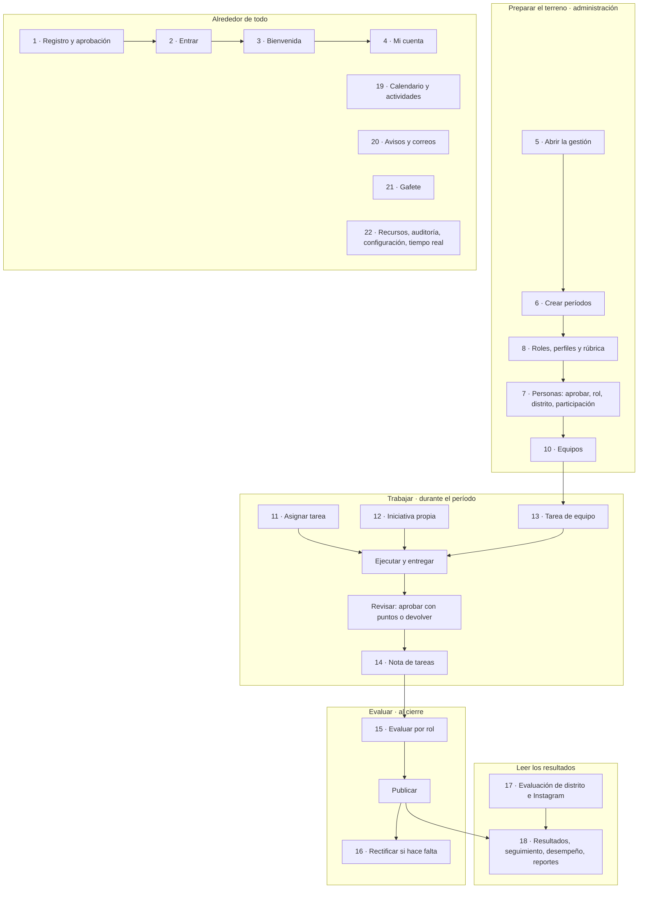

# 02 · Mapa de procesos

El sistema se entiende como **22 procesos** que se encadenan. Este capítulo da la vista de pájaro; cada proceso se desarrolla paso a paso en los capítulos 03 a 10.

## 2.1 La cadena de punta a punta

Lectura: la administración **prepara** el año (gestión, períodos, rúbrica, personas, equipos); durante el período el equipo **trabaja** con tareas que se revisan y puntúan; al cierre la administración **evalúa** por rol y **publica**; desde ese momento los resultados se **leen** en las pantallas de cada persona. Alrededor, el calendario programa, los avisos informan y los servicios transversales dan identidad, rastro y actualización en vivo.

## 2.2 Tabla de los 22 procesos

| N.º | Proceso | Quién lo hace | Pantalla «casa» | Capítulo |
|---|---|---|---|---|
| 1 | Registro y aprobación de acceso | Persona nueva → administración | Entrada (`index.html`) · Admin → Personas | 03 |
| 2 | Inicio de sesión y recuperación de contraseña | Cualquiera | Entrada | 03 |
| 3 | Bienvenida y primeros pasos | Persona nueva o con novedades | Inicio (tarjeta «Primeros pasos») · Mi cuenta | 03 |
| 4 | Mi cuenta: foto, nombre, contraseña, tema, roles y preferencias | Cada persona | Mi cuenta | 03 |
| 5 | Gestión del año | Administración | Gestiones (hoy bajo Configuración) | 04 |
| 6 | Períodos de evaluación | Administración | Períodos | 04 |
| 7 | Personas: acceso, tipo, distrito, rol(es), participación | Administración | Personas | 04 |
| 8 | Roles, segundo rol, perfiles de evaluación y rúbrica | Administración | Roles y perfiles · Rúbrica | 04 |
| 9 | Distritos (estructura y ranking) | Administración / secretaría | Distritos | 04, 08 |
| 10 | Equipos | Administración | Equipos | 04 |
| 11 | Tarea individual: asignar → ejecutar → entregar → revisar → cerrar | Quien asigna, quien ejecuta, quien revisa | Tareas · Mis tareas | 05 |
| 12 | Iniciativa propia | Cualquier persona con acceso | Mis tareas («+ Mi iniciativa») | 05 |
| 13 | Tarea de equipo | Administración / secretaría; integrantes | Equipos · Mis tareas | 05 |
| 14 | Calificación de tareas (puntos, pesos, correcciones, reglas del PE) | Quien revisa; administración | Tareas (reglas) · perfil | 05 |
| 15 | Evaluar por rol y publicar | Administración | Evaluar | 06 |
| 16 | Rectificar o retirar una evaluación publicada | Administración | Evaluar (Historial de versiones) | 06 |
| 17 | Evaluación de distrito y estadísticas de Instagram | Administración; secretaría sube cifras | Distritos | 06, 08 |
| 18 | Leer resultados: perfil, desempeño, seguimiento, reportes, ranking | Todos, según su acceso | Mi perfil · Desempeño · Seguimiento · Reportes | 08 |
| 19 | Calendario y actividades | Administración, secretaría (su distrito); todos leen | Calendario · Actividades | 09 |
| 20 | Avisos (campana) y correos | Automático | Campana · Mi cuenta → Preferencias | 09 |
| 21 | Gafete con QR, Wallet y verificación pública | Persona, administración | Mi perfil → Mi gafete · `/v/<código>` | 10 |
| 22 | Servicios transversales: recursos (antes banco de imágenes), auditoría, configuración general, sincronización en vivo | Varios | Banco · Auditoría · Configuración | 09, 10 |

## 2.3 Qué pasa en un período típico (guion)

Este es el recorrido que el sistema está diseñado para sostener. Cada paso remite al capítulo donde se detalla.

1. **Antes del período.** La administración abre (o ya tiene abierta) la gestión, crea el PE con sus cuatro fechas, revisa que los perfiles de cada rol estén vigentes, aprueba a las personas nuevas, les fija tipo, distrito y rol (y, si aplica, un segundo rol), marca quién no participa y arma los equipos. Define las **reglas de calificación de tareas** del PE (peso de las tareas en el resultado, mínimo de tareas, etc.). Ver caps. 04, 05.
2. **Al empezar.** Cada persona entra, ve en Inicio la cuenta regresiva a la próxima fecha y sus tareas. Si es nueva, el asistente de bienvenida la guía. Cap. 03.
3. **Durante el trabajo.** La administración o la secretaría **asignan** tareas (a una persona, a varias o a un equipo), con rol, fecha límite y qué competencias evidencia. La persona **empieza**, **entrega** (enlace y/o nota) y, si algo se bloquea, lo **marca bloqueado** con motivo. Una persona también puede crear **su propia iniciativa**, que nace *En curso*. Cap. 05.
4. **Revisión.** Quien revisa **aprueba con puntos (0–10)** —obligatorio— o **devuelve** con una observación concreta. Si la fecha límite cambia, se **prorroga con motivo**. Cada hecho queda en el historial. Los puntos aprobados alimentan la **nota de tareas**. Cap. 05.
5. **Cierre.** La administración abre **Evaluar**, revisa la evidencia de tareas de cada persona (solo como ayuda, no puntúa nada), **puntúa el núcleo y los criterios técnicos** de su rol (y del segundo rol si lo tiene), guarda borradores y **publica**. Cap. 06.
6. **Resultados.** Al publicar, la persona ve su resultado, su nivel, su lugar en el rol y cómo se compone (evaluación + tareas); la secretaría ve su distrito; la administración ve el equipo entero, compara períodos y personas y exporta. Cap. 08.
7. **Distritos.** La secretaría sube las estadísticas de Instagram de su distrito con una captura de prueba; la administración evalúa cada distrito y el ranking acumulado se actualiza. Caps. 06, 08.
8. **Correcciones.** Si una evaluación publicada tiene un error, la administración la **rectifica** con un motivo; queda una versión nueva con antes y después. Cap. 06.
9. **Cierre de año.** Se abre la gestión nueva: la anterior queda archivada en solo lectura. Cap. 04.

En paralelo, todo el tiempo: el **calendario** muestra fechas, actividades y tareas (cap. 09); la **campana** y el **correo** avisan lo que corresponde (cap. 09); la **auditoría** registra los cambios sensibles (cap. 10); y los portales **se actualizan solos** cuando otra persona cambia algo (cap. 10).

## 2.4 Dónde vive cada proceso hoy (menú del administrador)

| Grupo del menú | Entradas | Procesos que cubre |
|---|---|---|
| Centro de control | Panel · Desempeño · Seguimiento | 18 |
| Operaciones | Evaluar · Tareas · Equipos · Calendario · Recursos | 15, 11–14, 10, 19, 22 |
| Organización | Personas · Distritos | 7, 9, 17 |
| (suelto) | Reportes · Auditoría | 18, 22 |
| Configuración | Un solo ítem que abre el índice: Períodos, Actividades, Rúbrica, Roles y perfiles, Gestiones, tema, selector de entrada | 5, 6, 8, 19 |

El capítulo 13 discute si esta distribución sirve a los procesos o si hay cosas fuera de lugar.
