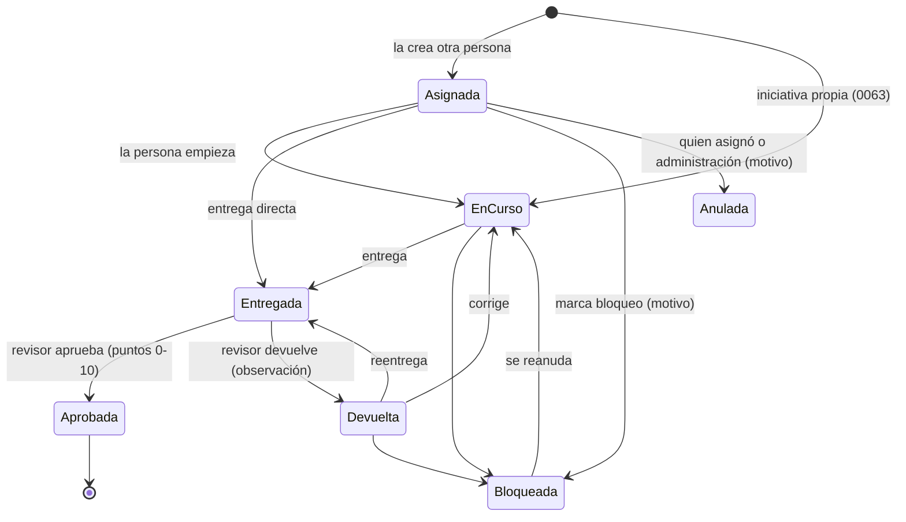

# 05 · Tareas (procesos 11 a 14)

Las tareas son **los hechos** que respaldan la evaluación: qué se pidió, para cuándo, cuándo se entregó por primera vez, cuántas veces volvió, cuánto se hizo por iniciativa propia y qué nota recibió. **Existen solo en períodos por roles** (el disparador de inserción rechaza cualquier otro). En un período clásico, la pestaña lo explica y mantiene el antiguo formulario «registrar trabajo».

## 5.1 Estados y transiciones

Estados: **Asignada · En curso · Bloqueada · Entregada · Devuelta · Aprobada · Anulada**. «Abiertas» = asignada, en curso, devuelta y bloqueada.



Quién puede cada cambio (matriz `tarea_transicion_valida`):

| Quién | Cambios permitidos |
|---|---|
| **La persona asignada** | Asignada → En curso/Entregada/Bloqueada · En curso → Entregada/Bloqueada · Devuelta → En curso/Entregada/Bloqueada · Bloqueada → En curso |
| **Quien revisa** | Entregada → Aprobada/Devuelta · Asignada/En curso/Devuelta → Bloqueada · Bloqueada → En curso |
| **Administración** | Cualquier cambio de estado (distinto del actual) |

**Todo lo importante lo fija el servidor**, no el navegador: `origen`, `asignada_por`, `estado` inicial, `entregada_en`, `aprobada_en`, `rondas_revision` se sobrescriben en cada inserción/cambio.

## Proceso 11 · Tarea individual: asignar → ejecutar → entregar → revisar → cerrar

**Actores.** Quien asigna (administración a cualquiera; secretaría a miembros de **su** distrito); la persona asignada; quien revisa (administración o secretaría del distrito, **nunca** la propia tarea).

**Pantallas.** Admin/Secretaría → **Tareas** (asignar y revisar) · Todos → **Mis tareas** · Perfil → pestaña Tareas.

### 11.1 Asignar (asistente «Nueva tarea» en tres pasos)

Se abre con **+ Nueva tarea** en Tareas (si hay equipos activos en el período, primero pregunta **«¿para quién es?»**: **para personas** —una tarea para cada una— o **para un equipo** —una sola tarea compartida—), o desde el perfil de una persona, o desde un día del calendario.

**Paso 1 · Qué.** Título (obligatorio, hasta 160 caracteres), **Qué se espera** (hasta **20 000** caracteres desde 0060: se puede pegar documentación completa), **fecha límite**, **prioridad** (baja, normal, alta), el **período** (si hay varios por roles) y, opcional, una **actividad** del calendario y **el rol para el que es el trabajo** (carga las responsabilidades y las competencias de ese rol).

**Paso 2 · Quién.** Un selector con búsqueda sin tildes (por nombre, rol o distrito), filtros **Todos / Equipos / Personas**, y **insignias** por persona: su rol, si lo tiene **habilitado**, si lo **prefiere (n.º N)**, su **rol predeterminado**, su **carga** (abiertas) y **vencidas**, y si **no participa**. Se pueden marcar personas sueltas o un **equipo entero** (el equipo se expande a sus integrantes de ese momento; una tarea colectiva es otra cosa: ver proceso 13).

**Paso 3 · Rol y resumen.** Un **rol por persona**; se ven sus responsabilidades y con qué competencias se evalúa. Se marcan las **competencias que evidencia** la tarea (opcional; «Sugerir las del rol» marca las principales). Se revisa el resumen.

### 11.2 Avisos al crear

| Aviso | Qué significa | Quién puede continuar |
|---|---|---|
| **Rol no habilitado** para esa persona | El rol elegido no es el suyo ni su segundo rol | **Administración** sí: la tarea queda como **«Excepción de rol»**. **Secretaría no puede** |
| Ya tiene una tarea abierta con el mismo título | Posible duplicado | Se confirma con la casilla «Entiendo los avisos» |
| **Carga alta** (5 o más abiertas) o alguna **vencida** | La persona ya tiene mucho trabajo | Se puede crear igual |
| **No participa en el período** · **fecha límite ya pasada** | La tarea no contaría en el resumen o nacería vencida | Se confirma |

Al crear, la persona recibe un aviso en la campana y un correo (**«tarea asignada» es esencial**).

### 11.3 Ejecutar (la persona asignada)

- **Empezar** (pasa a En curso). **Entregar**: se necesita un **enlace https** y/o una **nota** (uno de los dos es obligatorio) y, con el enlace, su **tipo de entrega** (enlace, documento, imagen, video u otro; 0065, se sugiere según el enlace); la entrega **solo se escribe en el momento de entregar**.
- **Bloquear** con el motivo («¿de qué o de quién depende?»): una tarea bloqueada **no cuenta como atrasada** mientras siga así; quien asignó recibe el aviso. **Reanudar** la devuelve a En curso.
- La persona **no puede** cambiar la fecha, aprobar ni anular.
- La descripción larga se ve recortada con **«Ver todo (N caracteres)»** que despliega el texto entero.

### 11.4 Revisar (quien revisa)

1. En **Tareas** se usa el filtro **Por revisar** (muestra el número) o se busca por persona.
2. **Abrir la entrega**: la tarea muestra una etiqueta con su **tipo** (Documento, Video…) y el enlace dice «Abrir documento», «Ver video», «Ver imagen»…; las entregas anteriores a 0065 siguen diciendo «Ver entrega». Se lee el enlace o la nota.
3. **Aprobar y puntuar**: se ponen los **Puntos (0 a 10), obligatorios**. **Desde 0065 ya no se elige un peso**: cuánto cuenta la tarea lo da su **nivel** (distrital o regional) y los multiplicadores del período (proceso 14). Quien revisa una **iniciativa regional** es la administración; la secretaría no la ve en «Por revisar».
4. **Devolver para corregir**: se escribe **«Qué hay que corregir»** (obligatorio y concreto). La persona recibe aviso con la observación (correo incluido).
5. **Lo de «a tiempo» se mide en la primera entrega**: devolver y corregir no la vuelve tarde.

### 11.5 Mover el plazo, bloquear, anular, historial

- **Mover la fecha límite**: nueva fecha + **motivo** (mínimo 5 caracteres) mediante `prorrogar_tarea()`. La fecha original (`fecha_limite_original`) **nunca cambia** y queda registrada; la persona recibe aviso («Cambió una tarea»).
- **Anular** la tarea: necesita motivo. **Una tarea anulada no entra en ninguna cuenta** (ni tareas ni promedios).
- **Historial** (`tarea_eventos`): cada cambio con quién, qué y cuándo. Es **append-only**: solo lo escriben disparadores y no se puede borrar.

### 11.6 Corregir una nota ya aprobada

Una vez aprobada, los puntos **no se editan a mano**. Solo la administración, desde la tarea, con **Corregir nota**, **Anular nota** o **Restaurar nota** (`corregir_nota_tarea`, `anular_nota_tarea`, `restaurar_nota_tarea`), siempre con **motivo ≥ 5 caracteres**. Cada cambio queda en el **historial de notas** (`calificaciones_historial`) con los pesos y reglas vigentes en ese momento. Una tarea con historial de notas **no se puede borrar**.

### 11.7 Avisos de todo el proceso

`tarea_asignada` · `tarea_cambio` · `tarea_por_vencer` (recordatorio; hoy o mañana) · `tarea_vencida` · `entrega_registrada` (a quien revisa) · `correccion_solicitada` · `tarea_aprobada` · `tarea_bloqueada`. Los esenciales: asignada, cambio, vencida, corrección. Ver capítulo 09.

## Proceso 12 · Iniciativa propia («+ Mi iniciativa»)

**Objetivo.** Que cualquier persona registre trabajo que decidió hacer por su cuenta y pueda contarlo como iniciativa.

**Actor.** Cualquier persona con acceso aprobado. **Pantalla.** **Mis tareas → + Mi iniciativa** (formulario simple de `core/tareas.js`).

### Actividades

1. Tocar **+ Mi iniciativa**.
2. Escribir **título**, **qué hiciste o harás** y, si quiere, una **fecha** y el **tipo de entrega** esperado.
2b. **Elegir quién la evalúa** (0065): **Distrital** (la secretaría de su distrito) o **Regional** (la administración). Solo esa instancia podrá aprobarla o devolverla y recibe el aviso de la entrega; no se cambia después (solo la administración puede). Sin secretaría en su distrito la única opción es Regional.
3. **Guardar.** Desde la migración **0063**, la tarea **nace «En curso»** (no hace falta «Empezar»). Las asignadas por otra persona siguen naciendo «Asignada».
4. La persona **entrega** (enlace y/o nota) y **otra persona** la revisa.

### Reglas

- Una tarea para uno mismo es **siempre** de origen «propia», la haya marcado como la haya marcado (lo decide el servidor).
- **Nadie aprueba su propia tarea.** Por eso la iniciativa **solo cuenta como iniciativa cuando alguien más la aprueba**: es lo que impide inflarla.
- Una propia pesa **siempre × 1** por nivel (el nivel solo decide **quién la evalúa**, no se infla el propio promedio) y cuenta para la nota de tareas **solo si la regla del PE «¿Cuentan las iniciativas propias?» está en Sí** (valor por defecto: Sí).
- **Quién evalúa, impuesto en la base (0065).** `puede_revisar_tarea_fila()` (parcheada en `tareas_validar_update()` y `prorrogar_tarea()`): la administración siempre; la secretaría del distrito de la persona **solo si la iniciativa no es regional**. Una secretaría que intenta aprobar/devolver una regional recibe «No tienes acceso a esta tarea». El aviso «entrega por revisar» (`notif_trg_tarea()` parcheada) llega **solo** a la instancia elegida (distrital sin secretaría → administración).
- **Casos límite.** Persona **sin secretaría de distrito** → cae a Regional (la base normaliza). **Una secretaría** (o la administración) que crea su iniciativa → siempre Regional: la evalúa la administración, y nadie aprueba la suya.
- Las propias **ya existentes** que seguían «Asignada» siguen así hasta que su dueña toque «Empezar»; la migración trae un UPDATE opcional comentado para pasarlas a «En curso».

## Proceso 13 · Tarea de equipo

**Objetivo.** Asignar **una** tarea compartida a un equipo (no una copia por persona) y calificarla como grupo.

**Actores.** Administración (o la secretaría del distrito del equipo si ella no participa) asigna y revisa; los integrantes aportan y entregan.

**Pantallas.** Admin → **Equipos** (dentro del equipo) · Mis tareas (bloque «Equipos») · Secretaría → **Tareas**.

### Actividades

1. Dentro del equipo, **Nueva tarea de equipo**: **título**, **instrucciones** (hasta 20 000), **criterios de evaluación** (texto, hasta 5 000), **fecha límite**, **prioridad**, **responsable** (opcional) y los **criterios que evidencia** (orientativo) y el **peso** de la tarea.
2. Los integrantes **de ese momento** reciben el aviso «Tarea para tu equipo». **Quien se suma después** entra a las tareas todavía abiertas (asignada/en curso/bloqueada/devuelta); **quien se va** sale de las abiertas y entregadas. Las **aprobadas y anuladas no cambian**.
3. **Avanzar**: cualquier integrante registra un aporte (**qué se avanzó** y **avance del equipo 0–100 %**); queda con su autoría fijada por el servidor.
4. **Entregar**: cualquier integrante pone el **enlace** (https) y/o una **nota**. Es **una** entrega para todo el equipo; la primera mide el plazo.
5. **Aprobar**: la administración (o la secretaría que no participa) pone **Puntos (0–10)** (sin peso desde 0065: lo da el nivel). La nota es **del grupo**: cada persona cuenta **una vez**.
6. **Devolver**: con **observación para el equipo** (obligatoria).
7. **Nota individual**: si una persona rindió distinto, quien revisa le pone una **nota individual** con evidencia (mínimo 10 caracteres). **Reemplaza la del grupo solo para ella** y se muestra aparte.
8. **Mover plazo / Anular**: solo la administración; anular pide motivo y **solo la administración la reabre** (estado extra «anulada»).

### Reglas

- Una **fila compartida** por tarea: participantes, aportes y eventos viven en tablas propias (`tareas_equipo`, `tarea_equipo_participantes`, `tarea_equipo_aportes`, `tarea_equipo_eventos`).
- Una persona **cuenta** en una colectiva si **participaba cuando se aprobó** o si **dejó al menos un aporte**.
- **No hay archivos adjuntos**: la evidencia es un enlace y/o una nota.
- El **progreso** (`tarea_equipo_avance`): aprobada/entregada = 100 %, anulada = sin dato, y en otro caso el último % reportado.
- Los integrantes **no pueden** editar, aprobar, prorrogar ni anular.

## Proceso 14 · Calificación de tareas (puntos, pesos y reglas por período)

**Objetivo.** Que los puntos de las tareas aprobadas entren a la evaluación con **una sola definición** y con reglas visibles y configurables **por período**.

**Actor.** Administración (configura); quien revisa (puntúa). **Pantallas.** Admin → **Tareas → Reglas de calificación de tareas** (entre el selector de PE y la lista) · perfil → «Cómo se compone tu evaluación».

### La nota de tareas

```
nota_tareas = 100 · Σ( peso_efectivo · puntos / 10 ) / Σ( peso_efectivo )     sobre las tareas que CUENTAN
peso_efectivo = peso heredado × multiplicador de su NIVEL × multiplicador de su tipo (individual | colectiva)     [0065]
```

**Desde la migración 0065 el peso de tarea se retiró.** `peso heredado` es `tareas.peso` / `tareas_equipo.peso`: **1 en toda tarea nueva** (los triggers lo fijan; nadie lo cambia) y, en las tareas anteriores, el valor que ya tenían (así sus resultados **no cambian**: paridad probada en `sql-0065.mjs`). El peso nuevo lo da el **nivel** de la tarea:

| Nivel | Qué es | Multiplicador (por PE) |
|---|---|---|
| **Distrital** | La asigna una secretaría (siempre es distrital) o la administración para un distrito; tarea de equipo de un equipo con distrito | `mult_distrital` (por defecto **1**) |
| **Regional** | La asigna la administración como tarea regional | `mult_regional` (por defecto **1**) |

- Con **1 y 1** el nivel no cambia ninguna nota; la administración los sube o baja en **Tareas → Reglas de calificación**. Cambiarlos con evaluaciones publicadas exige motivo y queda en `periodo_calif_config_hist`.
- Las **iniciativas propias siempre × 1** (su nivel solo decide quién las evalúa).
- Lo ya creado se reclasificó sin tocar notas: asignadas por la administración → regional; por una secretaría → distrital; iniciativas → distrital si la persona tiene distrito con secretaría, si no regional; tareas de equipo → distrital si el equipo es de un distrito.
- `resultados_periodo()` no cambia: lee `calif_items()`, que ya trae el `peso_efectivo` por nivel.

**Cuentan**: tareas **aprobadas**, con puntos y no anuladas (y las de iniciativa propia solo si la regla lo permite). **No cuentan —y nunca se rellenan con 0—**: entregadas esperando revisión, en curso, devueltas, bloqueadas, anuladas, con la nota anulada, aprobadas antes de que existieran los puntos. Una **vencida sin entregar cuenta como 0 solo si** la regla «vencidas como cero» está activa (apagada por defecto).

Se **calcula al leer** (no hay caché ni tabla de totales): crear, corregir o anular una nota actualiza todas las pantallas a la vez y no puede duplicarse.

### Reglas por PE (`periodo_calif_config`; solo administración vía `calif_config_guardar`)

| Regla | Qué decide | Valor inicial |
|---|---|---|
| **Peso de las tareas en el resultado** (0 a 100 %) | Cuánto pesa la nota de tareas frente a la evaluación | PE existentes: **0 %**; PE nuevos por roles: **20 % «sin confirmar»** hasta que se guarde |
| **Multiplicador de tareas individuales** | Cuánto pesa una individual frente a una colectiva | 1 |
| **Multiplicador de tareas del equipo** | Ídem | 1 |
| **Mínimo de tareas calificadas** | Con menos, no hay nota de tareas | 1 |
| **¿Cuentan las iniciativas propias?** | Si las aprobadas por otra persona cuentan | Sí |
| **¿Las vencidas sin entregar cuentan como 0?** | Penalización por no entregar | No (no recomendado) |
| **Sin tareas calificadas, ¿se pierden los puntos de tareas?** (0061) | Con **Sí**, quien no llegue al mínimo tiene **0 en tareas** y pierde el peso entero | No |

**Qué hace «sí pierde puntos»:** con peso 20 %, quien no tiene tareas calificadas queda con **0,8 × su evaluación**. Aplica por igual a **todas** las personas del PE, también a las que **no tenían tareas asignadas**; por eso hay que **asignar tareas a todos** antes de activarla y dejar «iniciativas propias» en Sí.

### Cómo se cambia una regla

1. Tareas → elegir el período → el bloque de reglas (resumen «Tareas: N % del resultado») → **Editar reglas**.
2. Ajustar los campos y escribir el **Motivo del cambio** (**obligatorio** si el PE ya tiene evaluaciones publicadas).
3. Guardar: los resultados se **recalculan al instante** y cada cambio queda en `periodo_calif_config_hist`.

### Dónde se ve el efecto

- En **Evaluar**, el resumen de cada persona muestra «Tareas 80 (pesan 20 %)» o «Tareas sin calificar».
- En el **perfil**, «Cómo se compone tu evaluación» detalla pieza por pieza **qué tarea cuenta, cuánto aporta y por qué una no cuenta** (`tareas_calificacion_detalle`).
- Ningún otro lugar recalcula: todos leen `resultados_periodo()`.
